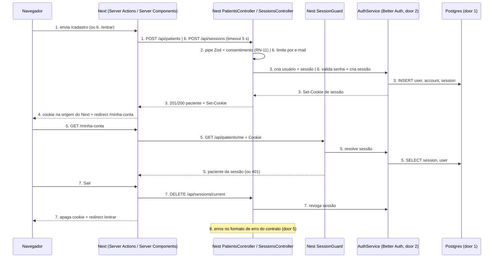
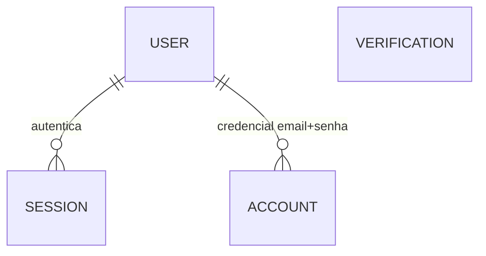

# F1 - Cadastro e login do paciente

**Approved**: 2026-11-08 - user: "aprovo as portas 1 a 3, pode escrever os checks"

## Problem

Hoje não existe conta de paciente: nenhuma pessoa consegue voltar a uma reserva ou inscrição que
fez, e a plataforma não tem como registrar que o paciente aceitou o tratamento de dado de saúde
antes de coletá-lo (RN-11). Sem identidade no servidor, também não há como garantir que um
paciente veja só o que é dele (RN-12): toda funcionalidade seguinte (F4 reserva comum, F5
inscrição, F10 aceite) depende disso. Evidência da fonte: decisão D12 do brainstorm ("Paciente
precisa voltar à reserva; substitui 'sem login'") e os três cenários de F1 em
`docs/product/marketplace-vagas-imagem.md` seção 4. Nenhum dado quantitativo.

Quando isto for entregue, uma pessoa cria a conta com nome, e-mail, telefone e senha aceitando o
termo de dados de saúde, entra e sai da plataforma, e a API passa a saber, a cada requisição, qual
paciente está chamando, sem aceitar identidade vinda do cliente.

## Shape

Reusa o bootstrap da API (`createApp`), o pacote `@hackathon/contracts` e o padrão de serviço
server-only com timeout e validação Zod de `api-health.service.ts`; senha, hash e sessão ficam
com a biblioteca da porta 2, sem código próprio de criptografia ou sessão. As regras que mudam o
resultado (consentimento obrigatório, e-mail único, identidade derivada só da sessão, limite de
tentativas) rodam em serviços e guards do Nest, cobertos pelos testes HTTP `node --test` da API
contra um Postgres real; o Next só valida formato para UX e repassa o cookie.

1. formulário `/cadastro` -> Server Action do Next (new) - valida formato com o schema do contrato
   para UX, envia `POST API_BASE_URL/api/patients` com timeout de 5 s
2. `PatientsController` (new) - valida o body com `patientSignUpInputSchema` (contracts, new) via
   pipe Nest; `PatientsService` (new) decide o consentimento (RN-11) e normaliza e-mail e telefone
3. `AuthService` (door 2) - cria usuário, credencial e sessão; persiste `user`, `account`,
   `session` no Postgres (door 1, door 4); devolve `Set-Cookie` de sessão (door 3)
4. Server Action copia o cookie para a origem do Next (door 3) e redireciona para `/minha-conta`
5. `/minha-conta` (Server Component, new) -> serviço server-only do Next (new) envia
   `GET /api/patients/me` com o cookie -> `SessionGuard` (new) resolve a sessão via `AuthService`
   e injeta o paciente; o controller responde só com o paciente da sessão (RN-12)
6. formulário `/entrar` -> Server Action -> `SessionsController` (new) `POST /api/sessions` ->
   limite por e-mail (door 6) -> `AuthService` valida a senha e cria a sessão -> segue como 4
7. "Sair" -> Server Action -> `SessionsController` (new), rota de saída da Surface -> `AuthService` revoga a sessão;
   o Next apaga o cookie e redireciona para `/entrar`
8. out: todo erro dessas rotas sai no formato de erro do contrato (door 5) por um exception filter
   global (new) no `PatientsController / SessionsController`; a próxima funcionalidade lê o paciente da sessão pelo mesmo `SessionGuard`

**Changes underneath**

| Front       | What changes                                                                                                                                                                                                          |
| ----------- | --------------------------------------------------------------------------------------------------------------------------------------------------------------------------------------------------------------------- |
| domain      | novo termo: `Paciente` = registro `user` com `role = 'patient'`; ninguém ramifica nele hoje. F2 acrescentará outro papel na mesma tabela                                                                              |
| stored data | não existe banco hoje - nada a migrar; a primeira migration cria as tabelas                                                                                                                                           |
| readers     | home `/` (exists) ganha os links de entrada e cadastro - critério 25                                                                                                                                                  |
| readers     | `apps/api/src/app.test.ts`, `scripts/smoke.mjs` e o workflow de CI sobem a API, que passa a exigir `DATABASE_URL` e `BETTER_AUTH_SECRET` - o CI ganha um serviço Postgres e o smoke recebe as variáveis - critério 29 |
| readers     | comando de teste da API só descobre `.test-dist/*.test.js` na raiz; testes em `src/modules/**` exigem descoberta recursiva (structure.md) - critério 33                                                               |
| readers     | rota desconhecida continua 404, mas o corpo passa ao formato `apiErrorSchema` com `code: "not_found"` - critério 32                                                                                                   |

New: `USER`, `SESSION`, `ACCOUNT`, `VERIFICATION` (esta exigida pela biblioteca, sem uso na F1) e
as relações acima. One-way constraints: `user.email` único e minúsculo (door 4); `user.phone`,
`user.role`, `user.healthConsentVersion` e `user.healthConsentAcceptedAt` NOT NULL (door 4).

## Surface

| Route                                 | In                                                                              | Out                                                      | Status                                                                                                   | Who                                                                |
| ------------------------------------- | ------------------------------------------------------------------------------- | -------------------------------------------------------- | -------------------------------------------------------------------------------------------------------- | ------------------------------------------------------------------ |
| `POST /api/patients`                  | `name`, `email`, `phone`, `password`, `healthDataConsent`, `consentTermVersion` | `{ id, name, email, phone }` + `Set-Cookie` · `apiError` | `201`, `400 validation_failed`, `409 email_in_use`, `422 consent_required`, `503 service_unavailable`    | anyone - qualquer pessoa, chamada pelo servidor do Next            |
| `POST /api/sessions`                  | `email`, `password`                                                             | `{ id, name, email, phone }` + `Set-Cookie` · `apiError` | `200`, `400 validation_failed`, `401 invalid_credentials`, `429 rate_limited`, `503 service_unavailable` | anyone - qualquer pessoa, chamada pelo servidor do Next            |
| `DELETE /api/sessions/current`        | cookie de sessão (opcional)                                                     | vazio + cookie expirado                                  | `204`                                                                                                    | anyone - sem sessão também recebe `204`                            |
| `GET /api/patients/me`                | cookie de sessão                                                                | `{ id, name, email, phone }` · `apiError`                | `200`, `401 unauthenticated`                                                                             | paciente com sessão válida; os demais recebem `401`                |
| `GET /cadastro`, `GET /entrar` (Next) | -                                                                               | página                                                   | `200`; com sessão válida, `307` para `/minha-conta`                                                      | anyone                                                             |
| `GET /minha-conta` (Next)             | cookie de sessão                                                                | página                                                   | `200`, `307` para `/entrar`                                                                              | paciente com sessão válida; os demais recebem `307` para `/entrar` |

O navegador nunca chama o Nest: todas as rotas `/api/*` acima são chamadas pelo servidor do Next
via `API_BASE_URL`.

## Landing

| One-way door                                               | Literal shape                                                                                                                                                                                                                                                                                                                                                                                                                                                                                                                                                                                                                                                                                                                                                                                                                              | Alternative rejected                                                                                                                                                                                                                                                                                                                                                                                                                                                                                                                                                                                                                                                                                       |
| ---------------------------------------------------------- | ------------------------------------------------------------------------------------------------------------------------------------------------------------------------------------------------------------------------------------------------------------------------------------------------------------------------------------------------------------------------------------------------------------------------------------------------------------------------------------------------------------------------------------------------------------------------------------------------------------------------------------------------------------------------------------------------------------------------------------------------------------------------------------------------------------------------------------------ | ---------------------------------------------------------------------------------------------------------------------------------------------------------------------------------------------------------------------------------------------------------------------------------------------------------------------------------------------------------------------------------------------------------------------------------------------------------------------------------------------------------------------------------------------------------------------------------------------------------------------------------------------------------------------------------------------------------- |
| 1. Banco e ORM - **revisão humana**                        | PostgreSQL 17 com Prisma ORM. Schema em `apps/api/prisma/schema.prisma`, migrations em `apps/api/prisma/migrations/`, cliente num `DatabaseModule` em `apps/api/src/database/`. `DATABASE_URL` no `.env` da API (`.env.example` com placeholder). Dev e testes: `compose.yaml` na raiz com serviço `postgres` (`postgres:17`, porta 5432); CI com `services: postgres`. Testes HTTP usam um banco próprio (`hackathon_test`) recriado por `prisma migrate reset --force` antes da suíte. Conexão preguiçosa: a API sobe sem o banco no ar                                                                                                                                                                                                                                                                                                  | **SQLite** - um único escritor por arquivo e sem `SELECT ... FOR UPDATE`; RN-41 (dois pagamentos simultâneos, só um trava a vaga) e um deploy com mais de uma instância exigiriam trocar de banco e reescrever migrations. **Drizzle** - alternativa viva: mais leve e próximo do SQL; Prisma foi preferido por `migrate` e `studio` prontos e por ter adapter oficial na biblioteca da porta 2; o time pode inverter esta escolha. **TypeORM** - entidades por decorator duplicam o formato que já está nos contratos e têm inferência de tipos mais fraca. **Supabase/Neon já agora** - hospedagem não está decidida; Postgres local mantém a escolha aberta e qualquer Postgres gerenciado serve depois |
| 2. Biblioteca de autenticação - **revisão humana**         | Better Auth, plugin e-mail+senha, usado só no servidor dentro do Nest: um provider `AUTH` criado por `useFactory` (depende de configuração) em `apps/api/src/modules/auth/`, com o adapter Prisma. Hash de senha (scrypt), criação, expiração e revogação de sessão no banco são da biblioteca. O handler HTTP próprio da biblioteca (`/api/auth/*`) **não** é montado: o Nest expõe só as rotas da `## Surface` e chama `auth.api.*`, traduzindo erros para a porta 5 (Adapter: o formato de erro da biblioteca difere do contrato). Variáveis: `BETTER_AUTH_SECRET` (mínimo 32 caracteres), `BETTER_AUTH_URL`. Sessão: 7 dias, renovada quando usada após 1 dia. Risco a provar no primeiro commit do build: a biblioteca é ESM e o Nest compila para CommonJS; no Node 24 `require(esm)` deve carregá-la - se falhar, parar e perguntar | **Auth.js (NextAuth) Credentials** - a sessão nasceria no Next e o Nest teria de confiar num token emitido pelo Next, tirando a autenticação do dono das regras; o provider de credenciais não tem cadastro. **Passport-local + @nestjs/jwt + bcrypt/argon2** - emissão, expiração e revogação de sessão montadas por nós: é a "sessão própria" que `security.md` proíbe. **Clerk/Auth0** - dado pessoal do paciente num terceiro (LGPD), conta externa e dependência de rede na demo. **Lucia** - descontinuada pelos mantenedores em 2025                                                                                                                                                                |
| 3. Transporte da sessão Next <-> Nest - **revisão humana** | Cookie da biblioteca `better-auth.session_token` (com prefixo `__Secure-` em produção HTTPS): `HttpOnly`, `SameSite=Lax`, `Path=/`, `Max-Age=604800`, `Secure` quando `NODE_ENV=production`. O Nest emite o `Set-Cookie`; a Server Action do Next grava o mesmo cookie, com os mesmos atributos, na origem do Next; toda chamada server-side do Next ao Nest encaminha só esse cookie no header `Cookie`. CSRF: Server Actions do Next conferem `Origin` contra `Host`, e o cookie é `SameSite=Lax`                                                                                                                                                                                                                                                                                                                                        | **Token no corpo + localStorage** - legível por qualquer script (XSS). **Rewrite `/api/*` do Next para o Nest** - expõe toda a API ao navegador, contra o perfil ativo (acesso direto só com requisito e CORS explícito). **JWT sem estado** - "Sair" não revogaria a sessão (critério 18)                                                                                                                                                                                                                                                                                                                                                                                                                 |
| 4. Forma da tabela `user`                                  | Tabela núcleo da biblioteca com campos adicionais: `id text pk` (gerado pela biblioteca), `name text not null`, `email text not null unique` (gravado em minúsculas), `emailVerified boolean not null default false`, `phone text not null` (E.164, `+55` + 10 ou 11 dígitos), `role text not null default 'patient'` (não aceito como entrada), `healthConsentVersion text not null`, `healthConsentAcceptedAt timestamptz not null` (horário do servidor), `createdAt`, `updatedAt`. Mais `session`, `account`, `verification` como a biblioteca define. Um único INSERT de `user` carrega o consentimento: não existe caminho que crie paciente sem ele                                                                                                                                                                                 | **Tabela `patient` 1:1 com `user`** - dois INSERTs para manter atômicos, sem ganho enquanto o paciente só tem esses campos. **Tabela `consent` só de inserção** - exige segundo INSERT na mesma transação, que o cadastro da biblioteca não expõe; volta quando houver revogação ou nova versão do termo (Out of scope). **Colunas de consentimento anuláveis** - permitiriam paciente sem consentimento, quebrando RN-11                                                                                                                                                                                                                                                                                  |
| 5. Contrato de erro da API                                 | `apiErrorSchema = { code: string, message: string, fields?: string[] }` em `packages/contracts/src/errors.ts`, aplicado por um exception filter global do Nest. Códigos desta feature: `validation_failed` 400, `invalid_credentials` 401, `unauthenticated` 401, `not_found` 404, `email_in_use` 409, `consent_required` 422, `rate_limited` 429, `service_unavailable` 503. `message` é texto em português seguro para exibir; nunca stack                                                                                                                                                                                                                                                                                                                                                                                               | Formato padrão do Nest (`statusCode`, `message`, `error`) - `message` vira string ou array conforme o erro, e o Next teria de adivinhar o campo inválido. Formato de erro da biblioteca - muda com a versão e prenderia o Next à porta 2                                                                                                                                                                                                                                                                                                                                                                                                                                                                   |
| 6. Limite de tentativas de login                           | Nova dependência `@nestjs/throttler` só em `POST /api/sessions`: 5 requisições por 60 s por e-mail normalizado (`getTracker` pelo e-mail do body), armazenamento em memória do processo; a 6ª recebe `429 rate_limited` com `Retry-After`                                                                                                                                                                                                                                                                                                                                                                                                                                                                                                                                                                                                  | **Limite embutido da biblioteca** - só vale no handler `/api/auth/*`, que não é montado. **Por IP** - atrás do Next todas as chamadas chegam com o IP do servidor do Next, e o limite viraria global. Limitação aceita: contador em memória vale por instância e zera no restart                                                                                                                                                                                                                                                                                                                                                                                                                           |

- Nothing else in this change is hard to reverse
- Ao aprovar, as portas 1, 2, 3 e 5 e a convenção de RN-12 (questão 1) entram como `AD-001` a
  `AD-005` em `.specs/project/STATE.md`, seção `## Decisions` (o log de decisões do repositório),
  porque toda funcionalidade seguinte precisa obedecê-las

## Criteria

### S1: Cadastro com consentimento (P1)

Uma pessoa sem conta cria a conta aceitando o termo de dados de saúde e já entra na plataforma.

**Acceptance Criteria**

1. WHEN `POST /api/patients` recebe nome, e-mail, telefone e senha válidos com `healthDataConsent: true` e `consentTermVersion: "saude-v1"` THEN a API SHALL responder `201` com exatamente `{ id, name, email, phone }` e um `Set-Cookie` de sessão com `HttpOnly`, `SameSite=Lax`, `Path=/` e `Max-Age=604800`
   - e-mail `" Maria@Exemplo.com "` → gravado e devolvido `"maria@exemplo.com"`; telefone `"(11) 98765-4321"` → `"+5511987654321"`; telefone fixo `"1133334444"` → `"+551133334444"`
2. WHEN um paciente é criado THEN a API SHALL gravar `healthConsentVersion = "saude-v1"` e `healthConsentAcceptedAt` com o horário do servidor, e `role = "patient"`
   - body com `healthConsentAcceptedAt: "2000-01-01T00:00:00Z"` e `role: "admin"` → ambos ignorados; gravados o horário do servidor (diferença < 5 s do relógio do teste) e `"patient"`
3. IF `healthDataConsent` está ausente, é `false` ou `consentTermVersion` não é `"saude-v1"` THEN a API SHALL responder `422 consent_required` e nenhum `user`, `account` ou `session` SHALL ser criado
   - `false` → 422 e contagem de `user` inalterada; campo ausente → 422; `"saude-v0"` → 422; todos os outros campos inválidos e consentimento `false` → `400 validation_failed` primeiro, sem criar nada
4. IF algum campo viola o formato THEN a API SHALL responder `400 validation_failed` com `fields` listando cada campo inválido, e nada SHALL ser criado
   - senha com 7 caracteres → `fields: ["password"]`; 8 → aceita; 128 → aceita; 129 → `["password"]`; nome `"   "` → `["name"]`; nome com 1 caractere → `["name"]`; e-mail `"maria.exemplo.com"` → `["email"]`; telefone com 9 dígitos → `["phone"]`; nome e e-mail inválidos juntos → `["name","email"]`
5. IF o e-mail normalizado já pertence a uma conta THEN a API SHALL responder `409 email_in_use` e a conta existente SHALL permanecer com nome, telefone e senha inalterados
   - `"MARIA@exemplo.com"` com `"maria@exemplo.com"` cadastrado → 409; a senha antiga continua entrando (critério 13)
6. The API SHALL nunca gravar nem devolver a senha em texto: nenhuma coluna do banco contém a senha enviada e nenhuma resposta tem campo `password` ou hash
7. WHEN a pessoa abre `/cadastro` THEN o site SHALL mostrar os campos rotulados "Nome", "E-mail", "Telefone" e "Senha", o texto do termo versão `saude-v1` e uma caixa desmarcada rotulada "Li e aceito o termo de consentimento para tratamento de dados de saúde"
8. WHEN a pessoa preenche `/cadastro` com dados válidos, marca o termo e usa "Criar conta" THEN o site SHALL redirecionar para `/minha-conta` mostrando o nome dela
9. IF a pessoa usa "Criar conta" sem marcar o termo THEN o site SHALL permanecer em `/cadastro`, mostrar "O consentimento para dados de saúde é obrigatório." junto à caixa, manter nome, e-mail e telefone preenchidos e a senha vazia, e nenhuma conta SHALL existir para aquele e-mail
10. IF a API responde `409 email_in_use` THEN `/cadastro` SHALL mostrar "Este e-mail já está cadastrado." com um link "Entrar" para `/entrar`
11. IF a API responde `400 validation_failed` THEN `/cadastro` SHALL mostrar uma mensagem junto a cada campo listado em `fields` e o foco SHALL ir para o primeiro campo inválido
12. IF a API não responde em 5 s, está fora do ar ou responde `503` THEN `/cadastro` e `/entrar` SHALL mostrar "Não foi possível concluir agora. Tente novamente em instantes." sem redirecionar e sem gravar cookie

### S2: Login, sessão e saída (P1)

O paciente entra com e-mail e senha, permanece identificado e consegue sair.

**Acceptance Criteria**

13. WHEN `POST /api/sessions` recebe e-mail e senha corretos THEN a API SHALL responder `200` com `{ id, name, email, phone }` e o mesmo `Set-Cookie` do critério 1
    - e-mail digitado `"MARIA@Exemplo.com"` para a conta `"maria@exemplo.com"` → 200
14. IF o e-mail não existe ou a senha está errada THEN a API SHALL responder `401 invalid_credentials` com a mesma `message` nos dois casos e sem `Set-Cookie`
15. IF o mesmo e-mail normalizado recebe mais de 5 requisições em `POST /api/sessions` dentro de 60 s THEN a API SHALL responder `429 rate_limited` com header `Retry-After`, mesmo com a senha correta
    - 5ª tentativa errada → 401; 6ª com senha correta → 429; outro e-mail na mesma janela → 200; mesma conta após 60 s → 200
16. WHEN `GET /api/patients/me` chega com cookie de sessão válida THEN a API SHALL responder `200` com `{ id, name, email, phone }` do dono da sessão
17. IF `GET /api/patients/me` chega sem cookie, com token desconhecido, com sessão expirada ou revogada THEN a API SHALL responder `401 unauthenticated`
    - sessão com `expiresAt` 1 s no passado → 401; cookie adulterado em um caractere → 401
18. WHEN `DELETE /api/sessions/current` chega com sessão THEN a API SHALL responder `204`, revogar a sessão no banco e devolver o cookie com `Max-Age=0`; o mesmo cookie em `GET /api/patients/me` SHALL receber `401`
    - sem cookie → 204 também
19. WHEN a pessoa preenche `/entrar` com credenciais corretas e usa "Entrar" THEN o site SHALL redirecionar para `/minha-conta` mostrando nome, e-mail e telefone dela
20. IF as credenciais estão erradas THEN `/entrar` SHALL mostrar "E-mail ou senha incorretos.", manter o e-mail preenchido e a senha vazia
21. IF a API responde `429` THEN `/entrar` SHALL mostrar "Muitas tentativas. Aguarde um minuto e tente novamente."
22. WHILE não há sessão válida, WHEN a pessoa abre `/minha-conta` THEN o site SHALL redirecionar para `/entrar`
23. WHEN a pessoa em `/minha-conta` usa "Sair" THEN o site SHALL redirecionar para `/entrar`, e abrir `/minha-conta` em seguida SHALL redirecionar para `/entrar`
24. WHILE há sessão válida, WHEN a pessoa abre `/entrar` ou `/cadastro` THEN o site SHALL redirecionar para `/minha-conta`
25. WHEN alguém abre `/` THEN o site SHALL mostrar os links "Entrar" (para `/entrar`) e "Criar conta" (para `/cadastro`), além do estado da API que já mostra
26. The site SHALL nunca expor o token de sessão a JavaScript do navegador: o cookie na origem do Next é `HttpOnly` e nenhuma resposta do Next carrega o token no corpo

### S3: Identidade do paciente vem só da sessão (P1)

A base de RN-12: a API identifica o paciente pela sessão e ignora qualquer identidade enviada pelo cliente.

**Acceptance Criteria**

27. The API SHALL derivar o paciente de toda rota protegida só da sessão, via `SessionGuard`, ignorando `id` ou `patientId` em query, body ou header
    - cookie da Maria em `GET /api/patients/me?patientId=<id do João>` → dados da Maria; header `x-patient-id: <id do João>` → dados da Maria
28. The API SHALL não ter rota que devolva dados de outro paciente por id: `GET /api/patients/<id do João>` com o cookie da Maria SHALL responder `404 not_found` sem nenhum campo do João

### S4: Operação e falhas (P1)

A API não sobe mal configurada, não finge sucesso e não vaza segredo.

**Acceptance Criteria**

29. IF `DATABASE_URL` ou `BETTER_AUTH_SECRET` está ausente, ou o segredo tem menos de 32 caracteres, THEN a API SHALL encerrar com código diferente de zero antes de escutar a porta, com mensagem que nomeia a variável sem mostrar o valor
30. IF o banco está inacessível durante cadastro, login ou `GET /api/patients/me` THEN a API SHALL responder `503 service_unavailable`, sem criar sessão
31. WHILE o banco está inacessível, `GET /api/health` SHALL continuar respondendo `200` (liveness, não readiness)
32. The API SHALL responder toda rota desconhecida com `404` no formato `apiErrorSchema` com `code: "not_found"`
33. The API SHALL não registrar em log a senha, o token de sessão ou o header `Cookie`: a saída de log de um cadastro, um login errado e um login certo não contém a senha nem o valor do token usados

## Out of scope

| Excluded                                                                                   | Why                                                                                                                    |
| ------------------------------------------------------------------------------------------ | ---------------------------------------------------------------------------------------------------------------------- |
| Cenário "Acesso a reserva de outro paciente" (Maria/João) com uma reserva real             | reservas só existem na F4; a F1 entrega o guard e a convenção que a F4 usa - questão 1                                 |
| Recuperação de senha, verificação de e-mail, login social, 2FA                             | não estão nos cenários de F1; o cenário diz que a pessoa entra logo após o cadastro                                    |
| Login de clínica e gestor                                                                  | F2 (RN-01 a RN-04); a coluna `role` já deixa espaço                                                                    |
| Edição de perfil e troca de senha                                                          | sem cenário na fonte                                                                                                   |
| Exclusão de conta, retenção de 30 dias (RN-13) e revogação ou nova versão do consentimento | RN-13 trata de reservas e inscrições, que ainda não existem; histórico de consentimento entra com a primeira revogação |
| Limite de tentativas no cadastro                                                           | sem IP confiável do cliente atrás do Next; volta com o deploy                                                          |
| Escolha de hospedagem e deploy                                                             | não decidido no projeto; Postgres local mantém a escolha aberta                                                        |
| PWA, push e e-mail                                                                         | F13                                                                                                                    |

## Assumptions

| Assumption                                        | Chosen default                                                                                                                                                                                        | Rationale                                                                                         | Confirmed? |
| ------------------------------------------------- | ----------------------------------------------------------------------------------------------------------------------------------------------------------------------------------------------------- | ------------------------------------------------------------------------------------------------- | ---------- |
| Regra de senha                                    | 8 a 128 caracteres, sem exigência de composição                                                                                                                                                       | NIST SP 800-63B; composição forçada não melhora segurança                                         | n          |
| Formato do telefone                               | só Brasil, 10 ou 11 dígitos com DDD após remover máscara, gravado em E.164                                                                                                                            | público do hackathon é nacional; E.164 serve a WhatsApp futuro                                    | n          |
| Telefone único?                                   | não; só o e-mail é único                                                                                                                                                                              | familiares podem compartilhar um telefone                                                         | n          |
| Nome                                              | 2 a 120 caracteres após remover espaços nas pontas                                                                                                                                                    | evita nome vazio sem rejeitar nomes curtos reais                                                  | n          |
| E-mail já cadastrado                              | `409` com "Este e-mail já está cadastrado."                                                                                                                                                           | revela que a conta existe; aceito pela clareza na demo, rever antes do go-live                    | n          |
| Texto do termo LGPD                               | texto placeholder marcado "TEXTO PROVISÓRIO - termo jurídico pendente", sem redação jurídica inventada, versão `saude-v1`, mostrado em `/cadastro`; pendência registrada em `.specs/project/STATE.md` | a fonte exige o termo mas não o fornece; o texto real bloqueia go-live, não a demo                | y          |
| Consentimento no cadastro                         | obrigatório no próprio cadastro, não só antes da primeira reserva                                                                                                                                     | o cenário "Cadastro sem consentimento" impede criar a conta; RN-11 fica atendida por consequência | n          |
| Cenário Maria/João (RN-12)                        | F1 entrega `SessionGuard` e a convenção 404; o cenário vira critério da F4                                                                                                                            | user: "Adote a recomendação"                                                                      | y          |
| Duração da sessão                                 | 7 dias, renovada quando usada após 1 dia                                                                                                                                                              | paciente volta para a reserva dias depois; padrão da biblioteca                                   | n          |
| "Sair" e redirecionamentos de quem já está logado | incluídos (critérios 18, 23, 24)                                                                                                                                                                      | login sem saída deixa a sessão presa no aparelho compartilhado                                    | n          |
| Prova das telas                                   | sem capturas: telas provadas por `walk` no navegador; nenhum runner de teste web adicionado na F1                                                                                                     | o frontend não tem runner hoje; as regras ficam na API, que é testada                             | n          |

**Open questions:** none - all resolved or logged above. Respostas de 2026-11-08 (mensagem do usuário): "Adote a recomendação: a F1 entrega SessionGuard e a convenção 404, e o cenário Maria/João vira critério da F4" (questão 1, `AD-005`); "aprovou as portas 1 a 3" (questão 2, `AD-001` a `AD-003`); "Para o termo LGPD use texto placeholder claramente marcado, sem inventar texto jurídico, e deixe isso registrado como pendência" (questão 3, linha "Texto do termo LGPD" em Assumptions).

Histórico das questões, já respondidas:

1. ~~`blocks`~~ resolvida - RN-12 na F1: o cenário "Maria abre a reserva do João pela URL" depende de reservas, que
   só existem na F4. Recomendação: a F1 entrega o `SessionGuard`, o paciente injetado pela sessão
   e a convenção "todo recurso de paciente é consultado filtrando pelo id da sessão; ausente ou de
   outro paciente responde `404 not_found` com o mesmo corpo" (critérios 27 e 28, `AD-005`), e o
   cenário Maria/João vira critério obrigatório da F4. Alternativa rejeitada: criar uma reserva
   fictícia na F1 só para o teste - seria dado simulado apresentado como funcionalidade.
2. ~~`blocks`~~ resolvida - Portas 1, 2 e 3 (banco/ORM, biblioteca de autenticação, transporte da sessão):
   aprovar como estão, ou trocar Prisma por Drizzle (alternativa viva da porta 1).
3. ~~`open`~~ resolvida - Termo de consentimento: o time fornece o texto, ou o build usa um texto provisório
   marcado como "versão de demonstração"?

## Differences from the source

None - the product matches the source

## Sources

- `docs/product/marketplace-vagas-imagem.md` seção 4, F1 - binding - os três cenários; seção 3, RN-11 e RN-12 - as regras
- `.specs/features/marketplace-vagas-imagem/brainstorm.md` D12 e B11 - binding - login obrigatório e isolamento por paciente
- `docs/architecture/ACTIVE.md`, `next-nest.md`, `structure.md` e `.claude/rules/` - binding - regras no Nest, contratos Zod, sem sessão ou criptografia própria, navegador não chama o Nest
- Nenhuma captura de tela acompanha o pedido: telas descritas por resultado, layout é do build
