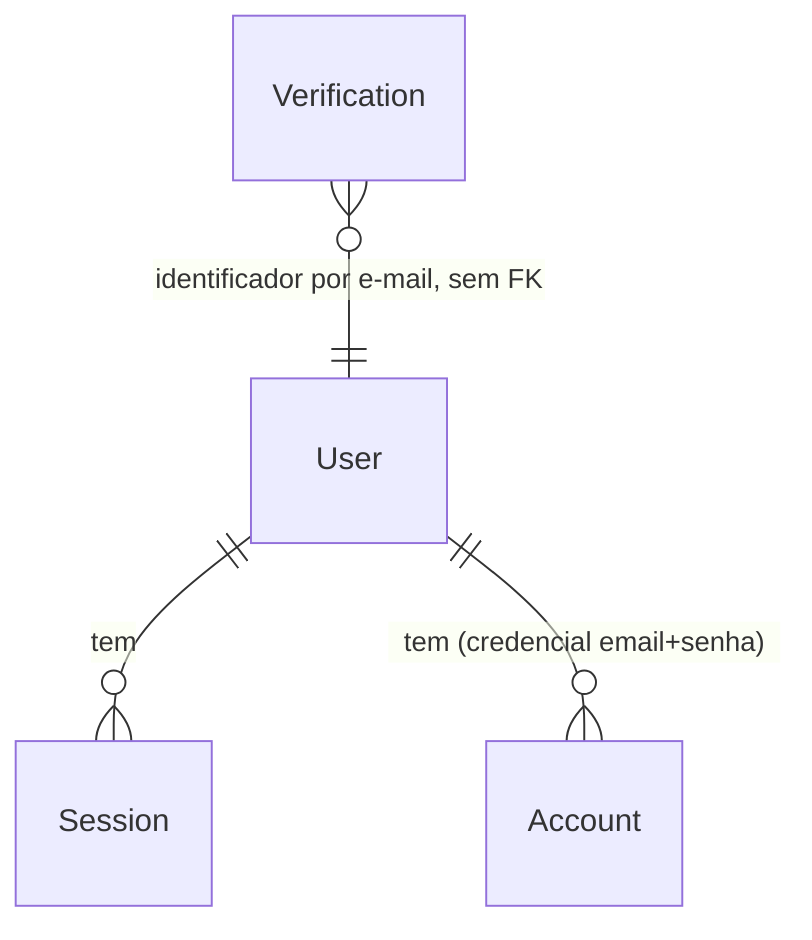

# HACK-12 · 0.1 Preparar stack: Prisma + Postgres, Better Auth no Nest, schedule e socket.io

## Problem

Hoje a API Nest só responde `/api/health`: não tem banco, não sabe quem está chamando, não roda nada em horário marcado e não empurra nada para o navegador. Todo card de E1 a E4 (cadastro de clínica e paciente, agenda, motor, notificações, tempo real) depende de pelo menos uma dessas quatro peças, e o card diz literalmente que ele "bloqueia todos os cards de E1 a E4". Enquanto a fundação não existe, cada dono de card teria de escolher sozinho como ligar o banco, a sessão e o cron, e o time terminaria com três jeitos de fazer a mesma coisa.

O card não traz número de esforço nem prazo próprio; o prazo é o do hackathon, e o HACK-12 está no caminho crítico (`docs/product/fluxo-de-trabalho.md`: 0.1 → 0.2 → 3.1 …).

Quando isto entrar: quem pega um card de E1–E4 sobe o Postgres do próprio worktree com um comando, tem um usuário com papel `paciente` ou `clinica` autenticado por cookie, um guard que já bloqueia rota sem sessão, um cron que roda a cada minuto e um gateway socket.io registrado, tudo com `npm run check`, `npm run build` e `npm run smoke` verdes.

## Flow

Reaproveita o bootstrap atual (`createApp`, prefixo global `api`, `parsePort`, smoke HTTP e o serviço de saúde do Next) e a integração pronta `@thallesp/nestjs-better-auth`, em vez de escrever guard e montagem de rotas de auth à mão.

1. dev sobe o banco: `docker compose up -d` na raiz (novo, porta 1) cria um Postgres por worktree, com banco e porta vindos do `.env` da raiz; `prisma migrate dev` em `apps/api` (novo, porta 2) cria as tabelas de auth.
2. boot: `main.ts` (existente) carrega `.env` → validação de configuração (novo, porta 5) exige `DATABASE_URL`, `BETTER_AUTH_SECRET`, `BETTER_AUTH_URL` e `WEB_ORIGIN`; ausente, o processo encerra com código ≠ 0 antes do `listen`.
3. `createApp` (existente) monta `AppModule` (existente) com o módulo de banco Prisma (novo, porta 2), o `AuthModule` da biblioteca (novo, porta 3), `ScheduleModule` (novo, porta 6) e o gateway de exemplo (novo, porta 6).
4. navegador → Next: `/api/auth/*` e `/api/sign-up/*` no Next (novo, porta 4) repassam método, corpo e `cookie` para o mesmo caminho em `API_BASE_URL` com timeout e devolvem status, corpo e `set-cookie` — o cookie de sessão fica no domínio do Next.
5. cadastro: `POST /api/sign-up/paciente` ou `/api/sign-up/clinica` no Nest (novo, porta 3, rota anônima) valida o corpo com o schema de `@hackathon/contracts`, fixa o papel pela rota num contexto da requisição (`AsyncLocalStorage`) e chama `auth.api.signUpEmail` no servidor; o hook `databaseHooks.user.create.before` do Better Auth lê o papel desse contexto e o grava no `User`; o `set-cookie` volta na resposta. `/api/auth/sign-up/email` responde 404 por HTTP (`disabledPaths`).
6. login e logout: Nest `/api/auth/*` (Better Auth, novo, porta 3) grava e encerra `Session` pelo adaptador Prisma e responde com cookie httpOnly.
7. Server Component do Next → serviço server-only (novo) lê o cookie da requisição e chama `GET /api/me` no Nest repassando `cookie`; valida a resposta com o schema de `@hackathon/contracts` (existente, ganha `sessionUserSchema` e o schema de cadastro).
8. Nest: guard global da biblioteca (novo, porta 3) lê a sessão; `GET /api/me` lê o usuário pelo `AuthSessionService` do módulo de auth (novo, porta 3), dono único da leitura de sessão e da verificação de token de uso único; sem sessão → 401; `/api/health` (existente) e as duas rotas de cadastro são marcadas como anônimas.
9. a cada minuto: job de exemplo (novo, porta 6) escreve uma linha no log do Nest.
10. cliente socket.io → gateway de exemplo (novo, porta 6): evento `ping` → resposta `pong`.
11. token de uso único (plugin `oneTimeToken`, novo, porta 3): o Next, com o cookie, chama `GET /api/auth/one-time-token/generate` e recebe um token; a verificação só existe no servidor (`AuthSessionService.verifyOneTimeToken`), consumindo o token na tabela `Verification`. O uso no handshake socket.io é do HACK-38.

## Impact

| Front | What changes |
| --- | --- |
| domain | termo novo: `role` - papel do usuário, `paciente` ou `clinica` (T2); mora na tabela `User` da autenticação; quem fixa é a rota de cadastro, nunca o cliente; HACK-16 e HACK-23 constroem as telas sobre `/api/sign-up/clinica` e `/api/sign-up/paciente` e leem o papel em `/api/me` |
| domain | termo novo: sessão - cookie httpOnly do Better Auth; todo card protegido passa a depender dele |
| comportamento HTTP | toda rota Nest nova nasce protegida (guard global); rota pública precisa de marcação explícita. `/api/health` e as duas rotas de cadastro são as públicas |
| boot | API passa a exigir 4 variáveis de ambiente; sem elas não sobe. Afeta `npm run dev`, smoke e CI |
| CI | `.github/workflows/ci.yml` ganha serviço Postgres e aplica as migrations no banco efêmero do runner antes de testes e smoke |
| testes | comando de teste da API passa a descobrir `*.test.js` em subpastas (`structure.md` exige ao criar teste em módulo) |
| outros cards | HACK-13 empilha nesta branch e é dono do modelo de domínio no `schema.prisma`; HACK-38 empilha nesta branch, injeta o `AuthSessionService` exportado pelo módulo de auth no handshake e só adiciona `socket.io-client`; não reimplementa leitura de sessão nem token |
| stored data | nada a migrar - não existe banco hoje |

## Relations

One-way constraints: e-mail do `User` único, um papel por conta (porta 2, D2); `role` obrigatório, sem valor padrão, com valor em `paciente` | `clinica` (porta 2); token da `Session` único (porta 2). Nomes e demais campos seguem o schema que o Better Auth pede para o adaptador Prisma.

## Surface

| Route | In | Out | Status |
| --- | --- | --- | --- |
| `POST /api/sign-up/paciente` (Nest, novo, anônima) | `name`, `email`, `password` | `user` (`id`, `name`, `email`, `role = paciente`) · cookie de sessão | `200`, `400`, `422` |
| `POST /api/sign-up/clinica` (Nest, novo, anônima) | `name`, `email`, `password` | `user` (`id`, `name`, `email`, `role = clinica`) · cookie de sessão | `200`, `400`, `422` |
| `POST /api/auth/sign-up/email` (Better Auth, desligada por HTTP) | qualquer | `Not Found` | `404` |
| `POST /api/auth/update-user` (Better Auth) | `role` | erro `FIELD_NOT_ALLOWED` | `400` |
| `POST /api/auth/sign-in/email` (Nest, via Better Auth) | `email`, `password` | `user` · cookie de sessão | `200`, `401` |
| `POST /api/auth/sign-out` (Nest, via Better Auth) | cookie | `success` · cookie expirado | `200` |
| `GET /api/me` (Nest, novo) | cookie | `id`, `name`, `email`, `role` | `200`, `401` |
| `GET /api/auth/one-time-token/generate` (Better Auth, plugin) | cookie | `token` | `200`, `401` |
| `POST /api/auth/one-time-token/verify` (Better Auth, desligada por HTTP) | qualquer | `Not Found` | `404` |
| `GET /api/health` (Nest, existente, agora anônima explícita) | - | `status`, `service` | `200` |
| `* /api/auth/[...path]` e `POST /api/sign-up/[role]` (Next, novo, repasse) | método, corpo, `cookie` | status, corpo e `set-cookie` do Nest | status do Nest repassado, `502`, `504` |
| socket.io namespace padrão, evento `ping` (Nest, novo) | qualquer payload | evento `pong` | `101` (upgrade para websocket) |

## Landing

| One-way door | Literal shape | Alternative rejected |
| --- | --- | --- |
| 1. Postgres local por worktree | `docker-compose.yml` na raiz com serviço `postgres` (imagem `postgres:17`), `ports: "${POSTGRES_PORT:-5432}:5432"`, `POSTGRES_DB: ${POSTGRES_DB:-hackathon}`, volume nomeado; nome do projeto compose = pasta do worktree, então cada worktree tem container e volume próprios; `.env.example` na raiz com `POSTGRES_PORT` e `POSTGRES_DB` | um container compartilhado com vários bancos: exige criar banco à mão e um worktree derrubar o do outro |
| 2. ORM e schema | `prisma` e `@prisma/client` na linha 7 (7.10.x), `@prisma/adapter-pg`; `apps/api/prisma/schema.prisma` com `datasource db { provider = "postgresql" }`, generator `prisma-client` com saída ignorada pelo git; migrations em `apps/api/prisma/migrations/`; primeira migration `init_auth` só com `User`, `Session`, `Account`, `Verification`; `User.role` texto não nulo e sem default (D1: insert sem papel falha) | Prisma 8 (só `rc` no npm em 07/11/2026); TypeORM/Drizzle (T1 decidiu Prisma); colocar o domínio aqui (é do HACK-13) |
| 3. Autenticação e papel fixado pela rota | `better-auth` 1.x + `@thallesp/nestjs-better-auth` 2.x; `emailAndPassword.enabled: true`; `user.additionalFields.role = { type: "string", input: false, required: false }` **sem `defaultValue`** (no 1.7.18, `input: false` com default troca o valor em silêncio e, sem default, devolve 400 `FIELD_NOT_ALLOWED` a qualquer `role` no corpo, inclusive em chamada do servidor); `disabledPaths: ["/sign-up/email", "/one-time-token/verify"]` (bloqueia só o roteador HTTP, `auth.api.*` continua disponível no servidor); plugin `oneTimeToken({ storeToken: "hashed", disableSetSessionCookie: true })` com validade padrão de 3 min, guardado na tabela `Verification` (sem migration própria); `AuthSessionService` (`@Injectable`, exportado pelo módulo de auth) com `getSession(headers)` → `auth.api.getSession` e `verifyOneTimeToken(token)` → `auth.api.verifyOneTimeToken`, os dois devolvendo `{ user: { id, name, email, role }, session }` ou `null`; rotas Nest anônimas `POST /api/sign-up/paciente` e `POST /api/sign-up/clinica` que rodam `auth.api.signUpEmail({ body, headers, returnHeaders: true })` dentro de um `AsyncLocalStorage` com o papel da rota; `databaseHooks.user.create.before` copia o papel do contexto para `data.role` e devolve `false` (não cria) se não houver papel no contexto; coluna `role` sem default no banco, então insert sem papel falha; cookie httpOnly, `Secure` quando `BETTER_AUTH_URL` é https; `trustedOrigins: [WEB_ORIGIN]`; guard global da biblioteca e `@AllowAnonymous()` nas rotas públicas | `role` no corpo do cadastro (D1: Gustavo pediu cadastros separados); `defaultValue: "paciente"` com `input: false` (a clínica viraria paciente em silêncio); papel por cabeçalho ou campo extra no corpo lido no hook (canal que o cliente controla); criar usuário e depois atualizar o papel (duas escritas, janela com usuário sem papel); rotas sob `/api/auth/*` (o middleware da biblioteca atende esse prefixo antes dos controllers); guard e sessão escritos à mão (proibido pela `security.md` e pela regra de reutilizar integração pronta); guard só por rota (rota nova esquecida nasceria aberta); verificação de token exposta por HTTP (quem pegasse o token levaria a sessão inteira; o 38 só precisa dela no servidor); token guardado em texto puro (padrão do plugin; vazamento da tabela entregaria sessões); leitura de sessão espalhada por controller e gateway (duas implementações da mesma regra sensível) |
| 4. Cookie no domínio do Next | Route Handlers `apps/web/app/api/auth/[...path]/route.ts` e `apps/web/app/api/sign-up/[role]/route.ts` (só `paciente` e `clinica`; outro valor → 404 sem chamar o Nest) que leem `API_BASE_URL` em tempo de execução, repassam `cookie`, corpo e método, devolvem `set-cookie`, timeout de 10 s | `rewrites` do `next.config` (destino fixado no build, quebra o smoke com porta aleatória e o deploy com URL da API diferente); navegador chamando o Nest direto (cookie de terceiro entre Vercel e Railway, T9) |
| 5. Configuração validada no boot | `apps/api/src/config/` com schema Zod das 4 variáveis; erro lista o nome da variável faltante e nunca o valor | ler `process.env` espalhado pelo código (erro só aparece na primeira requisição) |
| 6. Jobs e tempo real | `@nestjs/schedule` 6.x com `ScheduleModule.forRoot()`; `@nestjs/websockets` e `@nestjs/platform-socket.io` 11.x e `socket.io` 4.x como dependências de `apps/api` (o HACK-38 só adiciona `socket.io-client`); job e gateway de exemplo num módulo próprio, marcados como exemplo para HACK-32/HACK-38 substituírem | Nest 12 (é ESM-only e troca major sem pedido); fila (T3: sem fila) |
| 7. Resolução de módulos da API | `apps/api/tsconfig.json` com `module`/`moduleResolution` `node16` ou `nodenext` (saída continua CommonJS); `better-auth` e a integração são ESM-only e entram por `require(esm)` do Node ≥ 22.12 (`engines` já exige) | migrar a API inteira para ESM (mexe em todo import e no runner de teste sem ganho para o card) |

- Nada mais nesta mudança é difícil de reverter.

## Criteria

### S1: banco local do worktree e migrations (P1)

O dev sobe o Postgres do próprio worktree e aplica o schema de auth sem colidir com outro worktree.

**Acceptance Criteria**

1. QUANDO `docker compose up -d` roda na raiz com `POSTGRES_PORT=54312` e `POSTGRES_DB=hack_12` ENTÃO o sistema DEVE expor um Postgres em `127.0.0.1:54312` com o banco `hack_12` criado.
2. QUANDO `prisma migrate dev` roda em `apps/api` contra esse banco ENTÃO o sistema DEVE criar as tabelas de `User`, `Session`, `Account` e `Verification`, e nenhuma tabela de domínio.
3. O sistema DEVE manter `DATABASE_URL`, `POSTGRES_PORT` e `POSTGRES_DB` nos `.env.example` só com placeholders locais (`127.0.0.1`, usuário e senha `hackathon`), sem segredo real.

**Independent test:** `docker compose up -d && npm run db:migrate -w @hackathon/api` num worktree limpo; `psql` lista as quatro tabelas.

### S2: configuração obrigatória no boot (P1)

A API não sobe pela metade.

**Acceptance Criteria**

4. SE `DATABASE_URL`, `BETTER_AUTH_SECRET`, `BETTER_AUTH_URL` ou `WEB_ORIGIN` estiver ausente ou vazia ENTÃO o sistema DEVE encerrar o boot antes do `listen`, com código de saída 1 e mensagem que cita o nome da variável e nunca o valor de nenhuma variável.
5. SE `BETTER_AUTH_SECRET` tiver menos de 32 caracteres ENTÃO o sistema DEVE encerrar o boot com código de saída 1.

**Independent test:** `node dist/main.js` sem `BETTER_AUTH_SECRET` sai com 1 e a mensagem cita `BETTER_AUTH_SECRET`.

### S3: cadastros separados por papel e login por HTTP contra o Nest (P1)

Paciente e clínica se cadastram por URLs diferentes; o papel vem da rota, nunca do cliente; o login é um só.

**Acceptance Criteria**

6. QUANDO `POST /api/sign-up/clinica` recebe `name`, `email` novo e `password` com 8 ou mais caracteres ENTÃO o sistema DEVE responder 200 com `user.role = "clinica"` e um `set-cookie` de sessão com `HttpOnly`.
7. QUANDO `POST /api/sign-up/paciente` recebe `name`, `email` novo e `password` com 8 ou mais caracteres ENTÃO o sistema DEVE responder 200 com `user.role = "paciente"` e um `set-cookie` de sessão com `HttpOnly`.
8. SE o corpo de `POST /api/sign-up/paciente` ou `/api/sign-up/clinica` trouxer `role` ou qualquer campo além de `name`, `email` e `password` ENTÃO o sistema DEVE responder 400 e não criar usuário.
9. SE o `email` já estiver cadastrado, em qualquer dos dois papéis ENTÃO o sistema DEVE responder 422 e não criar um segundo usuário com o mesmo e-mail.
10. SE `password` tiver menos de 8 caracteres ENTÃO o sistema DEVE responder 400 e não criar usuário.
11. QUANDO `POST /api/auth/sign-up/email` chega por HTTP ENTÃO o sistema DEVE responder 404 e não criar usuário.
12. SE o Better Auth tentar criar um `User` fora das duas rotas de cadastro (sem papel no contexto da requisição) ENTÃO o sistema DEVE recusar a criação e nenhum `User` sem papel DEVE existir no banco.
13. QUANDO `POST /api/auth/sign-in/email` recebe e-mail e senha corretos ENTÃO o sistema DEVE responder 200 com `set-cookie` de sessão `HttpOnly`.
14. SE a senha estiver errada ou o e-mail não existir ENTÃO o sistema DEVE responder 401 com a mesma mensagem nos dois casos.
15. QUANDO `POST /api/auth/sign-out` recebe um cookie válido ENTÃO o sistema DEVE responder 200 e a sessão DEVE deixar de autorizar `GET /api/me` (401).
16. SE `POST /api/auth/update-user` chegar com `role` no corpo ENTÃO o sistema DEVE responder 400 e manter o `role` gravado no cadastro.

**Independent test:** teste HTTP do Nest com porta efêmera contra o banco local: cadastra um paciente e uma clínica pelas duas rotas, tenta `/api/auth/sign-up/email` (404), loga, chama `/api/me`, desloga.

### S4: guard e leitura de sessão com dono único (P1)

Rota protegida não responde sem cookie, e a sessão (por cookie ou por token de uso único) se lê num serviço só.

**Acceptance Criteria**

17. QUANDO `GET /api/me` recebe cookie de sessão válido ENTÃO o sistema DEVE responder 200 com exatamente `id`, `name`, `email` e `role`, validável por `sessionUserSchema` de `@hackathon/contracts`.
18. SE `GET /api/me` chegar sem cookie, com cookie adulterado ou com sessão encerrada ENTÃO o sistema DEVE responder 401 sem corpo de usuário.
19. O sistema DEVE responder 200 em `GET /api/health` sem cookie, e 404 em rota desconhecida sem cookie.
20. O sistema DEVE aplicar o guard a toda rota Nest que não tenha marcação explícita de anônima.
21. QUANDO `AuthSessionService.getSession` recebe os cabeçalhos de uma requisição com cookie de sessão válido ENTÃO o sistema DEVE devolver `user.id` e `user.role` (`paciente` ou `clinica`) do usuário logado; sem cookie válido DEVE devolver `null`.
22. QUANDO `GET /api/auth/one-time-token/generate` recebe cookie de sessão válido ENTÃO o sistema DEVE responder 200 com `token`; sem cookie DEVE responder 401.
23. QUANDO `AuthSessionService.verifyOneTimeToken` recebe um token recém-gerado ENTÃO o sistema DEVE devolver a sessão com o mesmo `user.id` e `user.role` de quem gerou.
24. SE o mesmo token for verificado uma segunda vez ENTÃO o sistema DEVE devolver `null`.
25. QUANDO `POST /api/auth/one-time-token/verify` chega por HTTP ENTÃO o sistema DEVE responder 404.

**Independent test:** `curl -i /api/me` sem cookie → 401; com o cookie do S3 → 200; teste HTTP gera um token com o cookie e o verifica duas vezes pelo serviço (sessão, depois `null`).

### S5: Next repassa o cookie ao Nest (P1)

O cookie de sessão vive no domínio do Next e chega ao Nest nas duas direções.

**Acceptance Criteria**

26. QUANDO o navegador chama `POST /api/auth/sign-in/email`, `POST /api/sign-up/paciente` ou `POST /api/sign-up/clinica` no Next ENTÃO o sistema DEVE repassar a chamada ao Nest e devolver o mesmo status e o `set-cookie` do Nest.
27. QUANDO um Server Component pede o usuário da sessão ENTÃO o sistema DEVE chamar `GET /api/me` no Nest com o cabeçalho `cookie` da requisição recebida e devolver o usuário validado por `sessionUserSchema`.
28. SE o Nest não responder em 10 s no repasse de `/api/auth/*` ou `/api/sign-up/*` ENTÃO o sistema DEVE responder 504; SE a conexão falhar ENTÃO DEVE responder 502; em nenhum dos dois casos DEVE devolver 200.
29. SE `GET /api/me` responder 401 ou falhar na consulta do Server Component ENTÃO o sistema DEVE tratar como sem sessão, sem lançar erro na renderização.

**Independent test:** smoke: cadastro de paciente pelo Next, login pelo Next, depois a página de verificação de sessão mostra o e-mail; com a API desligada, o repasse responde 502.

### S6: job a cada minuto e gateway de exemplo (P2)

O motor e o tempo real têm onde encaixar.

**Acceptance Criteria**

30. ENQUANTO a API estiver de pé o sistema DEVE executar o job de exemplo com a expressão `0 * * * * *` (a cada minuto) e escrever uma linha de log com o nome do job, sem dado de usuário.
31. QUANDO um cliente socket.io conecta na API e emite `ping` ENTÃO o sistema DEVE responder com o evento `pong`.

**Independent test:** `npm run dev`, esperar 61 s e ver a linha no log; `socket.io-client` emite `ping` e recebe `pong`.

### S7: portões do repositório (P1)

A fundação não deixa o repositório vermelho.

**Acceptance Criteria**

32. O sistema DEVE passar `npm run check`, `npm run build` e `npm run smoke` no worktree com o Postgres local de pé e as migrations aplicadas.
33. O sistema DEVE executar no `npm test` da API os arquivos `*.test.js` de subpastas de `src/`, não só os da raiz.
34. QUANDO o CI roda ENTÃO o sistema DEVE subir um Postgres de serviço, aplicar as migrations e rodar `check`, `build` e `smoke` contra ele.

**Independent test:** `npm run check && npm run build && npm run smoke` com o banco local; o workflow tem o serviço Postgres.

## Out of scope

| Excluded | Why |
| --- | --- |
| Telas de cadastro e login | HACK-16 (clínica, desktop) e HACK-23 (paciente, mobile) |
| Telefone, consentimento LGPD e campos de clínica (CNES, endereço, responsável técnico) | HACK-23 e HACK-16; RN-01 e RN-11 entram lá |
| Isolamento por recurso (paciente só vê o que é dele, clínica só o que é dela) | RN-04 e RN-12 são de HACK-16 e HACK-23; aqui o guard só diz se há sessão |
| Modelo de domínio (Clínica, Exame, Horário, Vaga…) | HACK-13 empilha nesta branch e é o dono do `schema.prisma` de domínio |
| Autenticação no handshake do socket.io e salas por paciente/clínica | HACK-38 (T4) |
| Jobs reais (preço, ondas, expiração, sincronizador) | HACK-19, HACK-30, HACK-32 |
| Verificação de e-mail, recuperação de senha, login Google | sem card; e-mail transacional é HACK-36 |
| Deploy, Neon, HTTPS e segredos de produção | HACK-14 |
| Dados de demonstração | HACK-15 |

## Assumptions

| Assumption | Chosen default | Rationale | Confirmed? |
| --- | --- | --- | --- |
| Senha mínima | 8 caracteres (padrão do Better Auth), máximo padrão da biblioteca | nenhuma RN fixa; trocar é configuração reversível | n |
| Verificação de e-mail no cadastro | desligada | sem provedor de e-mail até HACK-36; a demo precisa de cadastro imediato | n |
| Duração da sessão | padrão do Better Auth (7 dias, renovada com uso) | nenhuma RN fixa | n |
| Rate limit de auth | o embutido do Better Auth, com armazenamento em memória do processo | contador efêmero não é estado durável; uma instância na demo | n |
| Códigos de erro do Better Auth (400 senha curta, 400 `FIELD_NOT_ALLOWED` em `role` no update, 422 e-mail repetido, 401 credencial errada) | os listados em Surface, conferidos na versão instalada antes de virar check | vêm da biblioteca; se a versão instalada divergir, o check segue a biblioteca e o plano é corrigido | n |
| Job e gateway "de exemplo" | ficam no código até HACK-32 e HACK-38 os substituírem | o card pede os dois como prova de registro | n |
| Validade do token de uso único | 3 min (padrão do plugin) | o 38 usa o token logo após gerar; não testado por relógio neste card | n |
| Gateway de exemplo sem autenticação | aceito: só ecoa `ping`/`pong`, sem dado | auth no handshake é T4/HACK-38 | n |
| Porta e banco locais deste worktree | API 3121, Next 3120, Postgres 54312, banco `hack_12` | contrato dos maestros: nome de banco e portas por worktree | n |
| Imagem do Postgres local | `postgres:17` | versão estável suportada pelo Neon (T1/T9) | n |

### Decisões

Respondidas pelo Gustavo em 07/11/2026, pelo Maestro Fundação.

**D1 - Quem escolhe o papel no cadastro.** Resposta: cadastros separados, com URLs separadas. Paciente e clínica ficam na mesma aplicação no MVP, mas na prática seriam aplicativos diferentes; o papel não vem do corpo, é fixado pela rota (`/api/sign-up/paciente` e `/api/sign-up/clinica`), e o `/api/auth/sign-up/email` genérico fica desligado. Login, logout e `/api/me` continuam únicos. Entrou nos critérios 6 a 12 e 16 e na porta 3.

**D2 - Uma conta pode ter os dois papéis?** Resposta: não. Um papel por conta, e-mail único; quem precisar dos dois usa dois e-mails. Entrou no critério 9 e na porta 2.

| # | Kind | Question | Until answered |
| --- | --- | --- | --- |
| 1 | open | O cookie fica no domínio do Next (porta 4). Em produção com Next na Vercel e Nest no Railway (T9), o navegador não manda esse cookie no handshake socket.io direto ao Nest. O Maestro Fundação levou ao maestro-geral como desenho do HACK-38 e do HACK-14; este card segue como está | nada deste card; afeta o desenho do HACK-38 |

**Perguntas abertas:** uma, acima; não bloqueia o build.

## Observable

| Surface | Decision | Landing |
| --- | --- | --- |
| API `POST /api/sign-up/paciente` e `/api/sign-up/clinica` | formato e códigos de erro | AC 8, AC 9, AC 10 |
| API `POST /api/sign-up/paciente` e `/api/sign-up/clinica` | quem pode chamar | AC 11, AC 12 - anônimas, papel fixado pela rota |
| API `POST /api/auth/update-user` | quem pode alterar o papel | AC 16 |
| API `POST /api/auth/sign-in/email` | formato e códigos de erro | AC 14 |
| API `POST /api/auth/*` | quem pode chamar | existente - Better Auth checa a origem contra `trustedOrigins` (`WEB_ORIGIN`) |
| API `POST /api/auth/*` | limite de taxa | existente - rate limit embutido do Better Auth |
| API `GET /api/me` | formato da resposta e erro | AC 17, AC 18 |
| API `GET /api/me` | quem pode chamar | AC 18, AC 20 |
| API `GET /api/health` | quem pode chamar | AC 19 |
| API `GET /api/auth/one-time-token/generate` | quem pode chamar e erro | AC 22 |
| API `POST /api/auth/one-time-token/verify` | quem pode chamar | AC 25 |
| Next `/api/auth/[...path]` e `/api/sign-up/[role]` | erro quando a API falha | AC 28 |
| Server Component (consulta da sessão) | estado sem sessão e erro | AC 29 |
| todas as rotas novas | versionamento | não se aplica - API interna consumida só pelo Next deste repositório |
| `/api/me` e repasse | limite de taxa | não se aplica - sem dado sensível além do próprio usuário; auth já limitada pela biblioteca |
| job de exemplo | saída e verbosidade | AC 30 |
| job de exemplo | falha no meio | não se aplica - só escreve log; o job real trata falha no HACK-32 |
| gateway de exemplo | quem pode conectar | não se aplica - sem dado; auth do handshake é do HACK-38 |
| `docker compose` e scripts `db:*` | flags, padrões e falha | AC 1, AC 2; padrões de porta e banco no `.env.example` (AC 3) |
| telas | vazio, carregando, erro | não se aplica - nenhuma tela neste card (HACK-16 e HACK-23) |

## Sources

- Card HACK-12 no Linear - https://linear.app/workspace-do-gustavo/issue/HACK-12/01-preparar-stack-prisma-postgres-better-auth-no-nest-schedule-e - entrega e "Pronto quando" (sem comentários em 07/11/2026)
- `.specs/features/marketplace-vagas-imagem/brainstorm.md`, seção "Stack e decisões técnicas" - T1 a T5 fixam Prisma + Postgres, Better Auth no Nest com cookie httpOnly e `role`, `@nestjs/schedule` a cada minuto e socket.io
- `docs/execucao/contrato-dos-maestros.md` - Postgres via Docker Compose com banco e portas por worktree; HACK-13 e HACK-38 empilham nesta branch
