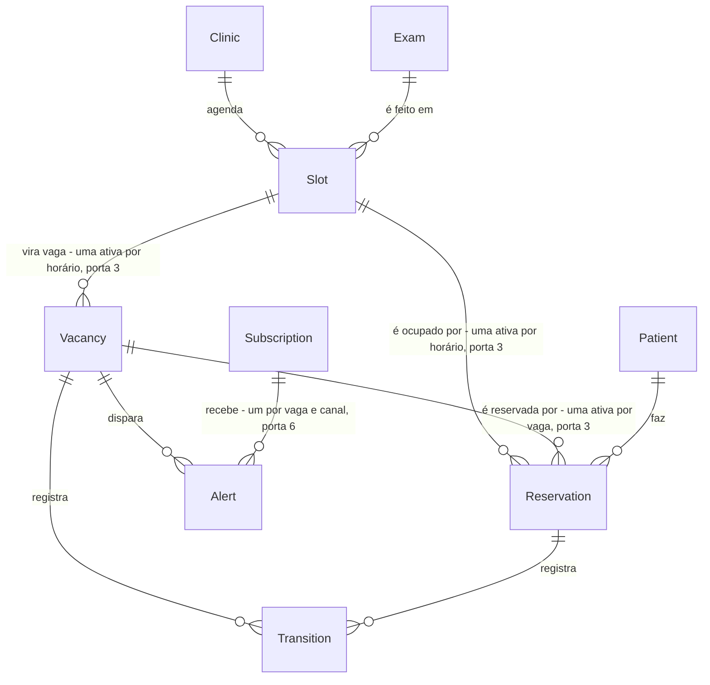

# HACK-13 · Fatia 2 · Horário, Vaga, Reserva, Alerta, Transição e a trava da vaga

Segunda de duas PRs do HACK-13 (D2, Gustavo, 08/11/2026). Depende da fatia 1 (`.specs/features/hack-13-modelo-dados/plan.md`: `Clinic`, `Exam`, `Patient`, `Subscription` e filhas). **O build só começa depois do merge da fatia 1 em `main`:** worktree atualizado com `git merge origin/main` (ou novo, a partir de `origin/main`), sem empilhar.

## Problem

Com a fatia 1, o banco conhece clínica, exame, paciente e inscrição, mas não tem onde gravar um horário, uma vaga, uma reserva, um alerta ou o registro das mudanças de estado. A máquina de estados (HACK-29, caminho crítico: 0.2 → 3.1 → 1.4/3.4 → 2.5), o matching (HACK-31) e as notificações (HACK-34) continuam parados. E a regra mais cara do produto, a trava da vaga (RN-41: dois pacientes pagam no mesmo segundo e só um fica com ela), sem mecanismo no banco, viraria um `if` no serviço, que perde a corrida entre duas transações.

O card não traz número de esforço nem prazo próprio; o prazo é o do hackathon.

Quando esta fatia entrar: o HACK-29 recebe os estados da vaga e da reserva como enum no banco (RN-24) e a tabela de transições (RN-50); a segunda reserva ativa da mesma vaga é recusada pelo próprio Postgres (RN-41), inclusive em corrida. É o "Pronto quando" do card.

## Flow

Reaproveita o `schema.prisma`, as migrations `init_auth` (HACK-12) e da fatia 1, o `PrismaService` global e o banco local por worktree, sem segundo cliente Prisma nem segundo módulo de banco.

1. dev: edita `apps/api/prisma/schema.prisma` (existente, HACK-12 + fatia 1) com `Slot`, `Vacancy`, `Reservation`, `Alert`, `Transition` e nove enums (novo, portas 1 a 6) e liga a preview `partialIndexes` no generator (novo, porta 4).
2. `npm run db:migrate -w @hackathon/api` (existente, HACK-12) gera a migration desta fatia depois da migration da fatia 1, criada com `--create-only` e completada à mão com os `CHECK` (novo, porta 5); aplica no Postgres do worktree.
3. `prisma generate` (existente, roda no `build`, `typecheck` e `test`) gera o cliente com os modelos e enums novos em `apps/api/src/generated/prisma` (existente, ignorado pelo git).
4. código Nest: HACK-29, 31, 32, 34, 19, 20 e 27 injetam o `PrismaService` (existente, `@Global`) e gravam nas tabelas novas; nenhum módulo de domínio nasce neste card.
5. teste de integração (novo) usa o `PrismaService` contra o banco do worktree, grava clínica → exame → horário → vaga → duas reservas e confirma que o Postgres recusa a segunda reserva ativa (porta 3), dentro e fora de corrida.

## Impact

| Front         | What changes                                                                                                                                                                                                                                                                                                                                                                             |
| ------------- | ---------------------------------------------------------------------------------------------------------------------------------------------------------------------------------------------------------------------------------------------------------------------------------------------------------------------------------------------------------------------------------------- |
| domain        | termos novos, nomes em inglês no schema: `Slot` (Horário), `Vacancy` (Vaga de encaixe), `Reservation` (Reserva), `Alert` (Alerta), `Transition` (Transição)                                                                                                                                                                                                                              |
| domain        | termo novo: reserva **ativa** - reserva em `confirmada` ou `realizada`; só ela ocupa a vaga e o horário. `aguardando_pagamento` (sinal iniciado, RN-42) não ocupa: vários pacientes de uma onda podem estar pagando ao mesmo tempo, e a confirmação é que trava (RN-41)                                                                                                                  |
| domain        | termo novo: vaga **ativa** - vaga em `publicada`, `alertando` ou `reservada`; no máximo uma por horário                                                                                                                                                                                                                                                                                  |
| outros cards  | HACK-29 (máquina de estados): recebe o alfabeto pronto - enums `VacancyState` e `ReservationState` e o modelo `Transition`. As regras de transição (RN-24) e a gravação da `Transition` na mesma transação da mudança de estado (RN-50) são dele, no serviço; o banco só garante o enum e as unicidades parciais (porta 3). Ver «Fora do card» para três conflitos da spec que ele herda |
| outros cards  | HACK-27 (pagamento) traduz o `P2002` da confirmação para "vaga acabou de ser preenchida"; HACK-31, 32 e 34 leem `Vacancy` e gravam `Alert`; HACK-19 e HACK-20 gravam `Slot` e `Vacancy`                                                                                                                                                                                                  |
| contratos     | `packages/contracts` não muda. Quem expuser estado de vaga ou reserva por HTTP cria o schema Zod no card dele, com os mesmos valores em português                                                                                                                                                                                                                                        |
| schema.prisma | dono único por vez (contrato dos maestros): a frente Fundação até esta fatia entrar em `main`                                                                                                                                                                                                                                                                                            |
| stored data   | nada a migrar - as tabelas desta fatia não existem; as de auth não são tocadas. As da fatia 1 ganham `CHECK` de faixa e uma unicidade em `PriceStep` (portas 8 e 9, settled pelo maestro): a migration falha se houver linha fora da faixa ou degrau repetido; o banco local só tem dados de teste, que a suíte apaga                                                                    |

## Relations

One-way constraints: estados como enum Postgres (porta 1); uma reserva ativa por vaga e uma por horário, uma vaga ativa por horário (porta 3); reserva comum sem vaga e encaixe/no-show com vaga, pagamento no local só na reserva comum, transição com exatamente um alvo, fim do horário depois do início (porta 5); alerta único por vaga, inscrição e canal (porta 6); faixas numéricas das duas fatias (porta 8); um degrau de preço por antecedência (porta 9). Todas as FKs desta fatia, para a fatia 1 e entre as tabelas novas, com `onDelete: Restrict`: horário, vaga e reserva são histórico (RN-50, RN-51) e não somem em cascata.

## Surface

Nenhum - nenhuma rota HTTP nova nem alterada; a fatia entrega schema e migration. As rotas que gravam nestas tabelas nascem em HACK-20, 25 e 27.

## Landing

| One-way door                                                   | Literal shape                                                                                                                                                                                                                                                                                                                                                                                                                                                                                                                                                                                                                                                                                                                                                                                                                                                                                                                      | Alternative rejected                                                                                                                                                                                                                                                                                                             |
| -------------------------------------------------------------- | ---------------------------------------------------------------------------------------------------------------------------------------------------------------------------------------------------------------------------------------------------------------------------------------------------------------------------------------------------------------------------------------------------------------------------------------------------------------------------------------------------------------------------------------------------------------------------------------------------------------------------------------------------------------------------------------------------------------------------------------------------------------------------------------------------------------------------------------------------------------------------------------------------------------------------------- | -------------------------------------------------------------------------------------------------------------------------------------------------------------------------------------------------------------------------------------------------------------------------------------------------------------------------------- |
| 1. Enums no banco (RN-24)                                      | `enum VacancyState { publicada alertando reservada realizada expirada cancelada }`, `enum ReservationState { aguardando_pagamento confirmada realizada no_show cancelada expirada }`, `enum VacancyOrigin { cancelamento no_show vazio }`, `enum SlotOrigin { agenda manual }`, `enum ReservationType { comum encaixe no_show }`, `enum PaymentMethod { pix cartao no_local }`, `enum AlertChannel { push email whatsapp }`, `enum AlertResult { pendente enviado falhou cancelado }`, `enum TransitionOrigin { agenda clinica paciente motor }`; todos viram `CREATE TYPE … AS ENUM`. Nomes de enum, modelo e campo em inglês; **valores em português, iguais aos da spec**, como `User.role` (dúvida técnica 1, respondida pelo Maestro)                                                                                                                                                                                         | `String` com validação só no serviço (o card exige enum no banco); valores em inglês com tabela de tradução (o time e os cards seguintes comparam direto com as RN em português; o `User.role` do HACK-12 já usa português)                                                                                                      |
| 2. Reserva sempre num horário                                  | `Reservation.slotId String` obrigatório e `Reservation.vacancyId String?`; reserva comum tem só `slotId`, encaixe e no-show têm os dois. Mesmas unidades da fatia 1: `chargedPriceCents`, `depositCents`, `currentPriceCents` em `Int` centavos; ids `String @id @default(uuid()) @db.Uuid`                                                                                                                                                                                                                                                                                                                                                                                                                                                                                                                                                                                                                                        | dois FKs opcionais exclusivos (vaga **ou** horário, como diz o card): a unicidade por horário teria de olhar duas colunas e uma reserva comum e uma de encaixe no mesmo horário passariam                                                                                                                                        |
| 3. Trava da vaga e do horário (RN-41)                          | `@@unique([vacancyId], map: "Reservation_active_vacancy_key", where: raw("state = ANY (ARRAY['confirmada'::\"ReservationState\", 'realizada'::\"ReservationState\"])"))`, `@@unique([slotId], map: "Reservation_active_slot_key", where: raw("state = ANY (ARRAY['confirmada'::\"ReservationState\", 'realizada'::\"ReservationState\"])"))` e, em `Vacancy`, `@@unique([slotId], map: "Vacancy_active_slot_key", where: raw("state = ANY (ARRAY['publicada'::\"VacancyState\", 'alertando'::\"VacancyState\", 'reservada'::\"VacancyState\"])"))`. O predicado fica na forma normalizada `= ANY (ARRAY[...])` porque é a forma que o Postgres devolve ao introspectar o índice; escrito como `IN (...)`, o próximo `migrate dev` veria diferença e geraria drift. A confirmação do sinal é um `UPDATE … SET state = 'confirmada'`; a segunda falha com `P2002` e o serviço do HACK-27 traduz para "vaga acabou de ser preenchida" | `SELECT … FOR UPDATE` ou checagem no serviço antes de gravar (depende de todo caller lembrar; um caller novo fura a trava); unique total em `vacancyId` (impede a vaga voltar a `publicada` e ser reservada de novo depois de um cancelamento, RN-49); coluna `isActive` mantida pelo serviço (duas fontes de verdade do estado) |
| 4. Preview do Prisma para índice parcial                       | `generator client { … previewFeatures = ["partialIndexes"] }`; conferido no Prisma 7.10.1 instalado: o motor aceita `where: raw("…")` em índice e exige essa preview (dúvida técnica 2, aceita pelo Maestro)                                                                                                                                                                                                                                                                                                                                                                                                                                                                                                                                                                                                                                                                                                                       | SQL do índice só na migration, fora do schema (o próximo `migrate dev` compara com o schema e pode gerar um `DROP INDEX` em silêncio); esperar a feature sair de preview (bloqueia o card)                                                                                                                                       |
| 5. `CHECK` no banco, escritos na migration                     | `CHECK (("type" = 'comum') = ("vacancyId" IS NULL))` e `CHECK ("paymentMethod" <> 'no_local' OR "type" = 'comum')` em `Reservation` (RN-39); `CHECK (num_nonnulls("vacancyId", "reservationId") = 1)` em `Transition`; `CHECK ("endsAt" > "startsAt")` em `Slot`. Migration criada com `prisma migrate dev --create-only` e completada à mão antes de aplicar                                                                                                                                                                                                                                                                                                                                                                                                                                                                                                                                                                      | só validação no serviço (HACK-27 continua validando para a mensagem ao usuário; o `CHECK` é a rede para seed, script e caller esquecido); trigger para regra de transição (é regra de negócio do HACK-29, não forma do dado)                                                                                                     |
| 6. Alerta único                                                | `Alert @@unique([vacancyId, subscriptionId, channel])` (RN-36: um alerta por vaga e paciente, uma linha por canal; com a inscrição única por paciente e TUSS da fatia 1, D4)                                                                                                                                                                                                                                                                                                                                                                                                                                                                                                                                                                                                                                                                                                                                                       | `Alert` único por `(vacancyId, subscriptionId)` (não cabe uma linha por canal, e o card pede canal e resultado por alerta); sem unicidade (o motor poderia alertar duas vezes o mesmo paciente)                                                                                                                                  |
| 7. Transição com dois alvos                                    | `model Transition { vacancyId String?; reservationId String?; fromState String?; toState String; origin TransitionOrigin; reason String; occurredAt DateTime @default(now()) }`; `fromState` nulo na criação; `fromState`/`toState` são texto porque guardam valores de dois enums diferentes, e quem valida é o HACK-29                                                                                                                                                                                                                                                                                                                                                                                                                                                                                                                                                                                                           | coluna polimórfica `entity` + `entityId` sem FK (o card sugere; perde integridade referencial e o join das métricas de RN-51); uma tabela de transição por entidade (duas tabelas para o mesmo log e duas consultas na linha do tempo de F14)                                                                                    |
| 8. `CHECK` de faixa (settled pelo maestro, 08/11)              | Na migration desta fatia, escritos à mão: `Clinic`: `"dailyDiscountCap" >= 0`, `"depositPercent" BETWEEN 0 AND 100`, `"waveSize" > 0`, `"waveWindowMinutes" > 0`; `ClinicOpeningHours` e `SubscriptionWindow`: `"weekday" BETWEEN 0 AND 6` e `0 <= "startMinute" AND "startMinute" < "endMinute" AND "endMinute" <= 1440`; `Exam`: `"fullPriceCents" >= 0`, `"floorPriceCents" >= 0`, `"minLeadMinutes" >= 0`, `"preparationHours" >= 0`; `PriceStep`: `"leadMinutes" >= 0`, `"discountPercent" BETWEEN 0 AND 100`; `Subscription`: `"maxPriceCents" >= 0`; colunas novas: `Vacancy."currentPriceCents" >= 0`, `Reservation`: `"chargedPriceCents" >= 0`, `"depositCents" >= 0`, `Alert."wave" > 0`                                                                                                                                                                                                                                | só validação no serviço (seed e script furam); `CHECK` dentro da migration da fatia 1 (já está em `main` e migration aplicada não se edita)                                                                                                                                                                                      |
| 9. Degrau único por antecedência (settled pelo maestro, 08/11) | `PriceStep @@unique([examId, leadMinutes])`, que substitui o `@@index([examId])`                                                                                                                                                                                                                                                                                                                                                                                                                                                                                                                                                                                                                                                                                                                                                                                                                                                   | sem unicidade (dois degraus na mesma antecedência com descontos diferentes deixam o preço do momento ambíguo, RN-26)                                                                                                                                                                                                             |

- Nada mais nesta fatia é difícil de reverter: nomes de campo comuns, índices não únicos e textos livres se decidem no diff.

## Criteria

### S1: horário, vaga, reserva, alerta e transição nascem por migration, com estados como enum (P1)

Um worktree a partir de `main` (com a fatia 1) aplica as migrations e tem as tabelas e enums desta fatia.

**Acceptance Criteria**

1. QUANDO `npm run db:migrate -w @hackathon/api` roda contra o Postgres do worktree (`127.0.0.1:54313`, banco `hack_13`) com `init_auth` e a migration da fatia 1 já aplicadas ENTÃO o sistema DEVE aplicar uma única migration nova que cria as tabelas `Slot`, `Vacancy`, `Reservation`, `Alert` e `Transition`.
2. O sistema DEVE manter as tabelas de auth sem nenhuma coluna, índice ou constraint alterada pela migration nova, e as sete tabelas da fatia 1 sem alteração além dos `CHECK` de faixa (porta 8) e da troca do índice de `PriceStep` pela unicidade (porta 9), settled pelo maestro em 08/11.
3. O sistema DEVE criar no Postgres os nove tipos enum da porta 1, cada um com exatamente os valores listados lá, na ordem listada.
4. SE um `INSERT` ou `UPDATE` grava em `Vacancy.state` ou `Reservation.state` um valor fora do enum ENTÃO o banco DEVE recusar com erro `22P02` e nenhuma linha DEVE mudar.
5. QUANDO `prisma migrate dev` roda de novo sem mudança no `schema.prisma` ENTÃO o sistema DEVE informar que o banco está em dia e não DEVE gerar migration nova (os índices parciais e os `CHECK` sobrevivem à comparação).

**Independent test:** `docker compose up -d && npm run db:migrate -w @hackathon/api` num worktree a partir de `main`; `psql -c '\dt'` lista as 5 tabelas novas, `\dT+` os nove enums e `\di` os três índices parciais; um segundo `db:migrate` responde "Already in sync".

### S2: a segunda reserva ativa da mesma vaga é recusada pelo banco (P1)

RN-41 com mecanismo e o "Pronto quando" do card: a confirmação do sinal trava a vaga no Postgres, não num `if`.

**Acceptance Criteria**

6. QUANDO uma reserva da vaga V passa a `confirmada` e outra reserva de V já está `confirmada` ou `realizada` ENTÃO o banco DEVE recusar o `UPDATE` com violação de unicidade (`P2002` no Prisma) e a segunda reserva DEVE continuar em `aguardando_pagamento`.
7. QUANDO duas reservas `aguardando_pagamento` da mesma vaga são confirmadas ao mesmo tempo, em duas transações concorrentes ENTÃO exatamente uma DEVE terminar `confirmada` e a outra DEVE receber `P2002`.
8. O sistema DEVE aceitar na mesma vaga qualquer número de reservas em `aguardando_pagamento`, `expirada`, `cancelada` ou `no_show`.
9. QUANDO a reserva `confirmada` de uma vaga passa a `cancelada` ENTÃO o sistema DEVE aceitar confirmar outra reserva da mesma vaga.
10. SE um horário já tem uma reserva `confirmada` ou `realizada` ENTÃO o banco DEVE recusar com `P2002` confirmar outra reserva no mesmo horário, comum ou de encaixe.
11. SE um horário já tem uma vaga em `publicada`, `alertando` ou `reservada` ENTÃO o banco DEVE recusar com `P2002` uma segunda vaga do mesmo horário num desses estados.

**Independent test:** `npm run test -w @hackathon/api` com o banco do worktree no ar; o teste grava clínica, exame, horário, vaga e duas reservas e prova 6 a 11.

### S3: o banco recusa reserva, transição, horário e alerta incoerentes (P2)

As invariantes de forma da RN-39 e da RN-36 valem também para seed e script, não só para quem passa pelo serviço.

**Acceptance Criteria**

12. SE uma reserva `comum` tem `vacancyId`, ou uma `encaixe` ou `no_show` não tem ENTÃO o banco DEVE recusar com erro `23514`.
13. SE uma reserva de tipo diferente de `comum` tem `paymentMethod = no_local` ENTÃO o banco DEVE recusar com erro `23514` (RN-39).
14. SE uma transição não tem nenhum alvo, ou tem `vacancyId` e `reservationId` ao mesmo tempo ENTÃO o banco DEVE recusar com erro `23514`.
15. SE um horário tem `endsAt` menor ou igual a `startsAt` ENTÃO o banco DEVE recusar com erro `23514`.
16. SE já existe um `Alert` para a mesma vaga, inscrição e canal ENTÃO o banco DEVE recusar com `P2002` o segundo (RN-36).

**Independent test:** no mesmo arquivo de teste, um `create` por regra, cada um esperando o erro do Postgres.

### S4: faixas, degrau único e exclusão restrita (P2, settled pelo maestro, 08/11)

Acréscimos do Maestro Fundação vindos da revisão da fatia 1: o banco recusa número fora da faixa nas tabelas das duas fatias, e o teste de exclusão restrita confere o código do erro.

**Acceptance Criteria**

17. SE uma linha de `Clinic`, `ClinicOpeningHours`, `Exam`, `PriceStep`, `Subscription` ou `SubscriptionWindow` grava um valor fora da faixa da porta 8 ENTÃO o banco DEVE recusar com erro `23514` e nenhuma linha DEVE mudar; os valores na borda da faixa DEVEM ser aceitos.
18. SE uma `Vacancy`, `Reservation` ou `Alert` grava preço em centavos negativo ou onda menor que 1 ENTÃO o banco DEVE recusar com erro `23514`.
19. SE um exame já tem um `PriceStep` com a mesma `leadMinutes` ENTÃO o banco DEVE recusar o segundo com `P2002`.
20. QUANDO se apaga uma linha referenciada por uma FK `Restrict` das duas fatias ENTÃO o banco DEVE recusar com `P2003` (SQLSTATE `23503`, o que o Postgres 17 devolve para `ON DELETE RESTRICT`) e as duas linhas DEVEM continuar lá.

**Independent test:** no mesmo arquivo de teste, um caso por faixa (recusa e borda aceita), um por unicidade e um por FK `Restrict`, cada um conferindo o código do erro.

## Out of scope

| Excluded                                                                              | Why                                                                     |
| ------------------------------------------------------------------------------------- | ----------------------------------------------------------------------- |
| Clínica, Exame, Paciente, Inscrição e filhas                                          | fatia 1 do HACK-13 (`.specs/features/hack-13-modelo-dados/plan.md`)     |
| Regras de transição de estado da vaga e da reserva (RN-24) e gravação da `Transition` | HACK-29; aqui só o enum e as unicidades                                 |
| Rotas, serviços e módulos Nest de domínio                                             | HACK-20, 25, 27                                                         |
| Estado da sincronização com a Google Agenda (RN-09, T12)                              | HACK-19 adiciona as colunas ou tabela                                   |
| Preço exibido no alerta (`shownPriceCents`, RN-27)                                    | RN-27 não está no card; coluna aditiva e anulável no HACK-27 ou HACK-32 |
| Taxa por reserva realizada e repasse (RN-46)                                          | HACK-21                                                                 |
| Apagar dados 30 dias depois (RN-13)                                                   | job de outro card; as FKs `Restrict` exigem apagar na ordem filho → pai |

## Assumptions

| Assumption                                             | Chosen default                                                                                                                                                                                                        | Rationale                                                                                                                                                  | Confirmed? |
| ------------------------------------------------------ | --------------------------------------------------------------------------------------------------------------------------------------------------------------------------------------------------------------------- | ---------------------------------------------------------------------------------------------------------------------------------------------------------- | ---------- |
| Valores dos enums                                      | em português, iguais aos da spec; nomes de modelo, campo e enum em inglês                                                                                                                                             | decisão técnica do Maestro Fundação (dúvida 1): o time e os cards seguintes comparam direto com as RN, sem tabela de tradução; mesmo padrão do `User.role` | y          |
| Preview `partialIndexes`                               | aceita, com o criterion 5 provando que o índice não some num `migrate dev` seguinte                                                                                                                                   | decisão técnica do Maestro Fundação (dúvida 2)                                                                                                             | y          |
| Estados da reserva (o card não lista)                  | `aguardando_pagamento` (sinal iniciado, RN-42; único valor sem termo literal na spec), `confirmada`, `realizada` (RN-45), `no_show` (RN-29), `cancelada` (RN-15, 48, 49), `expirada` (Z minutos sem pagamento, RN-42) | cobre todas as RN que mudam reserva; ativa = `confirmada` ou `realizada`                                                                                   | n          |
| Reserva em pagamento conta como linha de `Reservation` | sim, em `aguardando_pagamento`; várias por vaga                                                                                                                                                                       | é o que faz a trava cair na confirmação (RN-41) e não no clique em aceitar                                                                                 | n          |
| Vaga ativa para a unicidade por horário                | `publicada`, `alertando`, `reservada`                                                                                                                                                                                 | vaga `cancelada`/`expirada`/`realizada` libera o horário para uma vaga nova (no-show gera vaga nova no mesmo horário, RN-30)                               | n          |
| Prisma preserva `CHECK` escrito à mão na migration     | sim; criterion 5 prova que o segundo `migrate dev` não os remove                                                                                                                                                      | a fatia 1 já prova o mesmo para os `CHECK` de `Exam`                                                                                                       | n          |
| Onde o teste roda                                      | `apps/api`, suíte `node:test` existente, contra o Postgres do worktree via `DATABASE_URL`; limpa o que gravou                                                                                                         | o CI do HACK-12 já sobe Postgres e aplica migrations antes dos testes                                                                                      | n          |
| Portas e banco                                         | Postgres 54313, banco `hack_13`, API 3131, Next 3130 (mesmo worktree, atualizado de `main`)                                                                                                                           | contrato dos maestros: banco e portas por worktree                                                                                                         | y          |
| Base do build                                          | `origin/main` depois do merge da fatia 1; nada empilhado                                                                                                                                                              | D2 e contrato dos maestros                                                                                                                                 | y          |

### Decisões

**Settled pelo maestro, 08/11:** (a) `CHECK` de faixa nas tabelas da fatia 1, numa migration da fatia 2, com os mesmos tipos de faixa nas colunas novas (porta 8, AC 17 e 18); (b) `PriceStep @@unique([examId, leadMinutes])` (porta 9, AC 19); (c) teste de exclusão restrita confere o código do erro, não só a recusa (AC 20; o Postgres 17 devolve `23503`, não `23001`, para `ON DELETE RESTRICT`, conferido no banco do worktree). Não entra: `DEFAULT` SQL de uuid nas colunas `id` (o seed usa o Prisma client, que gera o uuid).

Respondidas pelo Gustavo em 08/11/2026, pelo Maestro Fundação. Nesta fatia valem D2 (fatiar: esta é a fatia 2, depois do merge da fatia 1) e D4 (inscrição única por paciente e TUSS, que torna o `Alert` único por inscrição equivalente a único por paciente, porta 6). D1, D3 e D5 entraram na fatia 1.

**Perguntas abertas:** nenhuma - D1 a D5 respondidas pelo Gustavo; as duas dúvidas técnicas respondidas pelo Maestro.

### Fora do card (para o HACK-29 e o maestro-geral)

A RN-24 diz que a vaga só anda `publicada → alertando → reservada → realizada | expirada | cancelada` e que fora dessa ordem a transição é recusada. Três RN pedem caminhos que essa ordem não tem; o schema aceita qualquer um deles (o enum não restringe a ordem), e quem decide é o HACK-29:

- RN-49: paciente cancela a reserva de encaixe e a vaga "volta a `publicada`" (`reservada → publicada`).
- RN-33: quem aceitou um no-show não chega e "a vaga volta para a próxima pessoa" (`reservada → alertando`?).
- RN-29/RN-30: no-show numa vaga `reservada` - a vaga velha vai para qual estado antes de a vaga nova de no-show nascer no mesmo horário? O schema exige que ela saia de `publicada`/`alertando`/`reservada` antes (porta 3).

## Observable

| Surface                                        | Decision                                                 | Landing                                                                                                         |
| ---------------------------------------------- | -------------------------------------------------------- | --------------------------------------------------------------------------------------------------------------- |
| comando `npm run db:migrate -w @hackathon/api` | saída e falha no meio                                    | existente - comando do HACK-12; a migration roda numa transação do Postgres, falha não deixa tabela pela metade |
| comando `npm run db:migrate -w @hackathon/api` | flags e padrões                                          | existente - HACK-12; esta fatia só acrescenta uma migration (AC 1, AC 5)                                        |
| comando `npm run db:migrate -w @hackathon/api` | código de saída                                          | existente - código do Prisma; AC 5 cobre a segunda execução                                                     |
| schema e enums lidos por outros cards          | nomes e valores                                          | AC 3                                                                                                            |
| rotas HTTP                                     | formato, erro, quem chama, versionamento, limite de taxa | não se aplica - nenhuma rota nesta fatia                                                                        |
| telas                                          | vazio, carregando, erro                                  | não se aplica - nenhuma tela nesta fatia                                                                        |

## Sources

- Card HACK-13 no Linear - https://linear.app/workspace-do-gustavo/issue/HACK-13/02-modelo-de-dados-prisma-clinica-exame-horario-vaga-inscricao-alerta - entidades, campos mínimos e "Pronto quando" (sem comentários em 08/11/2026); fatiamento e D1–D5 decididos pelo Gustavo em 08/11/2026, via Maestro Fundação
- `docs/product/marketplace-vagas-imagem.md` seções 2 e 3 - RN-14, 22, 24, 34, 36, 39, 41, 50
- `.specs/features/hack-13-modelo-dados/plan.md` - fatia 1, base desta
