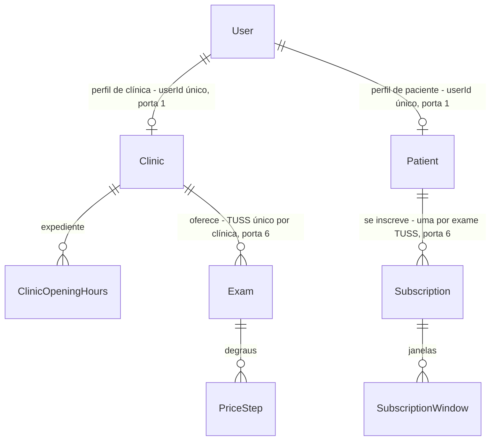

# HACK-13 · Fatia 1 · Clínica, Exame, Paciente e Inscrição

Primeira de duas PRs do HACK-13 (D2, Gustavo, 08/11/2026). A fatia 2 (Horário, Vaga, Reserva, Alerta, Transição e a trava RN-41) está em `.specs/features/hack-13-modelo-dados-fatia-2/plan.md` e sai de `origin/main` depois do merge desta.

## Problem

Depois do HACK-12, o banco só conhece contas (`User`, `Session`, `Account`, `Verification`). Quem pega o cadastro da clínica (HACK-16, Mateus), o cadastro do paciente e o seed (HACK-23 e HACK-15, Luiz) ou o preço e o matching (HACK-30 e HACK-31, Pedro) não tem onde gravar uma clínica, um exame, um paciente ou uma inscrição, e fica parado esperando o card inteiro (`docs/product/fluxo-de-trabalho.md`, alívio do caminho crítico: "primeira migration com Clínica, Exame, Paciente e Inscrição libera Mateus, Luiz e Pedro cedo").

O card não traz número de esforço nem prazo próprio; o prazo é o do hackathon.

Quando esta fatia entrar: `npm run db:migrate -w @hackathon/api` cria as tabelas de clínica, exame, paciente e inscrição; cada clínica e cada paciente ficam ligados a uma conta do HACK-12; os padrões de RN-28, RN-34 e RN-40 já vêm do banco; e o banco recusa exame com piso acima do preço cheio.

## Flow

Reaproveita o `schema.prisma`, a migration `init_auth`, o `PrismaService` global e o banco local por worktree do HACK-12, sem segundo cliente Prisma nem segundo módulo de banco.

1. dev: edita `apps/api/prisma/schema.prisma` (existente, HACK-12) com `Clinic`, `ClinicOpeningHours`, `Exam`, `PriceStep`, `Patient`, `Subscription` e `SubscriptionWindow` (novo, portas 1 a 6).
2. `npm run db:migrate -w @hackathon/api` (existente, HACK-12) gera a migration desta fatia depois de `init_auth`, criada com `--create-only` e completada à mão com os `CHECK` de `Exam` (novo, porta 5); aplica no Postgres do worktree.
3. `prisma generate` (existente, roda no `build`, `typecheck` e `test`) gera o cliente com os modelos novos em `apps/api/src/generated/prisma` (existente, ignorado pelo git).
4. código Nest: HACK-16, 23, 15, 30 e 31 injetam o `PrismaService` (existente, `@Global`) e gravam nas tabelas novas; nenhum módulo de domínio nasce neste card.
5. teste de integração (novo) usa o `PrismaService` contra o banco do worktree: cria um `User` com `role`, liga a clínica e o paciente e prova padrões, `CHECK` e unicidades.

## Impact

| Front         | What changes                                                                                                                                                                                                                                                               |
| ------------- | -------------------------------------------------------------------------------------------------------------------------------------------------------------------------------------------------------------------------------------------------------------------------- |
| domain        | termos novos, nomes em inglês no schema: `Clinic` (Clínica), `ClinicOpeningHours` (expediente), `Exam` (Exame), `PriceStep` (degrau de preço), `Patient` (Paciente), `Subscription` (Inscrição), `SubscriptionWindow` (janela de disponibilidade)                          |
| domain        | termo existente: `User.role` (`paciente` / `clinica`, HACK-12) não muda; `Clinic` e `Patient` são o perfil de domínio de um `User`, um para um                                                                                                                             |
| outros cards  | HACK-16 e HACK-23 criam a `Clinic` e o `Patient` no cadastro (o HACK-12 só cria o `User`); HACK-15 (seed) preenche `questionnaireKey`/`questionnaireVersion` a partir do catálogo do HACK-41; HACK-30 e 31 leem `Exam`, `PriceStep`, `Subscription` e `SubscriptionWindow` |
| outros cards  | fatia 2 do HACK-13: acrescenta `Slot`, `Vacancy`, `Reservation`, `Alert` e `Transition` com FKs para `Clinic`, `Exam`, `Patient` e `Subscription` desta fatia; HACK-29 continua esperando a fatia 2                                                                        |
| contratos     | `packages/contracts` não muda                                                                                                                                                                                                                                              |
| schema.prisma | dono único por vez (contrato dos maestros): a frente Fundação até a fatia 2 entrar em `main`                                                                                                                                                                               |
| stored data   | nada a migrar - as tabelas de domínio não existem; as quatro tabelas de auth não são tocadas                                                                                                                                                                               |

## Relations

One-way constraints: perfil um para um com `User` (porta 1); piso ≤ preço cheio, X e Y > 0 (porta 5); CNES único, TUSS único por clínica, inscrição única por paciente e TUSS (porta 6).

## Surface

Nenhum - nenhuma rota HTTP nova nem alterada; a fatia entrega schema e migration. As rotas que gravam nestas tabelas nascem em HACK-16, 17, 23 e 24.

## Landing

| One-way door                                        | Literal shape                                                                                                                                                                                                                                                                                                                                                                                                                                                                                                                                                            | Alternative rejected                                                                                                                                                                                                                                                                                                                                                                          |
| --------------------------------------------------- | ------------------------------------------------------------------------------------------------------------------------------------------------------------------------------------------------------------------------------------------------------------------------------------------------------------------------------------------------------------------------------------------------------------------------------------------------------------------------------------------------------------------------------------------------------------------------ | --------------------------------------------------------------------------------------------------------------------------------------------------------------------------------------------------------------------------------------------------------------------------------------------------------------------------------------------------------------------------------------------- |
| 1. Domínio ligado ao `User` do HACK-12              | `model Clinic { userId String @unique; user User @relation(fields: [userId], references: [id], onDelete: Cascade) … }` e o mesmo em `model Patient`; o papel continua em `User.role`; nenhuma coluna nova em `User`. As outras FKs de domínio com `onDelete: Restrict` (as filhas `ClinicOpeningHours`, `PriceStep` e `SubscriptionWindow` com `onDelete: Cascade` para o pai, porque não existem sem ele)                                                                                                                                                               | campos de clínica e paciente como `additionalFields` no `User` do Better Auth (mistura auth e domínio; o Better Auth passaria a validar e devolver CNES e telefone em toda sessão); tabelas de domínio apontando direto para `User` sem `Patient` (sem lugar para telefone e consentimento de RN-11); cascata em tudo (apagar uma clínica levaria exames que a fatia 2 liga a reservas pagas) |
| 2. Identificadores                                  | `id String @id @default(uuid()) @db.Uuid` em todo modelo de domínio; `userId` continua `String` (texto do Better Auth, conferido no `schema.prisma` de `main` em 0779304)                                                                                                                                                                                                                                                                                                                                                                                                | `Int @default(autoincrement())` (id sequencial na URL entrega volume e permite enumerar recursos de outro usuário, F1); `cuid()` (sem tipo nativo no Postgres)                                                                                                                                                                                                                                |
| 3. Unidades                                         | dinheiro `Int` em centavos com sufixo `Cents` no nome do campo (`fullPriceCents`, `floorPriceCents`, `maxPriceCents`); percentuais `Int` 0–100 (`depositPercent`, `discountPercent`); durações `Int` em minutos (`minLeadMinutes`, `toleranceMinutes` = X, `maxTravelMinutes` = Y, `waveWindowMinutes` = Z) e `preparationHours Int`; lat/lng `Float`; instantes `DateTime` em UTC (`timestamp(3)`, igual ao HACK-12); expediente e janelas com `weekday Int` 0–6 e `startMinute`/`endMinute Int` em hora local de America/Sao_Paulo. A fatia 2 segue as mesmas unidades | `Decimal` em reais (arredondamento entre JS e banco no cálculo de degrau e de 20% do sinal); `timestamptz` só no domínio (dois tipos de instante no mesmo schema); janela em UTC (muda com horário de verão e quebra RN-21)                                                                                                                                                                   |
| 4. Configuração da clínica e vínculo com o catálogo | `Clinic`: `dailyDiscountCap Int @default(5)` (RN-28), `depositPercent Int @default(20)` (RN-40, D1), `waveSize Int @default(5)` e `waveWindowMinutes Int @default(10)` (RN-34, D3). `Exam`: `questionnaireKey String` e `questionnaireVersion Int` (chave e versão do catálogo do HACK-41, não TUSS), `preparationCondition String`, `preparationHours Int`, `contraindications String[]` (ids de pergunta do catálogo) (D5)                                                                                                                                             | percentual do sinal em `Exam` (D1: contradiz a RN-40); onda e Z como constantes no motor (D3); só a chave do catálogo, sem preparo da clínica, ou o questionário inteiro numa tabela (D5)                                                                                                                                                                                                     |
| 5. `CHECK` de `Exam`, escritos na migration         | `CHECK ("floorPriceCents" <= "fullPriceCents")` e `CHECK ("toleranceMinutes" > 0 AND "maxTravelMinutes" > 0)` (RN-02). Migration criada com `prisma migrate dev --create-only` e completada à mão antes de aplicar                                                                                                                                                                                                                                                                                                                                                       | só validação no serviço (HACK-17 continua validando para a mensagem ao usuário; o `CHECK` é a rede para seed, script e caller esquecido)                                                                                                                                                                                                                                                      |
| 6. Unicidades de negócio                            | `Clinic.cnes @unique`; `Exam @@unique([clinicId, tussCode])`; `Subscription @@unique([patientId, tussCode])` (D4: renovar ou se reinscrever atualiza a mesma linha, RN-20)                                                                                                                                                                                                                                                                                                                                                                                               | sem unicidade (duas inscrições do mesmo exame dariam dois alertas da mesma vaga ao mesmo paciente, contra RN-36, que a fatia 2 garante por `Alert(vacancyId, subscriptionId, channel)`)                                                                                                                                                                                                       |

- Nada mais nesta fatia é difícil de reverter: nomes de campo comuns, índices não únicos, `ClinicOpeningHours`/`SubscriptionWindow`/`PriceStep` como tabelas filhas e textos livres se decidem no diff.

## Criteria

### S1: as tabelas de clínica, exame, paciente e inscrição nascem por migration (P1)

Um worktree a partir de `main` (com o HACK-12) aplica as migrations e tem as tabelas desta fatia.

**Acceptance Criteria**

1. QUANDO `npm run db:migrate -w @hackathon/api` roda contra o Postgres do worktree (`127.0.0.1:54313`, banco `hack_13`) com `init_auth` já aplicada ENTÃO o sistema DEVE aplicar uma única migration nova que cria as tabelas `Clinic`, `ClinicOpeningHours`, `Exam`, `PriceStep`, `Patient`, `Subscription` e `SubscriptionWindow`, e nenhuma das tabelas da fatia 2.
2. O sistema DEVE manter `User`, `Session`, `Account` e `Verification` sem nenhuma coluna, índice ou constraint alterada pela migration nova.
3. QUANDO `prisma migrate dev` roda de novo sem mudança no `schema.prisma` ENTÃO o sistema DEVE informar que o banco está em dia e não DEVE gerar migration nova (os `CHECK` escritos à mão sobrevivem à comparação).
4. O sistema DEVE preencher na criação de `Clinic` os padrões `dailyDiscountCap = 5` (RN-28), `depositPercent = 20` (RN-40), `waveSize = 5` e `waveWindowMinutes = 10` (RN-34) quando o insert não os informa.

**Independent test:** `docker compose up -d && npm run db:migrate -w @hackathon/api` num worktree a partir de `main`; `psql -c '\dt'` lista as 7 tabelas novas ao lado das 4 de auth e da `_prisma_migrations`; um segundo `db:migrate` responde "Already in sync".

### S2: clínica e paciente ligados a uma conta, sem duplicata e sem exame incoerente (P1)

Cada perfil de domínio pertence a exatamente um `User` do HACK-12, e as invariantes de RN-02 valem também para seed e script.

**Acceptance Criteria**

5. SE um exame tem `floorPriceCents` maior que `fullPriceCents`, ou `toleranceMinutes` ou `maxTravelMinutes` menor ou igual a 0 ENTÃO o banco DEVE recusar com erro `23514` (RN-02).
6. SE já existe uma `Clinic` para um `userId` ENTÃO o banco DEVE recusar com `P2002` uma segunda `Clinic` para o mesmo `userId`; idem `Patient`.
7. QUANDO o `User` de uma clínica sem exames ou de um paciente sem inscrições é apagado ENTÃO o sistema DEVE apagar a `Clinic` ou o `Patient` junto.
8. SE uma segunda `Clinic` usa um `cnes` já cadastrado, ou uma clínica cadastra um segundo `Exam` com o mesmo `tussCode` ENTÃO o banco DEVE recusar com `P2002`.
9. SE um paciente já tem uma `Subscription` para um `tussCode` ENTÃO o banco DEVE recusar com `P2002` uma segunda para o mesmo `tussCode`.

**Independent test:** `npm run test -w @hackathon/api` com o banco do worktree no ar; o teste cria um `User` pelo Prisma com `role`, liga a clínica e o paciente e prova 4 a 9.

## Out of scope

| Excluded                                                                             | Why                                                                         |
| ------------------------------------------------------------------------------------ | --------------------------------------------------------------------------- |
| Horário, Vaga, Reserva, Alerta, Transição, enums de estado e a trava RN-41           | fatia 2 do HACK-13 (`.specs/features/hack-13-modelo-dados-fatia-2/plan.md`) |
| Rotas, serviços e módulos Nest de domínio                                            | HACK-16, 17, 23, 24                                                         |
| Criar `Clinic`/`Patient` no cadastro e checar que o `User.role` combina com o perfil | HACK-16 e HACK-23; o banco não cruza `role` com a tabela de perfil          |
| Tokens OAuth da Google Agenda (RN-05, T12)                                           | HACK-18 adiciona as colunas ou tabela                                       |
| Persistir o conteúdo do questionário (perguntas, fontes, revisão clínica) do HACK-41 | o catálogo fica no código versionado do HACK-41; aqui só o vínculo (D5)     |
| Lista de códigos TUSS permitidos (RN-03) e chave de questionário válida              | HACK-17 valida no cadastro; o banco guarda texto                            |
| Apagar dados 30 dias depois (RN-13)                                                  | job de outro card                                                           |
| Dados de demonstração                                                                | HACK-15                                                                     |

## Assumptions

| Assumption                                                                        | Chosen default                                                                                                                                                 | Rationale                                                                                                                                | Confirmed? |
| --------------------------------------------------------------------------------- | -------------------------------------------------------------------------------------------------------------------------------------------------------------- | ---------------------------------------------------------------------------------------------------------------------------------------- | ---------- |
| Prisma preserva `CHECK` escrito à mão na migration                                | sim; criterion 3 prova que o segundo `migrate dev` não os remove                                                                                               | Prisma não descreve `CHECK` no schema e não os compara; se a versão instalada divergir, o check segue a ferramenta e o plano é corrigido | n          |
| Onde o teste roda                                                                 | `apps/api`, suíte `node:test` existente, contra o Postgres do worktree via `DATABASE_URL`, como os testes de auth do HACK-12; limpa o que gravou               | o CI do HACK-12 já sobe Postgres e aplica migrations antes dos testes                                                                    | n          |
| Portas e banco deste worktree                                                     | Postgres 54313, banco `hack_13`, API 3131, Next 3130                                                                                                           | contrato dos maestros: banco e portas por worktree                                                                                       | y          |
| Base do build                                                                     | worktree já em `origin/main` 0779304 (HACK-12 mergeado, fast-forward); antes do build, `git merge origin/main` de novo, depois `.env` e `docker compose up -d` | contrato dos maestros: sem empilhamento                                                                                                  | y          |
| Telefone e consentimento no `Patient`                                             | `phone String` e `healthDataConsentAt DateTime` obrigatórios; a linha nasce no cadastro do HACK-23 junto com o aceite                                          | F1: sem consentimento a conta não é criada; HACK-23 pode ajustar                                                                         | n          |
| Valores padrão dos degraus de preço (−10% a 48 h, −20% a 24 h, −30% a 6 h, RN-26) | não vêm do banco; quem cria o exame (HACK-17, HACK-15) grava as três linhas de `PriceStep`                                                                     | degrau é linha filha, não coluna com default                                                                                             | n          |

### Decisões

Respondidas pelo Gustavo em 08/11/2026, pelo Maestro Fundação.

**D1 - Onde mora o percentual do sinal.** Resposta: (a) `Clinic.depositPercent`, padrão 20, como diz a RN-40. Entrou na porta 4 e no criterion 4.

**D2 - Fatiar o card.** Resposta: fatiar em duas PRs. Esta é a fatia 1 (Clínica, Exame, Paciente, Inscrição e filhas); a fatia 2 sai de `origin/main` depois do merge desta.

**D3 - Tamanho da onda e Z.** Resposta: (a) colunas em `Clinic`, `waveSize` padrão 5 e `waveWindowMinutes` padrão 10. Entrou na porta 4 e no criterion 4.

**D4 - Uma inscrição por paciente e exame.** Resposta: (a) única por `(patientId, tussCode)`; renovar ou se reinscrever atualiza a mesma linha. Entrou na porta 6 e no criterion 9.

**D5 - Exame e o catálogo do HACK-41.** Resposta: (a) `Exam` guarda `questionnaireKey` e `questionnaireVersion` do catálogo, mais `preparationCondition`, `preparationHours` e `contraindications` como valores da clínica. Entrou na porta 4.

**Perguntas abertas:** nenhuma - D1 a D5 respondidas pelo Gustavo; as dúvidas técnicas (enums em português, preview `partialIndexes`) foram respondidas pelo Maestro e valem na fatia 2.

## Observable

| Surface                                        | Decision                                                 | Landing                                                                                                         |
| ---------------------------------------------- | -------------------------------------------------------- | --------------------------------------------------------------------------------------------------------------- |
| comando `npm run db:migrate -w @hackathon/api` | saída e falha no meio                                    | existente - comando do HACK-12; a migration roda numa transação do Postgres, falha não deixa tabela pela metade |
| comando `npm run db:migrate -w @hackathon/api` | flags e padrões                                          | existente - HACK-12; esta fatia só acrescenta uma migration (AC 1, AC 3)                                        |
| comando `npm run db:migrate -w @hackathon/api` | código de saída                                          | existente - código do Prisma; AC 3 cobre a segunda execução                                                     |
| schema lido por outros cards                   | nomes e padrões                                          | AC 1, AC 4                                                                                                      |
| rotas HTTP                                     | formato, erro, quem chama, versionamento, limite de taxa | não se aplica - nenhuma rota nesta fatia                                                                        |
| telas                                          | vazio, carregando, erro                                  | não se aplica - nenhuma tela nesta fatia                                                                        |

## Sources

- Card HACK-13 no Linear - https://linear.app/workspace-do-gustavo/issue/HACK-13/02-modelo-de-dados-prisma-clinica-exame-horario-vaga-inscricao-alerta - entidades, campos mínimos e "Pronto quando" (sem comentários em 08/11/2026); fatiamento e D1–D5 decididos pelo Gustavo em 08/11/2026, via Maestro Fundação
- `docs/product/marketplace-vagas-imagem.md` seções 2 e 3 - RN-01, 02, 17, 20, 26, 28, 34, 40; T1 em `.specs/features/marketplace-vagas-imagem/brainstorm.md`
- `apps/api/prisma/schema.prisma` e `apps/api/prisma/migrations/20261108025102_init_auth` em `main` (0779304, HACK-12) - `User` com `id String` e `role` sem default
- `docs/product/exam-questionnaires.md` (HACK-41, em `main`) - catálogo de preparo e o vínculo exame/questionário (D5)
