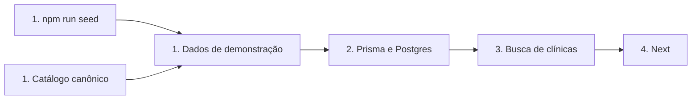
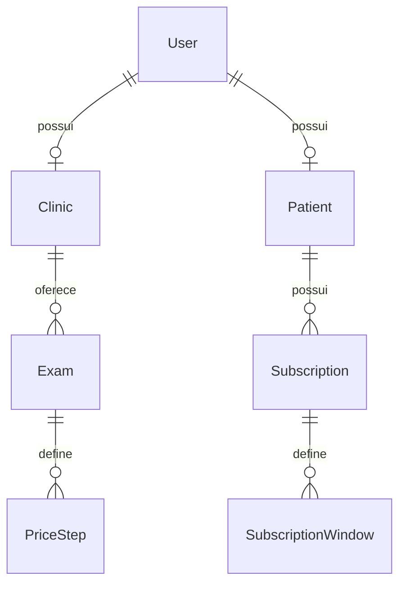

> Registro histórico do WIP 909a786. Para o escopo final e prova atual, consulte `spec.md` e `verification.md`. Busca web/API e IDs determinísticos deste registro foram retirados.

# HACK-15 — Dados de demonstração e associação HACK-41

**Approved**: 2026-11-08 - user: "Como Maestro, aprovo o plano HACK-15 e escolhas rotineiras propostas para MVP". Aprovação delegada pelo usuário ao Maestro, conforme mensagem recebida; escolhas do Maestro não são fala literal do usuário final.

## Problem

A base não tem seed executável nem busca de clínicas. A equipe não consegue reproduzir a demonstração ou provar as ondas com doze pacientes. HACK-41 possui catálogo canônico integrado, mas seus modelos ainda não estão associados aos exames persistidos.

A entrega permitirá executar o seed duas vezes e consultar dez clínicas, com preços demonstrativos, pacientes fictícios e questionários associados.

## Shape

Reutilizar Prisma, Postgres, catálogo `examQuestionnairesSeed`, contratos Zod e MatchingService existentes. Regras de persistência e busca ficam no Nest; Next apenas apresenta respostas validadas.

1. `npm run seed` entra no módulo de dados de demonstração (new), valida manifesto e importa o catálogo de exames (exists).
2. Dados de demonstração (new) grava clínicas, exames, pacientes e inscrições por Prisma (exists), numa transação com identificadores estáveis.
3. Busca de clínicas (new) lê Prisma (exists) e entrega somente dados públicos por contrato compartilhado.
4. Next (exists) apresenta a busca e seus estados de carregamento, vazio e erro.

**Changes underneath**

| Front       | What changes                                                                                                                                          |
| ----------- | ----------------------------------------------------------------------------------------------------------------------------------------------------- |
| domain      | Clínicas reais são referências geográficas; preços, disponibilidade e usuários pertencem à demonstração, sem parceria comercial presumida.            |
| stored data | Seed adiciona registros próprios; nunca apaga ou adota registros alheios por coincidência de email/CNES. Reexecução preserva identidades e histórico. |
| readers     | Busca pública mostra clínicas e exames; MatchingService consome inscrições compatíveis; futuro aceite consulta questionários.                         |

New: dados demonstrativos nas entidades existentes. One-way constraints: identidades estáveis do manifesto; campos adicionais descritos em Landing.

## Surface

| Route            | In                                   | Out                                                                                            | Status        | Who    |
| ---------------- | ------------------------------------ | ---------------------------------------------------------------------------------------------- | ------------- | ------ |
| GET /api/clinics | q opcional, texto até 120 caracteres | clinics ordenadas por nome, identificação pública e exames; sem usuários/contatos de pacientes | 200, 400, 500 | anyone |
| GET /buscar      | q opcional                           | busca de clínicas, quantidade e aviso de demonstração                                          | 200           | anyone |

Comando `npm run seed`: sem argumentos; exige DATABASE_URL e ambiente local/teste explícito. Sucesso imprime contagens, saída 0. Configuração inválida, conflito de identidade ou transação recusada produz saída diferente de zero, sem segredos e sem sucesso parcial.

## Landing

| One-way door                     | Literal shape                                                                                                                                                                     | Alternative rejected                                                            |
| -------------------------------- | --------------------------------------------------------------------------------------------------------------------------------------------------------------------------------- | ------------------------------------------------------------------------------- |
| Snapshot do questionário         | `Exam.questionnaire Json?`: snapshot integral validado do catálogo; key/version existentes devem corresponder ao snapshot. Nulo preserva exames anteriores. Seed sempre preenche. | Recriar perguntas ou preencher revisão clínica fictícia perde a fonte canônica. |
| Marcação demonstrativa de agenda | `Clinic.demoCalendarTarget Boolean @default(false)`; exatamente dois registros do manifesto true. Não representa OAuth conectado.                                                 | Tokens falsos ou contas Google inventadas apresentam integração inexistente.    |
| Identidade do seed               | UUIDs fixos por registro no manifesto; emails em domínio reservado `.invalid`; colisão com registro fora do manifesto interrompe a transação.                                     | Upsert irrestrito por email/CNES pode modificar trabalho alheio.                |

- Nothing else in this change is hard to reverse.

## Criteria

### S1: Demonstração reproduzível e visível (P1)

**Acceptance Criteria**

1. WHEN o operador executa o seed duas vezes THEN o banco SHALL conter exatamente 10 clínicas próprias e os mesmos IDs, sem duplicar exames, degraus, pacientes, inscrições ou janelas.
2. O manifesto SHALL conter endereço e coordenadas de 10 estabelecimentos reais da cidade aprovada, com URL e data de verificação por estabelecimento.
3. O seed SHALL marcar exatamente 2 clínicas para conexão futura e 8 sem agenda, sem criar tokens, sessões ou credenciais Google.
4. O seed SHALL oferecer USG por regiões cobertas, eco transtorácico em repouso, mamografia, TC de crânio/tórax e RM de joelho, sem contraste/sedação. Cada exame SHALL guardar preço cheio e piso em centavos, com piso menor ou igual ao cheio; RM de joelho terá 72000/50000.
5. Cada exame do seed SHALL guardar chave, versão, preparo, horas, IDs de contraindicações e snapshot integral do modelo canônico compatível com região/via/protocolo. `clinicalReview` SHALL permanecer igual ao catálogo, atualmente pending.
6. WHEN o seed termina THEN SHALL haver 12 pacientes explicitamente fictícios e 12 inscrições ativas para RM articular de joelho, com preço máximo 72000, raio 50000 metros e janelas diárias 0–1440 em America/Sao_Paulo.
7. WHEN uma vaga de RM de joelho para o dia seguinte às 14h locais é consultada pelo MatchingService THEN SHALL retornar os 12 pacientes demonstrativos distintos; a prova usa banco real e evita envio externo.
8. WHEN o visitante abre /buscar sem filtro THEN SHALL ver as 10 clínicas e aviso de demonstração. WHEN busca pelo nome exato de uma delas THEN SHALL ver somente a clínica correspondente.
9. IF a busca não tem correspondências THEN SHALL apresentar quantidade zero. IF o banco/API falha THEN SHALL apresentar indisponibilidade, sem substituir por dados locais.
10. IF seed encontra colisão de identidade ou falha no meio THEN SHALL sair com erro e reverter a transação, preservando registros alheios.
11. O comando SHALL recusar produção e não enviar emails, push ou WhatsApp; contas fictícias não terão login nem consentimento atribuído a pessoa real.
12. A busca SHALL funcionar com teclado em larguras 390 e 1280 pixels, sem rolagem horizontal; contrato público não SHALL expor clinicalReview ou dados de pacientes.

## Out of scope

| Excluded                                | Why                                                                |
| --------------------------------------- | ------------------------------------------------------------------ |
| OAuth e contas Google reais             | Apenas marcação futura autorizada; time ainda fornecerá contas.    |
| Aprovação médica                        | Usuário dispensou mentor para aceite; não houve aprovação clínica. |
| Reservas, pagamentos e envio de alertas | Outros cards; teste de matching não envia mensagens.               |
| Login dos pacientes fictícios           | Não inventar credenciais reais; cadastro completo é HACK-23.       |

## Assumptions

| Assumption               | Chosen default                                                                                                   | Rationale                                                                          | Confirmed? |
| ------------------------ | ---------------------------------------------------------------------------------------------------------------- | ---------------------------------------------------------------------------------- | ---------- |
| Cidade                   | São Paulo/SP                                                                                                     | Aprovado pelo Maestro sob delegação do usuário após pesquisa sem decisão anterior. | y          |
| Dois registros de agenda | SCOPP Pompéia e CURA Jardins                                                                                     | Marcação futura sem vínculo presumido; contas do time pendentes.                   | y          |
| UI                       | Reutilizar tokens, Arial e cartões existentes, lista responsiva com busca por nome; alternativa: tabela compacta | Apresentação aprovada pelo Maestro sob delegação do usuário.                       | y          |
| Preços                   | Valores fictícios plausíveis, claramente identificados; RM 720/500                                               | Card exige plausibilidade, não cotação comercial.                                  | y          |

**Open questions:** none — cidade, alvos e apresentação aprovados pelo Maestro sob delegação do usuário. Contas Google são pendência da conexão futura, não bloqueiam seed.

## Sources

- HACK-15 no Linear — binding — dez clínicas, doze pacientes, preços, idempotência e busca.
- HACK-41 e comentários de 08/11/2026 — binding — somente associação pendente, mentor dispensado; Nicolas não edita seed concorrentemente.
- `docs/product/exam-questionnaires.md` e catálogo canônico — binding — escopo e revisão clínica factual.
- Pesquisa inicial em `research.md`; seleção final em `research-verified.md` e `clinics-researched.json` — dez unidades, fontes por campo e divergências documentadas; substituições factuais equivalentes autorizadas em 08/11/2026.

## Differences from the source

None - the product matches the source. Não há captura visual vinculante; cidade e apresentação foram aprovadas por delegação.
