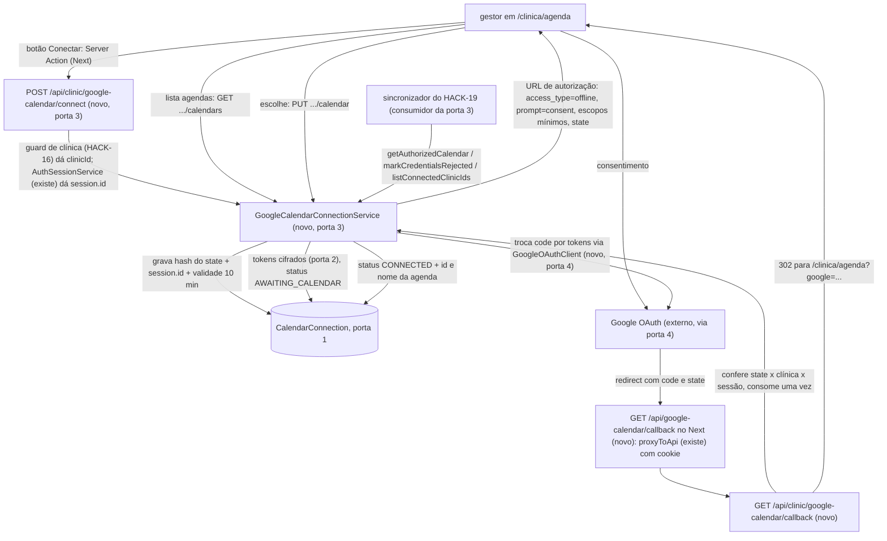
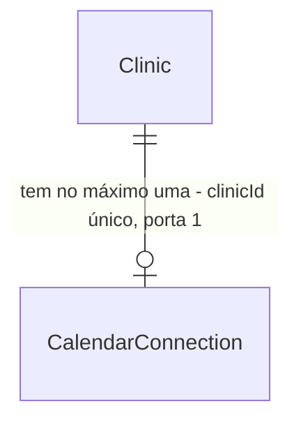

# HACK-18 · Conectar Google Agenda por OAuth

## Problem

Hoje a plataforma não tem acesso à agenda de nenhuma clínica. RN-05 diz que a agenda da clínica é a Google Agenda
conectada por OAuth, e todo o F3 (horários livres viram oferta, reserva cria evento, evento apagado vira vaga de
encaixe) depende de a plataforma conseguir ler e escrever eventos na agenda que a clínica escolheu. Sem isso, o
sincronizador (HACK-19, "o gatilho da demo") não tem de onde ler, e a clínica não tem como dizer qual das agendas
da conta Google é a dos exames. O card não traz números; o custo é que a demo do F3 não acontece.

Há também um risco que nasce junto com a solução: o refresh token do Google dá acesso permanente à agenda da
clínica. Guardado em texto puro, ou vazado num log de erro, ele entrega a agenda (com nomes de pacientes, RN-06)
a quem ler o banco ou o log.

Quando isto entrar, o gestor da clínica abre `/clinica/agenda`, clica em "Conectar Google Agenda", autoriza na conta
Google, escolhe a agenda e vê "Conectada" com o nome dela. Os tokens ficam cifrados no banco, ligados à clínica.
O módulo novo exporta uma API pequena que o HACK-19 usa para obter um cliente autenticado da clínica e para marcar a
conexão como expirada quando o Google recusar as credenciais.

## Flow

Reusa a sessão do Better Auth (`AuthSessionService`, HACK-12), o guard e a sessão de clínica do HACK-16 (id da
clínica sempre da sessão), o repasse `proxyToApi` do Next (`apps/web/core/shared/services/api-proxy.service.ts`), a
validação de ambiente de `apps/api/src/config/env.ts` (padrão "opcional, mas tudo ou nada" do `DEMO_CLOCK_*`) e a
cifra autenticada nativa `node:crypto` (AES-256-GCM). Nada de cripto própria, nada de webhook do Google (T12).

1. botão "Conectar Google Agenda" em `/clinica/agenda` -> Server Action do Next chama `POST /api/clinic/google-calendar/connect` com o cookie; `@ClinicOnly()` do HACK-16 (`apps/api/src/modules/clinics/clinic.guard.ts`) barra sem sessão e papel diferente de `clinica`, e `@CurrentClinicId()` dá o `clinicId` e o `AuthSessionService` (existe) dá `session.id`.
2. `GoogleCalendarConnectionService` (novo, módulo `apps/api/src/modules/google-calendar`) gera 32 bytes aleatórios de state, grava só o SHA-256 dele, o `session.id` e a validade de 10 min na `CalendarConnection` da clínica (porta 1; upsert, um state pendente por clínica) e devolve a URL de autorização montada pelo `GoogleOAuthClient` (porta 4). A Server Action redireciona o navegador para o Google.
3. Google devolve o navegador para `GET {WEB_ORIGIN}/api/google-calendar/callback` (route handler novo do Next, mesma origem do cookie) -> `proxyToApi` (existe) repassa `code`, `state`, `error` e o cookie para `GET /api/clinic/google-calendar/callback`.
4. o serviço consome o state numa escrita condicional (hash igual, mesma sessão, não vencido; zera o state), troca o `code` por tokens no `GoogleOAuthClient`, exige refresh token, cifra refresh e access token com AES-256-GCM (porta 2) e grava status `AWAITING_CALENDAR`. Responde 302 para `/clinica/agenda?google=<resultado>`.
5. a tela lista as agendas em que a conta é dona (`GET .../calendars`) e a clínica escolhe uma (`PUT .../calendar`); o serviço confere que o id está na lista do Google e grava id, nome e status `CONNECTED`.
6. out: `GET /api/clinic/google-calendar` alimenta o status da tela; o HACK-19 injeta o `GoogleCalendarConnectionService` exportado pelo `GoogleCalendarModule` (porta 3) e chama `getAuthorizedCalendar(clinicId)` e `markCredentialsRejected(clinicId)`.

## Impact

| Front            | What changes                                                                                                                                                                                                                                                                                                                                                           |
| ---------------- | ---------------------------------------------------------------------------------------------------------------------------------------------------------------------------------------------------------------------------------------------------------------------------------------------------------------------------------------------------------------------- |
| domain           | termo novo: `conexão de agenda` (`CalendarConnection`) - a autorização Google de uma clínica e a agenda escolhida; vive em `apps/api/src/modules/google-calendar`                                                                                                                                                                                                      |
| domain           | termo novo: status da conexão - `DISCONNECTED` (nunca conectou), `AWAITING_CALENDAR` (autorizou, falta escolher a agenda), `CONNECTED`, `EXPIRED` (o Google recusou as credenciais: expiradas ou revogadas, o Google não distingue). Quem ramifica: a tela `/clinica/agenda` e o HACK-19 (só sincroniza `CONNECTED`)                                                   |
| api              | `AppModule` importa `GoogleCalendarModule`; dependência nova `googleapis` em `apps/api/package.json` (T12), instalada com o lock pesado                                                                                                                                                                                                                                |
| api              | erros do `googleapis` (Gaxios) carregam a config da requisição, com o header `Authorization: Bearer` e o corpo da troca de tokens: nunca são logados nem repassados inteiros; o adaptador traduz para código e status                                                                                                                                                  |
| config           | variáveis novas, opcionais em grupo: `GOOGLE_OAUTH_CLIENT_ID`, `GOOGLE_OAUTH_CLIENT_SECRET`, `GOOGLE_OAUTH_REDIRECT_URI`, `GOOGLE_TOKEN_ENCRYPTION_KEY` (base64 de 32 bytes). Nenhuma preenchida: integração indisponível (503 claro). Parte preenchida ou chave inválida: o boot falha com o nome da variável, nunca o valor. Placeholders em `apps/api/.env.example` |
| contracts        | arquivo novo `google-calendar.ts` (status, lista de agendas, corpo da escolha) exportado por `index.ts`                                                                                                                                                                                                                                                                |
| web              | rota `/clinica/agenda` (página nova, layout de clínica do HACK-16), Server Action de conectar e de escolher, route handler do callback                                                                                                                                                                                                                                 |
| schema           | `apps/api/prisma/schema.prisma` ganha `CalendarConnection` e um enum; migration nova. O HACK-13 está em `main` (Done no Linear), então a trava "Fundação é dona do schema" acabou; HACK-16 e HACK-17 também podem migrar em paralelo (ver Assumptions)                                                                                                                 |
| stored data      | nada a migrar: tabela nova, sem linha para clínicas existentes (ausência = `DISCONNECTED`)                                                                                                                                                                                                                                                                             |
| deploy (HACK-14) | `GOOGLE_OAUTH_REDIRECT_URI` = `<URL pública do Next>/api/google-calendar/callback`, cadastrada no Google Cloud; segredos só no host do Nest                                                                                                                                                                                                                            |

## Relations

Restrições de uma via: `CalendarConnection.clinicId` único (porta 1), com `onDelete: Cascade` (apagar a clínica apaga os tokens dela); status como enum `CalendarConnectionStatus` com os quatro valores (porta 1); tokens só no formato cifrado da porta 2. Sem colunas nem tipos aqui.

## Surface

| Route                                       | In                                                          | Out                                                                                                                                                                   | Status                                                 |
| ------------------------------------------- | ----------------------------------------------------------- | --------------------------------------------------------------------------------------------------------------------------------------------------------------------- | ------------------------------------------------------ |
| `GET /api/clinic/google-calendar`           | cookie de sessão de clínica                                 | `status`, `calendarName?`, `connectedAt?` (nunca token)                                                                                                               | `200`, `401`, `403`, `503`                             |
| `POST /api/clinic/google-calendar/connect`  | cookie de sessão de clínica                                 | `authorizationUrl`                                                                                                                                                    | `200`, `401`, `403`, `503`                             |
| `GET /api/clinic/google-calendar/callback`  | query `code`, `state`, `error`; cookie de sessão de clínica | redirect para `{WEB_ORIGIN}/clinica/agenda?google=<resultado>`, resultado em `awaiting_calendar`, `denied`, `invalid_state`, `no_refresh_token`, `google_unavailable` | `302`, `401`, `403`, `503`                             |
| `GET /api/clinic/google-calendar/calendars` | cookie de sessão de clínica                                 | `calendars[]` com `id`, `name`, `primary` (só agendas em que a conta é dona)                                                                                          | `200`, `401`, `403`, `409`, `502`, `503`, `504`        |
| `PUT /api/clinic/google-calendar/calendar`  | `calendarId`                                                | o mesmo corpo do `GET` de status                                                                                                                                      | `200`, `401`, `403`, `409`, `422`, `502`, `503`, `504` |
| `GET /api/google-calendar/callback` (Next)  | query do Google, cookie                                     | repasse do `302` do Nest; sem sessão, redirect para `/clinica/login`                                                                                                  | `302`, `502`, `504`                                    |

API de módulo (porta 3), não HTTP: `GoogleCalendarConnectionService`, exportado por `GoogleCalendarModule`.

- `getAuthorizedCalendar(clinicId: string): Promise<{ calendar: calendar_v3.Calendar; calendarId: string }>` - cliente autenticado com timeout; lança `CalendarNotConnectedError` quando o status não é `CONNECTED`.
- `markCredentialsRejected(clinicId: string): Promise<void>` - status `EXPIRED`, tokens apagados, idempotente.
- `listConnectedClinicIds(): Promise<string[]>` - clínicas com status `CONNECTED`.
- `isCredentialsRejectedError(error: unknown): boolean` - função pura exportada pelo módulo; `true` para `invalid_grant` e `401` do Google.

Corpo de erro do Nest no formato já usado (`{ code, message }`): `GOOGLE_CALENDAR_UNAVAILABLE` (503), `403` do `@ClinicOnly()` do HACK-16 (papel e `CLINIC_PROFILE_MISSING`), `CALENDAR_NOT_AUTHORIZED` (409), `CALENDAR_NOT_AVAILABLE` (422), `VALIDATION_FAILED` (422, `{ code, message, fields }` do `ZodBodyPipe` do HACK-16), `GOOGLE_UNAVAILABLE` (502), `GOOGLE_TIMEOUT` (504).

## Landing

| One-way door                    | Literal shape                                                                                                                                                                                                                                                                                                     | Alternative rejected                                                                                                                                                                                                                                                                                   |
| ------------------------------- | ----------------------------------------------------------------------------------------------------------------------------------------------------------------------------------------------------------------------------------------------------------------------------------------------------------------- | ------------------------------------------------------------------------------------------------------------------------------------------------------------------------------------------------------------------------------------------------------------------------------------------------------ |
| 1. Tabela da conexão            | `model CalendarConnection { clinicId String @unique @db.Uuid ... status CalendarConnectionStatus @default(DISCONNECTED) }` e `enum CalendarConnectionStatus { DISCONNECTED AWAITING_CALENDAR CONNECTED EXPIRED }`; state pendente na mesma linha (`oauthStateHash`, `oauthStateSessionId`, `oauthStateExpiresAt`) | colunas em `Clinic`: misturam segredo cifrado com o perfil público (RN-01) e todo `select` de clínica passaria a carregar token. Tabela `Account` do Better Auth: guarda token em texto puro e é de login, não de integração. Tabela própria de states: um state por clínica basta e a linha já existe |
| 2. Formato do token cifrado     | texto `v1.<iv base64url 12 bytes>.<tag base64url 16 bytes>.<cifra base64url>`, AES-256-GCM de `node:crypto`, AAD = `clinicId`, chave de `GOOGLE_TOKEN_ENCRYPTION_KEY` (32 bytes)                                                                                                                                  | AES-CBC + HMAC à mão: cripto montada por nós. `pgcrypto`: a chave iria na query e no log do Postgres. Sem AAD: um token copiado para a linha de outra clínica decifraria                                                                                                                               |
| 3. API exportada para o HACK-19 | as quatro assinaturas da linha de módulo em `## Surface`, nomes literais                                                                                                                                                                                                                                          | expor o `PrismaService` da tabela ou o refresh token decifrado: o HACK-19 teria de repetir cifra, refresh e classificação de erro, e o token sairia do módulo dono                                                                                                                                     |
| 4. Seam do Google para teste    | `GoogleOAuthClient` (classe `@Injectable()`, único lugar que importa `googleapis`): `buildAuthUrl(state)`, `exchangeCode(code)`, `listOwnedCalendars(credentials)`, `calendarFor(credentials, onTokens)`; testes trocam o provider por um falso                                                                   | mock de `fetch` ou de rede: amarra o teste ao formato HTTP interno do `googleapis`. Interface + árvore de adapters: um fornecedor só (design-patterns.md)                                                                                                                                              |
| 5. Dependência                  | `googleapis` (versão atual estável no `npm install`, lock commitado)                                                                                                                                                                                                                                              | `@googleapis/calendar` + `google-auth-library`: menor, mas T12 fixa `googleapis`; trocar é decisão de stack que sobe ao geral                                                                                                                                                                          |
| 6. Escopos OAuth                | `https://www.googleapis.com/auth/calendar.events.owned` e `https://www.googleapis.com/auth/calendar.calendarlist.readonly`, `access_type=offline`, `prompt=consent`, `include_granted_scopes=false`                                                                                                               | `calendar` (acesso total, inclusive apagar agendas). `calendar.events` (eventos de agendas só compartilhadas com a conta, além das próprias). Mudar o escopo depois obriga todas as clínicas a reautorizar                                                                                             |
| 7. URL de callback              | `GOOGLE_OAUTH_REDIRECT_URI` = `{WEB_ORIGIN}/api/google-calendar/callback`, servida pelo Next                                                                                                                                                                                                                      | callback direto no Nest: o cookie de sessão mora no domínio do Next (HACK-12), então o Nest não saberia qual clínica autorizou e o state não ficaria ligado à sessão                                                                                                                                   |

- Nada mais nesta mudança é difícil de reverter.

## Criteria

### S1: configuração e indisponibilidade claras (P1)

A integração sobe só com configuração completa e válida; sem ela, diz que está indisponível.

**Acceptance Criteria**

1. SE uma das quatro variáveis `GOOGLE_*` estiver preenchida e outra vazia, ou `GOOGLE_TOKEN_ENCRYPTION_KEY` não decodificar para exatamente 32 bytes, ENTÃO o sistema DEVE recusar o boot com `EnvValidationError` citando só os nomes das variáveis, sem o valor.
2. ENQUANTO nenhuma das quatro variáveis `GOOGLE_*` estiver preenchida o sistema DEVE responder `503` com `code` `GOOGLE_CALENDAR_UNAVAILABLE` em todas as rotas `/api/clinic/google-calendar*`, e o boot DEVE seguir normal para o resto da API.
3. ENQUANTO a integração estiver indisponível a tela `/clinica/agenda` DEVE mostrar "Integração com a Google Agenda indisponível neste ambiente" e não DEVE mostrar o botão "Conectar Google Agenda".

**Independent test:** subir a API de teste sem as variáveis e com metade delas.

### S2: autorizar com state ligado à sessão (P1)

A clínica autoriza no Google e a volta só é aceita para a mesma clínica e a mesma sessão.

**Acceptance Criteria**

4. QUANDO uma clínica logada chamar `POST /api/clinic/google-calendar/connect` ENTÃO o sistema DEVE responder `200` com `authorizationUrl` contendo `access_type=offline`, `prompt=consent`, os dois escopos da porta 6 e um `state` de 43 caracteres base64url, e DEVE gravar só o SHA-256 do state, o `session.id` e a validade de 10 minutos.
5. SE a sessão for de paciente ENTÃO o sistema DEVE responder `403` em todas as rotas `/api/clinic/google-calendar*`; SE não houver sessão ENTÃO DEVE responder `401`.
6. QUANDO o callback chegar com `state` válido, da mesma clínica e da mesma sessão, dentro de 10 minutos, e o Google devolver refresh token ENTÃO o sistema DEVE gravar refresh e access token cifrados no formato da porta 2, status `AWAITING_CALENDAR`, zerar o state e responder `302` para `/clinica/agenda?google=awaiting_calendar`.
7. SE o callback chegar com `state` desconhecido, vencido, já consumido ou gravado por outra sessão ENTÃO o sistema DEVE responder `302` para `/clinica/agenda?google=invalid_state`, não DEVE chamar a troca de `code` no Google e não DEVE alterar tokens nem status.
8. SE o callback chegar com a sessão da Clínica B e o `state` gerado pela Clínica A ENTÃO o sistema DEVE responder `302` com `google=invalid_state` e as conexões das duas clínicas DEVEM ficar como estavam.
9. SE dois callbacks com o mesmo `state` válido chegarem ao mesmo tempo ENTÃO o sistema DEVE trocar o `code` no Google uma vez só, e o outro DEVE receber `google=invalid_state`.
10. SE o Google devolver `error=access_denied` no callback ENTÃO o sistema DEVE responder `302` com `google=denied`, zerar o state e manter o status anterior.
11. SE a troca do `code` não trouxer refresh token ENTÃO o sistema DEVE responder `302` com `google=no_refresh_token` e não DEVE gravar nenhum token.
12. SE a troca do `code` falhar por erro ou timeout de 10 segundos no Google ENTÃO o sistema DEVE responder `302` com `google=google_unavailable` e não DEVE gravar nenhum token.

**Independent test:** teste HTTP com `GoogleOAuthClient` falso: conectar, chamar o callback com o state devolvido, conferir a linha no banco.

### S3: escolher a agenda e ver o status (P1)

A clínica escolhe uma agenda própria e vê "Conectada" com o nome dela.

**Acceptance Criteria**

13. QUANDO a clínica com status `AWAITING_CALENDAR` ou `CONNECTED` chamar `GET /api/clinic/google-calendar/calendars` ENTÃO o sistema DEVE responder `200` só com as agendas em que a conta Google tem `accessRole` `owner`, com `id`, `name` e `primary`.
14. SE a clínica com status `DISCONNECTED` ou `EXPIRED` chamar `GET .../calendars` ou `PUT .../calendar` ENTÃO o sistema DEVE responder `409` com `code` `CALENDAR_NOT_AUTHORIZED`.
15. QUANDO a clínica chamar `PUT /api/clinic/google-calendar/calendar` com um `calendarId` da lista de agendas próprias ENTÃO o sistema DEVE gravar o id e o nome, status `CONNECTED`, e responder `200` com `status` `connected` e `calendarName`.
16. SE o `calendarId` não estiver na lista de agendas próprias da conta ENTÃO o sistema DEVE responder `422` com `code` `CALENDAR_NOT_AVAILABLE`; SE o corpo não passar no schema do contrato ENTÃO DEVE responder `422` com `code` `VALIDATION_FAILED` e `fields` (`ZodBodyPipe` do HACK-16); nos dois casos não DEVE alterar a conexão.
17. SE o Google recusar as credenciais (`invalid_grant` ou `401`) ao listar agendas ENTÃO o sistema DEVE marcar a conexão como `EXPIRED`, apagar os tokens e responder `409` com `code` `CALENDAR_NOT_AUTHORIZED`.
18. SE o Google falhar de outro modo ao listar agendas ENTÃO o sistema DEVE responder `502` com `code` `GOOGLE_UNAVAILABLE`, ou `504` com `code` `GOOGLE_TIMEOUT` após 10 segundos, sem alterar a conexão.
19. QUANDO a tela `/clinica/agenda` carregar com status `connected` ENTÃO ela DEVE mostrar "Conectada" e o nome da agenda.
20. QUANDO a tela carregar com status `disconnected` ENTÃO ela DEVE mostrar "Desconectada" e o botão "Conectar Google Agenda".
21. QUANDO a tela carregar com status `expired` ENTÃO ela DEVE mostrar "Agenda desconectada: a autorização expirou ou foi revogada. Reautorize." e o botão "Conectar Google Agenda".
22. QUANDO a tela carregar com status `awaiting_calendar` ENTÃO ela DEVE listar as agendas próprias para escolha com o botão "Usar esta agenda"; com a lista vazia DEVE mostrar "Nenhuma agenda própria encontrada nesta conta Google".
23. SE a API não responder ou responder fora do contrato ao carregar `/clinica/agenda` ENTÃO a tela DEVE mostrar "Não foi possível carregar o status da agenda. Tente de novo." e nenhum status.
24. QUANDO a tela abrir com `?google=<resultado>` de erro (`denied`, `invalid_state`, `no_refresh_token`, `google_unavailable`) ENTÃO ela DEVE mostrar uma mensagem específica para cada um, em `role="alert"`.

**Independent test:** tela com API falsa em cada status; fluxo completo com `GoogleOAuthClient` falso.

### S4: tokens nunca saem do módulo (P1)

O token só existe decifrado dentro do serviço, no momento de montar o cliente.

**Acceptance Criteria**

25. O sistema DEVE responder em toda rota `/api/clinic/google-calendar*` e no `302` do callback sem nenhum refresh token, access token, `code` nem state em corpo ou `Location`.
26. O sistema DEVE gravar refresh e access token só no formato `v1.` da porta 2; o texto puro não DEVE aparecer em nenhuma coluna.
27. SE um token cifrado for decifrado com o `clinicId` de outra clínica como AAD, ou com o texto adulterado, ENTÃO o sistema DEVE lançar erro e não DEVE devolver texto.
28. O sistema DEVE registrar falhas do Google só com o `code` traduzido e o status HTTP; nenhum log DEVE conter token, `code`, state, header `Authorization` nem o objeto de erro do `googleapis`.

**Independent test:** teste que lê as colunas cru do banco e captura o logger durante as falhas.

### S5: API para o sincronizador (P1)

O HACK-19 obtém o cliente e marca a conexão como expirada sem tocar em token.

**Acceptance Criteria**

29. QUANDO `getAuthorizedCalendar(clinicId)` for chamado para uma clínica `CONNECTED` ENTÃO o sistema DEVE devolver o `calendar_v3.Calendar` autenticado com os tokens decifrados, timeout de 10 segundos, e o `calendarId` escolhido.
30. SE `getAuthorizedCalendar(clinicId)` for chamado para uma clínica sem conexão `CONNECTED` ENTÃO o sistema DEVE lançar `CalendarNotConnectedError` sem chamar o Google.
31. QUANDO o cliente devolvido renovar o access token ENTÃO o sistema DEVE gravar o novo access token cifrado e a nova validade.
32. QUANDO `markCredentialsRejected(clinicId)` for chamado ENTÃO o sistema DEVE gravar status `EXPIRED`, apagar os dois tokens e manter o nome da agenda; uma segunda chamada DEVE deixar o mesmo estado.
33. QUANDO a conta Google revogar o acesso e o próximo uso do cliente receber `invalid_grant` ENTÃO `isCredentialsRejectedError(error)` DEVE devolver `true`, e depois de `markCredentialsRejected` o `GET /api/clinic/google-calendar` DEVE responder `status` `expired`.
34. QUANDO `listConnectedClinicIds()` for chamado ENTÃO o sistema DEVE devolver só os ids das clínicas com status `CONNECTED`.

**Independent test:** teste de serviço com `GoogleOAuthClient` falso que simula renovação e `invalid_grant`.

## Out of scope

| Excluded                                                                                               | Why                                                                                                  |
| ------------------------------------------------------------------------------------------------------ | ---------------------------------------------------------------------------------------------------- |
| Ler a agenda a cada minuto, criar e reconhecer eventos, aviso de "desconectada" vindo do sincronizador | HACK-19; aqui só a API que ele consome                                                               |
| Botão "Desconectar" e revogação ativa no Google                                                        | o card não pede; reconectar sobrescreve a conexão. Fica para card próprio se a clínica precisar sair |
| Rotação da chave de cifra                                                                              | o prefixo `v1.` deixa a porta aberta; nenhum card pede rotação                                       |
| Webhook (push) do Google                                                                               | T12: polling                                                                                         |
| Mais de uma agenda por clínica                                                                         | RN-05 fala na agenda da clínica; uma só                                                              |
| Expediente da clínica                                                                                  | HACK-16 (cadastro)                                                                                   |

## Assumptions

Plano aprovado pelo Gustavo em 08/11/2026. Decisões dele: credenciais OAuth providenciadas pelo time, código testado só com cliente Google falso, sem `GOOGLE_*` responde `503` e a tela mostra «indisponível» (S1); revogado e expirado são um status só, `EXPIRED`, com a cópia «a autorização expirou ou foi revogada. Reautorize.».

Decisões técnicas do Maestro Agenda (08/11/2026, na aprovação dos checks): nas rotas `/api/clinic/google-calendar*`, `401`/`403` vêm antes do `503`; corpo fora do schema no `PUT .../calendar` responde `422` `VALIDATION_FAILED` pelo `ZodBodyPipe` do HACK-16 (revoga a orientação anterior de `400` `INVALID_BODY`), e `calendarId` fora da lista de agendas próprias responde `422` `CALENDAR_NOT_AVAILABLE` (AC 16 ajustado); a prova do timeout (C39) aponta o `googleapis` para servidor local, conferido na versão instalada, e volta ao Maestro se não houver forma documentada.

| Assumption                           | Chosen default                                                                                                                                                                                                                                                                                                                                                                                                                                                                                                 | Rationale                                                                                                | Confirmed? |
| ------------------------------------ | -------------------------------------------------------------------------------------------------------------------------------------------------------------------------------------------------------------------------------------------------------------------------------------------------------------------------------------------------------------------------------------------------------------------------------------------------------------------------------------------------------------- | -------------------------------------------------------------------------------------------------------- | ---------- |
| Guard e sessão de clínica do HACK-16 | consumir o `@ClinicOnly()` e o `@CurrentClinicId()` exportados pelo `ClinicsModule` do HACK-16 (`apps/api/src/modules/clinics/clinic.guard.ts`): sem sessão `401`, papel diferente de `clinica` `403`, conta de clínica sem perfil `403` `CLINIC_PROFILE_MISSING`; `@CurrentClinicId()` dá o `id` da `Clinic` da sessão; o `session.id` vem do `AuthSessionService` (existe). Corpo validado pelo `ZodBodyPipe` (`apps/api/src/common/pipes/zod-body.pipe.ts`). A construção só começa com o HACK-16 em `main` | conferido pelo Maestro no HEAD `36f0d2e` do HACK-16 (ainda não em `main`)                                | y          |
| Layout e login de clínica            | `/clinica/agenda` usa o layout desktop de `/clinica/*` do HACK-16; sem sessão de clínica, redireciona para `/clinica/login`                                                                                                                                                                                                                                                                                                                                                                                    | rotas do HACK-16 (card: `/clinica/cadastro`, `/clinica/login`)                                           | n          |
| Revogado x expirado                  | um status só, `EXPIRED`, com a cópia "a autorização expirou ou foi revogada"; o card fala em "desconectada" ao revogar e o F3 em "agenda desconectada, reautorize", e a cópia cobre os dois                                                                                                                                                                                                                                                                                                                    | o Google devolve o mesmo `invalid_grant` ("Token has been expired or revoked") nos dois casos            |            | y   |
| Dono do `schema.prisma`              | o HACK-18 cria a própria migration; se HACK-16 ou HACK-17 mergearem migration antes, o Construtor faz `git merge origin/main` e regenera a migration por cima (nunca edita migration já mergeada)                                                                                                                                                                                                                                                                                                              | HACK-13 Done; não há dono único declarado depois disso; o conflito entre frentes sobe ao maestro         | n          |
| Relógio do state                     | validade do state pelo relógio real (`Date.now()`), não pelo `ClockService` da demo                                                                                                                                                                                                                                                                                                                                                                                                                            | OAuth é contra o Google, que usa tempo real; adiantar o relógio da demo não deve invalidar a autorização | n          |
| Timeout do `googleapis`              | 10 s por chamada pela opção `timeout` do cliente (gaxios); o Construtor confirma o nome da opção na versão instalada antes de escrever o teste                                                                                                                                                                                                                                                                                                                                                                 | regra de engenharia: chamada externa com timeout; não conferido na versão ainda não instalada            | n          |
| Reconectar com conexão ativa         | `POST .../connect` com status `CONNECTED` é permitido; os tokens antigos ficam até o callback dar certo, aí são substituídos e o status volta a `AWAITING_CALENDAR`                                                                                                                                                                                                                                                                                                                                            | reautorizar depois de `EXPIRED` é o caminho principal; trocar de conta Google também                     | n          |
| Agenda escolhida que some            | se a agenda escolhida for apagada no Google, quem descobre é o HACK-19 (erro 404 na leitura)                                                                                                                                                                                                                                                                                                                                                                                                                   | este card só lê a lista na hora de escolher                                                              | n          |

**Open questions:**

| #   | Kind           | Question                                                                                                                                                                                                                                                                                                                                        | Until answered                                                                                                                                                                                                 |
| --- | -------------- | ----------------------------------------------------------------------------------------------------------------------------------------------------------------------------------------------------------------------------------------------------------------------------------------------------------------------------------------------- | -------------------------------------------------------------------------------------------------------------------------------------------------------------------------------------------------------------- |
| 1   | blocks go-live | O time já tem projeto no Google Cloud com tela de consentimento OAuth, client id/secret e redirect cadastrado (`http://127.0.0.1:3000/api/google-calendar/callback` em dev e a URL pública do HACK-14)? Os escopos de agenda são sensíveis: em modo "Testing" só contas cadastradas como test user autorizam, e o refresh token vence em 7 dias | respondida pelo Gustavo (08/11): o time providencia as credenciais; o código é testado só com `GoogleOAuthClient` falso e, sem `GOOGLE_*`, responde `503` / tela «indisponível». Segue bloqueando só o go-live |
| 2   | open           | O guard de clínica do HACK-16 terá o nome e a forma assumidos acima?                                                                                                                                                                                                                                                                            | respondida pelo Maestro (08/11): `@ClinicOnly()` + `@CurrentClinicId()` e `ZodBodyPipe`, HEAD `36f0d2e` do HACK-16                                                                                             |

## Observable

| Surface                            | Decision                      | Landing                                                                                                                                                      |
| ---------------------------------- | ----------------------------- | ------------------------------------------------------------------------------------------------------------------------------------------------------------ |
| tela `/clinica/agenda`             | estado vazio (nunca conectou) | AC 20                                                                                                                                                        |
| tela `/clinica/agenda`             | lista de agendas vazia        | AC 22                                                                                                                                                        |
| tela `/clinica/agenda`             | carregando                    | não se aplica - Server Component carrega antes de renderizar; o `loading.tsx` do segmento mostra "Carregando agenda…" pelo padrão do Next, sem regra própria |
| tela `/clinica/agenda`             | erro                          | AC 23, AC 24                                                                                                                                                 |
| tela `/clinica/agenda`             | não autorizado                | Assumptions (redirect para `/clinica/login`, HACK-16)                                                                                                        |
| tela `/clinica/agenda`             | indisponível por configuração | AC 3                                                                                                                                                         |
| tela `/clinica/agenda`             | ação destrutiva confirma      | não se aplica - não há ação destrutiva; reconectar não apaga a conexão até o callback dar certo                                                              |
| tela `/clinica/agenda`             | densidade e ordem             | agendas na ordem do Google com a primária primeiro, em lista de rádio com label                                                                              |
| API `/api/clinic/google-calendar*` | formato e códigos de erro     | AC 2, AC 5, AC 14, AC 16, AC 17, AC 18                                                                                                                       |
| API `/api/clinic/google-calendar*` | quem pode chamar              | AC 5, AC 8                                                                                                                                                   |
| API `GET .../callback`             | erro vira redirect, não JSON  | AC 7, AC 10, AC 11, AC 12                                                                                                                                    |
| todas as rotas novas               | versionamento                 | não se aplica - consumidas só pelo Next do mesmo repo                                                                                                        |
| todas as rotas novas               | limite de taxa                | não se aplica - exigem sessão de clínica e o Google já limita o fluxo de consentimento; o `ThrottlerGuard` do HACK-12 é só do cadastro                       |
| API de módulo para o HACK-19       | assinatura e erro             | AC 29 a AC 34                                                                                                                                                |

## Sources

- Card HACK-18 no Linear: https://linear.app/workspace-do-gustavo/issue/HACK-18/13-conectar-google-agenda-por-oauth - entrega, critérios, dependência do 0.3 (URL pública).
- `docs/product/marketplace-vagas-imagem.md` - RN-05, RN-09 e F3 "Conectar a agenda" e "Token expirado".
- `.specs/features/marketplace-vagas-imagem/brainstorm.md` seção "Stack e decisões técnicas" - T12 (`googleapis`, OAuth no Nest, tokens no banco, polling) e T2 (Better Auth, cookie no Next).
- Escopos: https://developers.google.com/workspace/calendar/api/auth - `calendar.events.owned` e `calendar.calendarlist.readonly`.
