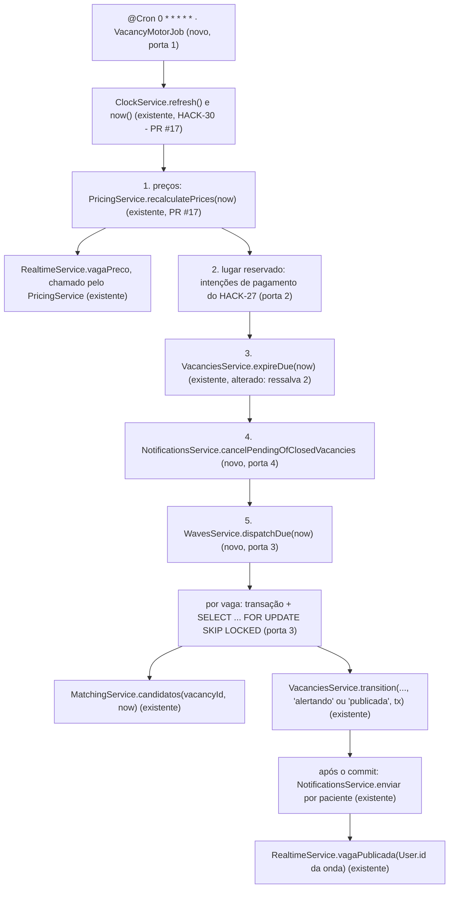

# HACK-32 · 3.4 Cron a cada minuto: ondas de alerta e expiração de vagas

Worktree `.worktrees/HACK-32`, branch `gvieira26gomes/hack-32-34-cron-a-cada-minuto-ondas-de-alerta`, base `origin/main` em `ab0c571`. Bloqueadores em `main`: HACK-29 (`9681fb6`), HACK-30/31/34 (`18069e5`), HACK-43/44/45 (`ab0c571`). Plano aprovado pelo Gustavo em 08/11/2026 (D1 = b, D2 = a, ordem das etapas = a). **O build espera a PR #17 do HACK-30/31/34 (Pedro, `79855cc`) em `main`** (pergunta 1, `blocks`): ela traz o relógio da demo (`ClockService`), o `PricingService` e o `enviar(patientId, …)`; o card os consome, não os cria.

## Problem

Uma vaga publicada em `main` hoje fica parada. Nada chama `MatchingService.candidatos` nem `NotificationsService.enviar`, então nenhum paciente inscrito recebe alerta (RN-34). Nada chama `VacanciesService.expireDue`, então uma vaga cujo horário passou continua `publicada` ou `alertando` e aparece na busca (RN-25). O `currentPriceCents` da vaga é o preço da publicação para sempre, porque nada aplica `currentPriceCents()` de `price-engine.ts` com o passar do tempo (RN-26, RN-27). O único job registrado é o `ExampleJob` (`apps/api/src/examples/example.job.ts:11`), que só escreve uma linha de log.

Quem paga: o paciente da lista de encaixe, que não fica sabendo da vaga; a clínica, cujo horário ocioso não é preenchido. É o centro da demo (F9). O card está no caminho crítico (`docs/product/fluxo-de-trabalho.md:69`: 0.1 → 0.2 → 3.1 → 1.4 e 3.4 → 2.5) e bloqueia o HACK-33 (no-show).

A revisão do HACK-29 deixou três ressalvas para este card (comentário do Gustavo no HACK-32, 08/11/2026):

1. Dois ticks podem disparar a mesma onda duas vezes. A transição `alertando → alertando` (T3) tem o mesmo estado de origem nos dois ticks, então o update condicional do 29 (`vacancies.service.ts:128`) não os distingue.
2. Um erro que não é 409 numa vaga interrompe o lote do `expireDue` inteiro (`vacancies.service.ts:92`, `if (!(error instanceof ConflictException)) throw error;`).
3. A expiração e o `occurredAt` usam `new Date()` (`vacancies.service.ts:52`, `:66`, `:73`, `:155`). O relógio do HACK-30 não existe em `main`; está na PR #17 como `ClockService` (`apps/api/src/modules/clock/clock.service.ts:21`, `now()` em `:31`, `refresh()` em `:40`, `advance(minutes)` em `:53`, `reset()` em `:68`), com o deslocamento persistido em `DemoClock` (`schema.prisma:408` da #17). D1 = (b): o Pedro cria o relógio no 3.2 e este card só o consome.

Quando isto entrar, a cada minuto: o preço das vagas abertas cai pelos degraus e o socket avisa; a vaga vencida expira; e cada vaga com candidatos recebe uma onda de N pacientes, depois a seguinte a cada Z minutos. Quando a fila acaba, a vaga volta a `publicada` e espera o horário.

## Flow

Reaproveita sem duplicar: `VacanciesService.transition` e `expireDue` (HACK-29) para toda mudança de estado; `PricingService.recalculatePrices` (HACK-30, PR #17) para o preço; `MatchingService.candidatos` (HACK-31/44) para a fila; `NotificationsService.enviar` (HACK-34/45) para o envio e a gravação de `Alert`; `haversineMeters` (HACK-31) para a distância de cada paciente; `RealtimeService.vagaPreco` e `vagaPublicada` (HACK-38) para o socket; `Clinic.waveSize` e `Clinic.waveWindowMinutes` (HACK-13, D3 dele) para N e Z. Nenhum segundo cálculo de preço, matching ou envio.

1. O `@Cron('0 * * * * *', { name: 'vacancy-motor' })` do `VacancyMotorJob` (novo, porta 1, em `apps/api/src/modules/vacancies/`) chama `await ClockService.refresh()` (existente, PR #17, `clock.service.ts:40`) para reler o deslocamento gravado por outra instância ou pelo endpoint, lê `now` uma vez de `ClockService.now()` (`:31`) e chama `tick(now)`. O `refresh` fica no handler do cron, não no `tick`: o `tick` recebe `now` pronto, e o comentário do serviço pede o `refresh` «no começo de cada ciclo» (`clock.service.ts:14-15`). `tick` é público para os testes passarem `now` sem esperar o minuto. Se o tick anterior do mesmo processo ainda roda, o novo é pulado com `warn`.
2. O `tick` roda as etapas da lista ordenada (porta 2), cada uma num `try/catch` próprio. Uma etapa que lança registra o nome e a causa, e as seguintes rodam.
3. Etapa `prices`: `PricingService.recalculatePrices(now)` (existente, PR #17, `pricing.service.ts:65-91`), dono do preço no tempo. Ele lê as vagas `publicada`/`alertando` com `Slot.startsAt > now`, calcula com `currentPriceCents` (`price-engine.ts`), grava só se baixar (`updateMany` condicional a `currentPriceCents > novo`, `:78-85`) e chama `RealtimeService.vagaPreco` por vaga alterada (`:88`). O motor não recalcula preço.
4. Lugar reservado para o HACK-27 na lista, entre `prices` e `expire`. Este card não põe nada ali.
5. Etapa `expire`: `VacanciesService.expireDue(now)` (existente, `vacancies.service.ts:73`), com a ressalva 2 aplicada: uma vaga com erro que não é 409 é registrada em `warn` e o lote segue.
6. Etapa `cancel-pending` (RN-36): `NotificationsService.cancelPendingOfClosedVacancies()` (novo, porta 4) passa a `cancelado` todo `Alert` `pendente` de vaga em `reservada`, `expirada` ou `cancelada`.
7. Etapa `waves`: `WavesService.dispatchDue(now)` (novo, porta 3) lista as vagas `publicada`/`alertando` com `Slot.startsAt > now`. Para cada uma, isolada num `try/catch`, abre `prisma.$transaction` e trava a linha com `SELECT id FROM "Vacancy" WHERE id = $1 FOR UPDATE SKIP LOCKED`. Sem linha (outro tick ou o pagamento do HACK-27 está nela), pula a vaga neste minuto. Com a trava:
   - relê o estado e o `occurredAt` da última `Transition` com `toState = 'alertando'`;
   - em `alertando` com `now < último + Z`, não faz nada (onda em curso);
   - senão chama `candidatos(vacancyId, now)` (existente, `matching.service.ts:63`) e guarda a lista inteira, em ordem; quantos dela recebem a onda se decide no envio (passo 8), até N (N = `Clinic.waveSize`);
   - com pelo menos um, grava a marca da onda: `transition(id, 'alertando', { origin: 'motor', reason: 'Onda <k>' }, tx, now)`, que é T2 vindo de `publicada` e T3 vindo de `alertando`. O `now` do tick vira o `occurredAt` da onda: com o `clock.now()` do momento da gravação, a onda ficaria segundos depois do tick, e o tick de Z minutos depois a acharia ainda dentro da janela (Z viraria Z + 1 minuto);
   - com zero em `alertando`, grava `transition(id, 'publicada', { origin: 'motor', reason: 'Inscrições compatíveis esgotadas' }, tx, now)` (T4);
   - com zero em `publicada`, não faz nada.

   A transação faz commit antes de qualquer envio.

8. Depois do commit, a onda percorre a lista em ordem, em lotes (`Promise.allSettled` por lote, um paciente não derruba os outros): o primeiro lote são os N primeiros; cada lote seguinte tem o tamanho do que falta para N. Para cada paciente, `NotificationsService.enviar(patientId, mensagem, { vacancyId, subscriptionId, wave: k })` (existente, assinatura da PR #17, `notifications.service.ts:56`). Só conta para N o paciente com pelo menos um `ChannelOutcome` diferente de `sem_canal` (`enviado`, `falhou` ou `duplicado`); o que só tem `sem_canal`, ou cujo `enviar` rejeitou, não conta e a onda passa ao próximo, até N contados ou a lista acabar (HACK-48, ver Assumptions). O motor não grava `Alert` (o dono é o `NotificationsService`) nem guarda estado em memória. Os canais e o contato saem do próprio serviço (`recipientFor`, `:77`: `Patient.alertChannels`, WhatsApp só com telefone verificado), e o texto é montado uma vez por `renderAlert` (`render-alert.ts` da #17). A mensagem é montada uma vez por vaga: `clinicName`, `examName`, `startsAt`, `priceCents = currentPriceCents`, `preparation` e `vacancyUrl`. Só a `distanceMeters` muda por paciente, calculada com `haversineMeters(subscription, clinic)`.
9. Ao fim da onda: `RealtimeService.vagaPublicada({ vagaId }, userIds)` (existente, `realtime.service.ts:36`) com `Patient.userId` dos pacientes que contaram para a onda (lembrete do HACK-38: `User.id`, nunca `Patient.id`). Uma falha do socket é registrada e não desfaz nada.
10. out: estado e `Transition` no banco, `Alert` por canal (gravado pelo `NotificationsService`), eventos de socket e linhas de log. Nenhuma rota HTTP.

## Impact

| Front                                | What changes                                                                                                                                                                                                                                                                                                                                                                                                                                                                                                                                                      |
| ------------------------------------ | ----------------------------------------------------------------------------------------------------------------------------------------------------------------------------------------------------------------------------------------------------------------------------------------------------------------------------------------------------------------------------------------------------------------------------------------------------------------------------------------------------------------------------------------------------------------- |
| domain                               | termo novo: **onda** em código = uma `Transition` da vaga com `toState = 'alertando'`, gravada pelo motor; o horário da onda é o `occurredAt` dela; o número `k` = `max(Alert.wave da vaga) + 1` (1 na primeira)                                                                                                                                                                                                                                                                                                                                                  |
| domain                               | termo novo: **etapa do motor** = item nomeado da lista ordenada do `tick` (porta 2); o HACK-27 acrescenta a dele                                                                                                                                                                                                                                                                                                                                                                                                                                                  |
| `vacancies.service.ts` (HACK-29)     | `expireDue` deixa de relançar erro que não é 409 (ressalva 2); o construtor recebe o `ClockService` do HACK-30 (PR #17; `ClockModule` é `@Global`, `clock.module.ts:7`, então não há import novo) e `publish`/`transition`/`expireDue`/`nextOccurredAt` usam `clock.now()` em vez de `new Date()` (D1 = b); `transition` ganha o parâmetro opcional `now` depois de `tx` (padrão `clock.now()`, como o `expireDue`), para a onda gravar o instante do tick; os testes do 29 obtêm o serviço por `app.get` (`vacancies.service.test.ts:67`), então a DI não quebra |
| `notifications.service.ts` (HACK-34) | método novo `cancelPendingOfClosedVacancies()`; `enviar` não muda                                                                                                                                                                                                                                                                                                                                                                                                                                                                                                 |
| `VacanciesModule`                    | passa a importar `NotificationsModule` (o `RealtimeModule` e o `PricingService` já entram pela PR #17, `vacancies.module.ts:13-15`) e a declarar `WavesService` e `VacancyMotorJob`; sem ciclo (`NotificationsModule` e `RealtimeModule` não importam `VacanciesModule`; o `matching.service.ts` da #17 importa só a constante `STALE_PENDING_MS` do arquivo do `NotificationsService`)                                                                                                                                                                           |
| `ExamplesModule` (HACK-12)           | sai: `example.job.ts`, `examples.module.ts` e `examples.test.ts` (C34 do HACK-12) são removidos, como o próprio comentário do job pede (`example.job.ts:6`); o teste de registro do cron passa para o job real (AC 19)                                                                                                                                                                                                                                                                                                                                            |
| HACK-27                              | pluga a etapa de intenções no lugar reservado (porta 2) e chama `cancelPendingOfClosedVacancies` ou um equivalente por vaga na transação da reserva, se quiser o cancelamento no mesmo instante (fora do card)                                                                                                                                                                                                                                                                                                                                                    |
| HACK-33                              | T11 (`reservada → alertando`, origem `motor`) também conta como «última onda» para o Z; o 33 decide se quer onda imediata depois do T11                                                                                                                                                                                                                                                                                                                                                                                                                           |
| contratos                            | `packages/contracts` não muda: usa `vagaPrecoEventSchema` e `vagaPublicadaEventSchema` como estão                                                                                                                                                                                                                                                                                                                                                                                                                                                                 |
| schema.prisma                        | não muda; nenhuma migration                                                                                                                                                                                                                                                                                                                                                                                                                                                                                                                                       |
| stored data                          | nada a migrar; vagas abertas que já existam no banco local entram no primeiro tick                                                                                                                                                                                                                                                                                                                                                                                                                                                                                |

## Relations

Nenhum - nenhuma mudança na forma do dado. O card lê `Vacancy`, `Slot`, `Exam`, `PriceStep`, `Clinic` (`waveSize`, `waveWindowMinutes`), `Subscription`, `Patient` (`userId`), `Alert` e `Transition` como o HACK-13 os criou, e escreve `Vacancy.state` (só pelo `VacanciesService`), `Vacancy.currentPriceCents`, `Transition` (pelo `VacanciesService`) e `Alert.result` (pelo `NotificationsService`).

## Surface

Nenhum - nenhuma rota HTTP nova nem alterada. A superfície é uma tarefa agendada (ver Observable) e a API TypeScript das portas 2 a 4. O endpoint protegido que move o relógio é do HACK-30.

## Landing

| One-way door                                            | Literal shape                                                                                                                                                                                                                                                                                                                                                                | Alternative rejected                                                                                                                                                                                                                                                                                                                                                                                                                                                                                    |
| ------------------------------------------------------- | ---------------------------------------------------------------------------------------------------------------------------------------------------------------------------------------------------------------------------------------------------------------------------------------------------------------------------------------------------------------------------- | ------------------------------------------------------------------------------------------------------------------------------------------------------------------------------------------------------------------------------------------------------------------------------------------------------------------------------------------------------------------------------------------------------------------------------------------------------------------------------------------------------- |
| 1. Um job só para o motor                               | `@Injectable() export class VacancyMotorJob` em `apps/api/src/modules/vacancies/vacancy-motor.job.ts`, `@Cron('0 * * * * *', { name: 'vacancy-motor' })` chamando `tick(now: Date): Promise<void>`; guarda `running` em memória contra sobreposição no mesmo processo                                                                                                        | um `@Cron` por etapa: preço, ondas e expiração rodariam em ordem livre, e a ordem é requisito do card; fila (`bull`): o T3 da stack diz «sem fila»                                                                                                                                                                                                                                                                                                                                                      |
| 2. Ponto de extensão ordenado                           | `type MotorStep = { name: string; run(now: Date): Promise<void> }`; dentro do job, `const steps: MotorStep[] = [prices, /* HACK-27: payment-intents */, expire, cancelPending, waves]`, executadas em sequência, cada uma num `try/catch` que registra `etapa <name> falhou: <mensagem>`                                                                                     | token de multi-provider (`MOTOR_STEPS`) com ordem por prioridade: abstração sem segundo consumidor hoje, e o HACK-27 editaria o módulo de qualquer jeito; hook por evento (`EventEmitter`): perde a ordem garantida                                                                                                                                                                                                                                                                                     |
| 3. Uma onda por vez por vaga                            | dentro de `prisma.$transaction`: `tx.$queryRaw\`SELECT id FROM "Vacancy" WHERE id = ${id}::uuid FOR UPDATE SKIP LOCKED\``; zero linhas → pula a vaga neste tick; com a trava, decide pela última `Transition` `toState = 'alertando'`e grava a marca da onda com`VacanciesService.transition(..., tx)` antes do commit; o envio acontece depois do commit                    | `pg_try_advisory_xact_lock(hashtext(id))`: não serializa contra o `SELECT ... FOR UPDATE` da reserva que o HACK-27 descreve, e o hash pode colidir; só o update condicional do 29: `alertando → alertando` tem o mesmo `from` nos dois ticks, é a própria ressalva 1; `FOR UPDATE` sem `SKIP LOCKED`: espera o tick concorrente e pode estourar o timeout de 5 s da transação interativa do Prisma; enviar dentro da transação: segura a trava da vaga durante até 5 s por canal (`CHANNEL_TIMEOUT_MS`) |
| 4. Cancelamento de pendentes (RN-36) com dono único     | `NotificationsService.cancelPendingOfClosedVacancies(): Promise<number>` = `prisma.alert.updateMany({ where: { result: 'pendente', vacancy: { state: { in: ['reservada', 'expirada', 'cancelada'] } } }, data: { result: 'cancelado' } })`                                                                                                                                   | o motor fazer o `updateMany` direto: segunda escrita de `Alert` fora do serviço dono; cancelar só na reserva (HACK-27): o card 32 pede «vaga reservada → alertas pendentes cancelados», e a expiração também fecha a vaga                                                                                                                                                                                                                                                                               |
| 5. Liga/desliga do motor por ambiente (achada no build) | `VACANCY_MOTOR_ENABLED` em `OPTIONAL_ENV` de `config/env.ts`, `z.enum(['true', 'false']).default('true')` como o `DEMO_CLOCK_ENABLED`; o `@Cron` continua registrado e o handler retorna sem fazer nada quando `false`; o script `test` de `apps/api/package.json` roda com `VACANCY_MOTOR_ENABLED=false`, e os testes do motor montam o `VacancyMotorJob` com a flag ligada | parar o cron por `SchedulerRegistry` em cada arquivo de teste: todo arquivo que sobe a app (mais de dez) teria de lembrar, e o que esquecer roda o motor real contra o banco compartilhado no meio dos testes do HACK-29 e do preço (expira as vagas de era passada deles); registrar o cron só com a flag: o C31 exige o cron registrado na app montada                                                                                                                                                |

- Nada mais nesta mudança é difícil de reverter: divisão em `WavesService`/método privado para preço, textos de log e `reason` se decidem no diff.

## Criteria

N e Z vêm de `Clinic.waveSize` e `Clinic.waveWindowMinutes` (padrões 5 e 10 no schema). Nos critérios, «em t0+10» significa `tick(now)` com `now` = t0 + 10 min. Nos testes, os adapters de canal são substituídos por adapters de teste em `CHANNEL_ADAPTERS`: nenhum envio real.

### S1: a vaga recebe ondas de N candidatos a cada Z minutos, sem repetir (P1)

O critério do card: 12 candidatos, N = 5 → 5, 5, 2, depois nada.

**Acceptance Criteria**

1. QUANDO o `tick(t0)` roda e uma vaga `publicada` tem candidatos ENTÃO o sistema DEVE chamar `enviar` para os N primeiros de `candidatos(vacancyId, t0)`, na ordem devolvida, e gravar uma `Transition` `publicada → alertando` com `origin = 'motor'`.
2. QUANDO a vaga tem 12 candidatos, N = 5 e Z = 10 e o `tick` roda em t0, t0+10, t0+20, t0+30 e t0+40 ENTÃO o sistema DEVE alertar as inscrições 1–5 em t0, 6–10 em t0+10, 11–12 em t0+20, e nenhuma em t0+30 e t0+40, com `Alert.wave` = 1, 2 e 3 nas três ondas.
3. ENQUANTO a vaga está em `alertando` e passaram menos de Z minutos desde a última `Transition` com `toState = 'alertando'`, o sistema DEVE não alertar ninguém nem gravar `Transition` nela (ex.: `tick` em t0+9 depois da onda de t0).
4. QUANDO uma onda é disparada sobre uma vaga já em `alertando` ENTÃO o sistema DEVE gravar uma `Transition` `alertando → alertando` com `origin = 'motor'` (T3).
5. QUANDO o `tick` de t0+30 encontra a vaga em `alertando` com Z vencido e zero candidatos ENTÃO o sistema DEVE gravar `alertando → publicada` com `origin = 'motor'` (T4), e no `tick` de t0+40 DEVE não gravar `Transition` nova.
6. QUANDO o `tick(t0)` roda duas vezes seguidas ENTÃO o sistema DEVE ter, para a vaga, exatamente uma `Transition` de onda e exatamente 5 inscrições distintas com `Alert`, sem `Alert` duplicado por (vaga, inscrição, canal).
7. QUANDO duas chamadas de `tick(t0)` rodam ao mesmo tempo (`Promise.all`) sobre a mesma vaga ENTÃO o sistema DEVE gravar exatamente uma `Transition` de onda e alertar exatamente 5 inscrições distintas.
8. SE a vaga está em `reservada`, `realizada`, `expirada` ou `cancelada` ENTÃO o sistema DEVE não chamar `candidatos` nem `enviar` para ela.

**Independent test:** semear uma clínica com N = 5 e Z = 10, uma vaga `publicada` a 3 dias e 12 inscrições compatíveis; chamar `tick` em t0, t0+9, t0+10, t0+20, t0+30 e t0+40 com um adapter de teste que conta as chamadas; conferir as contagens, `Alert.wave` e a `timeline()` da vaga.

### S2: falha de um envio ou de uma vaga não derruba o resto (P1)

**Acceptance Criteria**

9. SE o envio para um paciente da onda lança erro ENTÃO o sistema DEVE chamar `enviar` para os demais pacientes da mesma onda e manter a `Transition` da onda.
10. SE o processamento de ondas de uma vaga lança erro (ex.: `candidatos` falha) ENTÃO o sistema DEVE disparar no mesmo `tick` a onda das outras vagas e registrar uma linha `warn`/`error` com o `vacancyId`, sem nome, e-mail, telefone ou texto da mensagem.
11. SE uma etapa do `tick` lança erro ENTÃO o sistema DEVE rodar as etapas seguintes no mesmo `tick` e registrar uma linha com o nome da etapa.
12. SE a expiração de uma vaga lança erro que não é `ConflictException` ENTÃO `expireDue` DEVE expirar as demais vagas vencidas, não lançar, registrar `warn` com o `vacancyId` e devolver só a quantidade expirada (ressalva 2).

**Independent test:** adapter de teste que lança para uma inscrição; `MatchingService` com `candidatos` que lança para uma vaga entre duas; `VacanciesService` com falha forçada numa vaga do lote do `expireDue`.

### S3: a vaga vencida expira no tick, antes de qualquer onda (P1)

**Acceptance Criteria**

13. QUANDO o `tick(now)` roda com `now ≥ Slot.startsAt` de uma vaga `publicada` ou `alertando` ENTÃO o sistema DEVE passá-la a `expirada` no mesmo `tick` e DEVE não alertar ninguém sobre ela.

**Independent test:** vaga `alertando` com horário em t0+5 e candidatos restantes; `tick(t0+10)` → `expirada`, nenhum `Alert` novo.

### S4: o preço cai pelos degraus e o socket avisa (P1)

**Acceptance Criteria**

14. QUANDO o `tick(now)` roda e o preço calculado de uma vaga aberta é menor que o `currentPriceCents` gravado ENTÃO o sistema DEVE gravar o novo valor e chamar `RealtimeService.vagaPreco` com `precoCentavos` igual a ele (ex.: cheio 72000, piso 50000, degraus −10%/2880 min, −20%/1440 min, −30%/360 min, faltam 30 h → 64800).
15. SE o preço calculado é maior ou igual ao gravado ENTÃO o sistema DEVE manter o `currentPriceCents` e não emitir `vagaPreco` (RN-27, o preço nunca sobe).
16. QUANDO a onda é disparada no mesmo `tick` em que o preço caiu ENTÃO a mensagem da onda DEVE levar `priceCents` igual ao preço novo.

**Independent test:** vaga com `currentPriceCents = 72000` a 30 h; `tick` → 64800 no banco e um `vagaPreco` capturado; segundo `tick` no mesmo instante → nenhum evento.

### S5: o tempo da demo move preço, ondas e expiração juntos (P1, depende do ClockService do HACK-30, PR #17)

D1 = (b): consome o `ClockService` da PR #17 depois do merge em `main`. O tempo avança por `ClockService.advance(minutes)`, só para frente; `reset()` volta ao relógio real.

**Acceptance Criteria**

17. O sistema DEVE tirar o «agora» do `tick`, do `occurredAt` de `publish` e `transition` e do padrão de `expireDue` de `ClockService.now()`, e o cron DEVE chamar `ClockService.refresh()` antes de ler o `now`; com o relógio avançado 25 h por `ClockService.advance`, o próximo `tick` DEVE expirar a vaga cujo horário ficou para trás e baixar o preço das outras.
18. QUANDO o relógio é avançado em 10 min depois da onda 1 ENTÃO o próximo `tick` DEVE disparar a onda 2, e o `occurredAt` da `Transition` dela DEVE ser 10 min ou mais depois do da onda 1.

**Independent test:** `clock.advance(25 * 60)` + `job.tick(clock.now())`, com `clock.reset()` no `finally` (padrão de `pricing.service.test.ts:181-196` da #17).

### S6: o tempo real chega a quem foi alertado (P2)

**Acceptance Criteria**

19. QUANDO uma onda é disparada ENTÃO o sistema DEVE chamar `RealtimeService.vagaPublicada({ vagaId })` uma vez, com a lista de `Patient.userId` (ids de `User`) dos pacientes da onda, e nunca com `Patient.id`.
20. SE `vagaPublicada` lança erro ENTÃO o sistema DEVE manter a `Transition` da onda e os `Alert` gravados e registrar a falha.

**Independent test:** `RealtimeService` substituído por espião no módulo de teste; conferir os ids recebidos contra `User.id` dos pacientes semeados.

### S7: alertas pendentes de vaga fechada são cancelados (P2)

**Acceptance Criteria**

21. QUANDO o `tick` roda e uma vaga em `reservada`, `expirada` ou `cancelada` tem `Alert` com `result = 'pendente'` ENTÃO o sistema DEVE passá-los a `cancelado` e DEVE manter `enviado` e `falhou` como estão.
22. ENQUANTO a vaga está em `publicada` ou `alertando`, o sistema DEVE não alterar os `Alert` `pendente` dela.

**Independent test:** semear `Alert` `pendente`/`enviado` em uma vaga `reservada` e uma `alertando`; `tick` → só o pendente da reservada vira `cancelado`.

### S8: o job está registrado e não se sobrepõe (P2)

**Acceptance Criteria**

23. O sistema DEVE registrar no `SchedulerRegistry` o cron `vacancy-motor` com expressão `0 * * * * *`, e DEVE não registrar mais o `example-heartbeat`.
24. SE o cron dispara enquanto o `tick` anterior do mesmo processo ainda roda ENTÃO o sistema DEVE pular o disparo e registrar uma linha `warn`.

**Independent test:** `app.get(SchedulerRegistry).getCronJob('vacancy-motor')`; `tick` lento com um adapter que espera, mais um disparo do handler do cron.

## Out of scope

| Excluded                                                                     | Why                                                                                                                                   |
| ---------------------------------------------------------------------------- | ------------------------------------------------------------------------------------------------------------------------------------- |
| Expirar intenções de pagamento (RN-42, F10 «Sinal não confirmado»)           | o card manda deixar só o lugar na lista (porta 2); a intenção nasce no HACK-27 (2.5)                                                  |
| Segurar a próxima onda enquanto há intenção de pagamento aberta              | depende do modelo da intenção (HACK-27); hoje «ninguém pagou» = vaga não está `reservada`                                             |
| Cancelar pendentes na própria transação da reserva                           | HACK-27 chama o dono (porta 4) se quiser cancelamento no mesmo instante; aqui o `tick` varre a cada minuto                            |
| Endpoint protegido que move o relógio e a tela da demo                       | HACK-30 (critério «avançar 25 h pelo endpoint») e card 6.1 (tela); depende de quem pode chamar, que é decisão de auth                 |
| Preferência de canal do paciente e telefone verificado                       | entregue pela PR #17 dentro do `NotificationsService` (`recipientFor`, `notifications.service.ts:77`); o motor passa só o `patientId` |
| Adapters reais de push, e-mail e WhatsApp                                    | cards 4.2–4.4; em `main` `CHANNEL_ADAPTERS = []` (`notifications.module.ts:11`); a esteira nunca envia de verdade                     |
| Ordem por tempo de chegada e onda imediata do no-show (RN-31, RN-33)         | HACK-33 (3.5)                                                                                                                         |
| Evento de socket de vaga expirada                                            | não existe no contrato do HACK-38 (`packages/contracts/src/realtime.ts:7`); criar evento é mudança de contrato fora do card           |
| Degraus padrão (−10/−20/−30%) quando o exame não tem `PriceStep`             | quem cria o exame grava os degraus (F2); aqui vale o que está em `Exam.priceSteps`                                                    |
| Edição de N e Z pela clínica                                                 | tela da clínica; aqui só se leem `Clinic.waveSize` e `waveWindowMinutes`                                                              |
| Relógio no `em` dos eventos de socket e no `sentAt`/reivindicação de `Alert` | medem tempo real do processo (a PR #16 argumenta o mesmo para o pendente abandonado); ficam com `new Date()`                          |

## Assumptions

| Assumption                                              | Chosen default                                                                                                                                                                                                                                                                                                                                                                                                                                                                                                                                                                                                                                                                                                                                          | Rationale                                                                                                                                                                                                                                                                                                                                                                                                               | Confirmed? |
| ------------------------------------------------------- | ------------------------------------------------------------------------------------------------------------------------------------------------------------------------------------------------------------------------------------------------------------------------------------------------------------------------------------------------------------------------------------------------------------------------------------------------------------------------------------------------------------------------------------------------------------------------------------------------------------------------------------------------------------------------------------------------------------------------------------------------------- | ----------------------------------------------------------------------------------------------------------------------------------------------------------------------------------------------------------------------------------------------------------------------------------------------------------------------------------------------------------------------------------------------------------------------- | ---------- |
| Assinatura de `candidatos`                              | `candidatos(vacancyId: string, now: Date)` devolve `Subscription & { windows }` em ordem de `createdAt`, sem quem já tem `Alert` da vaga (`matching.service.ts:63-85`, `main`)                                                                                                                                                                                                                                                                                                                                                                                                                                                                                                                                                                          | contrato de `main`; o cron só consome                                                                                                                                                                                                                                                                                                                                                                                   | y          |
| PR #16 (Pedro, HACK-45, em `main` desde `bd3ed1e`)      | não muda assinatura nem tipo de retorno; muda o filtro: inscrição com `Alert` `pendente` há mais de `STALE_PENDING_MS` (10 s, relógio real) volta para a fila. Se entrar: o abandonado entra na próxima onda e ocupa uma das N vagas dela, o `NotificationsService` reivindica e reenvia. O 32 não muda código; o AC 6 continua valendo porque o tick repetido roda dentro de 10 s. O `pendente` passado a `cancelado` pela porta 4 sai da fila, porque `cancelado` ≠ `pendente`                                                                                                                                                                                                                                                                        | `gh pr diff 16` em 08/11/2026                                                                                                                                                                                                                                                                                                                                                                                           | n          |
| Canais por paciente                                     | decididos pelo `NotificationsService` da PR #17 (`recipientFor`, `notifications.service.ts:77-98`: `Patient.alertChannels`, padrão `[push, email]`, WhatsApp só com `phoneVerifiedAt`); canal ativado sem como enviar (sem adapter ou WhatsApp sem telefone verificado) devolve `sem_canal` e o próprio serviço grava `Alert` `sem_canal` (HACK-48, PR #22); paciente sem canal ativo nenhum fica fora de `candidatos`                                                                                                                                                                                                                                                                                                                                  | o `enviar` da #17 recebe só `patientId` (`:56`); o motor não escolhe canal                                                                                                                                                                                                                                                                                                                                              | y          |
| Paciente só com `sem_canal` (HACK-48, PR #22 `21c8b39`) | quando todos os `ChannelOutcome` de `enviar` são `sem_canal`, ninguém recebeu mensagem: o `NotificationsService` grava `Alert` `sem_canal` (o paciente sai da fila daquela vaga), mas a onda não o conta para N e passa ao próximo na mesma onda, sem esperar Z. Sem nenhum adapter, a lista se esgota numa onda só e, passado Z, a vaga segue o T4 (`alertando → publicada`)                                                                                                                                                                                                                                                                                                                                                                           | decisão do Maestro Motor em 08/11/2026, ajustada ao HACK-48 em 08/11; o motor não grava `Alert` (só lê `max(wave)`) nem guarda estado em memória                                                                                                                                                                                                                                                                        | y          |
| Processo cai entre o commit da onda e o envio           | a onda fica marcada e os pacientes dela não recebem; como não têm `Alert`, entram na onda seguinte, Z minutos depois                                                                                                                                                                                                                                                                                                                                                                                                                                                                                                                                                                                                                                    | preferimos atraso a alerta duplicado (RN-36); o caso pendente-abandonado já é do HACK-45                                                                                                                                                                                                                                                                                                                                | n          |
| Ordem das etapas                                        | preço → [intenções do 27] → expiração → cancelar pendentes → ondas; o card lista «preço, ondas, expira»                                                                                                                                                                                                                                                                                                                                                                                                                                                                                                                                                                                                                                                 | expirar antes das ondas evita alertar sobre horário passado e gravar um T4 inútil antes do T8; o HACK-27 pede a etapa dele antes das ondas, e ela fica. Aprovada pelo Gustavo em 08/11/2026                                                                                                                                                                                                                             | y          |
| Wave number `k`                                         | `max(Alert.wave)` da vaga + 1, lido na transação travada                                                                                                                                                                                                                                                                                                                                                                                                                                                                                                                                                                                                                                                                                                | `Alert.wave` existe para isso (`schema.prisma`, «Número da onda, a partir de 1»); a contagem de transições misturaria o T11 do no-show                                                                                                                                                                                                                                                                                  | n          |
| `vacancyUrl`                                            | `${WEB_ORIGIN}/vagas/<vacancyId>`                                                                                                                                                                                                                                                                                                                                                                                                                                                                                                                                                                                                                                                                                                                       | a rota do alerta é do card 2.4 (Luiz) e ainda não existe; o link só precisa ser estável                                                                                                                                                                                                                                                                                                                                 | n          |
| `preparation` na mensagem                               | `Exam.preparationCondition`, ou `null` quando vazio                                                                                                                                                                                                                                                                                                                                                                                                                                                                                                                                                                                                                                                                                                     | `NotificationMessage.preparation: string \| null` (`notification.types.ts:11`)                                                                                                                                                                                                                                                                                                                                          | n          |
| Vaga `publicada` depois de esgotar (T4)                 | uma inscrição compatível criada depois recebe onda no tick seguinte; um alerta por paciente por vaga (RN-36)                                                                                                                                                                                                                                                                                                                                                                                                                                                                                                                                                                                                                                            | D2 = (a), decidida pelo Gustavo em 08/11/2026                                                                                                                                                                                                                                                                                                                                                                           | y          |
| Relógio da demo                                         | `ClockService` do HACK-30 (PR #17, `apps/api/src/modules/clock/clock.service.ts`), global (`clock.module.ts:7`), injetado no `VacanciesService` e no `VacancyMotorJob`: `now(): Date` (`:31`), `refresh()` (`:40`), `advance(minutes)` só para frente (`:53`), `reset()` (`:68`); deslocamento em `DemoClock`, lido no boot (`onModuleInit`, `:26`). O card troca `new Date()` por `clock.now()` em `publish` (`vacancies.service.ts:52`), `transition` (`:66`), `expireDue` (`:73`) e `nextOccurredAt` (`:155`, passa a receber `now`, preservando o +1 ms da D6 do 29 mesmo se o relógio recuar por `reset()`), e o handler do `@Cron` chama `refresh()` antes de `now()`. O endpoint (`ClockController`, atrás de `DEMO_CLOCK_ENABLED`) é do HACK-30 | D1 = (b), decidida pelo Gustavo em 08/11/2026; interface conferida no diff da PR #17 (`79855cc`)                                                                                                                                                                                                                                                                                                                        | y          |
| Testes da API em série                                  | o script `test` de `apps/api/package.json` ganha `--test-concurrency=1`, num commit próprio (`test(api): HACK-32 roda arquivos de teste em série por causa do DemoClock compartilhado`); os testes que mexem no relógio mantêm `clock.reset()` antes e no `finally`; medido em 08/11/2026 sobre 172 testes: `duration_ms` 12,7 s em paralelo → 33,9 s em série (2,66x; 16 s → 38 s com o `tsc`); acima do teto de 2x, o Maestro Motor aceitou o custo (34 s absolutos) em vez de separar os arquivos em duas fases, porque a lista no script viraria manutenção                                                                                                                                                                                         | o `DemoClock` é linha única (`schema.prisma:408` da #17) e o `ClockService` lê o deslocamento no boot (`clock.service.ts:26`): com arquivos em paralelo, um arquivo que sobe a app enquanto outro está com o relógio adiantado herda o deslocamento, e `reset` no `finally` não resolve corrida entre arquivos; protege também `pricing.service.test.ts:181-196` da #17. Decisão técnica do Maestro Motor em 08/11/2026 | y          |
| Porta e banco do worktree                               | Postgres 54329 (container do HACK-29), banco `hack_32`, API 3321, Next 3320 (`.env` locais, fora do git)                                                                                                                                                                                                                                                                                                                                                                                                                                                                                                                                                                                                                                                | contrato dos maestros: banco e portas por worktree                                                                                                                                                                                                                                                                                                                                                                      | y          |
| `node_modules`                                          | copiado de `.worktrees/HACK-29`, que tem o mesmo `package-lock.json` de `origin/main`; o do checkout principal estava velho (sem `@nestjs/schedule`, `@prisma/client`, `socket.io`)                                                                                                                                                                                                                                                                                                                                                                                                                                                                                                                                                                     | o contrato manda copiar do checkout principal; aquele não servia                                                                                                                                                                                                                                                                                                                                                        | y          |

### Decisões

Todas decididas pelo Gustavo em 08/11/2026 (via Maestro Motor e maestro-geral). As alternativas ficam registradas com o trade-off.

**D1 - Relógio da demo (ressalva 3).** **Decidida: (b).**

- (a) Criar aqui um `ClockService` mínimo (`now`, `advance`, offset em memória) e trocar o `new Date()` do `VacanciesService`. Trade-off: módulo novo neste card, sobreposto ao que o 3.2 deveria entregar.
- (b) **Esperar o relógio do HACK-30 (Pedro) em `main` (escolhida); entregue como `ClockService` na PR #17.** O card injeta o relógio no `VacanciesService` e no cron e consome a interface do 3.2. Trade-off: o build deste card fica bloqueado até o relógio entrar em `main` (pergunta 1).
- (c) `now` injetável só no cron. Trade-off: `occurredAt` no relógio real, e Z e linha do tempo desalinham com o relógio adiantado.

**D2 - Inscrição nova numa vaga que voltou a `publicada` por esgotamento (T4).** **Decidida: (a).**

- (a) **Uma inscrição compatível que chega depois recebe alerta no tick seguinte, um alerta por paciente por vaga (escolhida).** Trade-off: a vaga pode alternar `publicada → alertando → publicada` mais de uma vez.
- (b) Depois do T4 a vaga não alerta mais ninguém. Trade-off: quem se inscreve tarde não é avisado.

**D3 - Ordem das etapas do job.** **Decidida: (a).**

- (a) **Expirar antes das ondas: preço → [intenções do 27] → expiração → cancelar pendentes → ondas (escolhida).** Nenhuma onda alerta sobre horário passado.
- (b) A ordem literal do card (preço → ondas → expiração). Trade-off: uma vaga vencida ainda passa pela etapa de ondas e pode gravar um T4 antes do T8.

**Perguntas abertas:**

| #   | Kind     | Question                                                                                                            | Until answered                                                                                                                  |
| --- | -------- | ------------------------------------------------------------------------------------------------------------------- | ------------------------------------------------------------------------------------------------------------------------------- |
| 1   | blocks   | A PR #17 (HACK-30/31/34, `79855cc`, com o `ClockService`) já entrou em `main`? A interface já é conhecida pelo diff | S5 (ACs 17, 18), a troca do `new Date()` no `VacanciesService`, a etapa `prices` e o `enviar(patientId, …)`; o build não começa |
| 2   | resolved | PR #16 entra antes do build do 32?                                                                                  | entrou em `main` (`bd3ed1e`); o `git merge origin/main` do build a traz                                                         |

### Fora do card

- `RealtimeService` usa `new Date()` no `em` dos eventos (`realtime.service.ts:81`). Com o relógio da demo adiantado, `em` é tempo real. Não afeta regra, só registro.
- HACK-48 (Pedro, PR #22 `21c8b39`, em `main` e incorporado por merge em 08/11): o dono grava `Alert` `sem_canal` para todo canal ativado e `candidatos` exclui paciente com `alertChannels` vazio. A fila não trava mais, e o filtro do passo 8 deixou de ser contorno: é a regra definitiva de N, porque sem ele um paciente `sem_canal` ocuparia uma das N vagas da onda sem ter recebido nada.
- HACK-46 (bug aberto na PR #17): qualquer clínica adianta o relógio global da demo. O 32 só lê o relógio (`refresh()` e `now()`), não muda o endpoint nem a autorização dele.
- O HACK-30 foi reaberto para o Pedro e o relógio e o endpoint do critério «avançar 25 h» estão na PR #17 (aberta).
- O `.env` e o `node_modules` do checkout principal estão em `ad7ff67` (antes do HACK-12). Quem copia `node_modules` dali recebe dependências faltando.

## Observable

| Surface                                          | Decision                            | Landing                                                                                                                           |
| ------------------------------------------------ | ----------------------------------- | --------------------------------------------------------------------------------------------------------------------------------- |
| tarefa agendada `vacancy-motor`                  | formato e verbosidade da saída      | linha de log por falha (AC 10, 11, 12, 24); sucesso sem log por vaga, para não poluir a cada minuto                               |
| tarefa agendada `vacancy-motor`                  | flags e padrões                     | não se aplica - sem flags; N e Z vêm da clínica (`Clinic.waveSize`, `waveWindowMinutes`) e o cron é fixo em `0 * * * * *` (AC 23) |
| tarefa agendada `vacancy-motor`                  | códigos de saída                    | não se aplica - job dentro do processo da API, não processo próprio                                                               |
| tarefa agendada `vacancy-motor`                  | o que registra quando falha no meio | AC 10, AC 11, AC 12                                                                                                               |
| tarefa agendada `vacancy-motor`                  | execução sobreposta                 | AC 7 (dois ticks concorrentes), AC 24 (mesmo processo)                                                                            |
| log da aplicação                                 | dado pessoal                        | AC 10 - só `vacancyId` e nome da etapa; o `NotificationsService` já não registra contato (`notifications.service.ts:163`)         |
| evento de socket `vaga.preco` / `vaga.publicada` | forma do payload                    | existente - schemas do HACK-38 em `packages/contracts/src/realtime.ts` validam antes de emitir                                    |

## Sources

- Card HACK-32: https://linear.app/workspace-do-gustavo/issue/HACK-32/34-cron-a-cada-minuto-ondas-de-alerta-e-expiracao-de-vagas - entrega, critérios (12/N=5 → 5, 5, 2; job duas vezes sem repetir), RN-34, 36, 42, 25
- Comentário do Gustavo no HACK-32 (08/11/2026) - ressalvas 1 a 3 do HACK-29 e o lembrete do HACK-38 (`User.id`)
- `docs/product/marketplace-vagas-imagem.md` - RN-24, 25, 26, 27, 34, 35, 36, 42; F9 «Primeira onda», «Próxima onda», «Inscrições esgotadas»; F10 «Sinal não confirmado»
- `.specs/features/marketplace-vagas-imagem/brainstorm.md`, «Stack e decisões técnicas» - T3 (`@nestjs/schedule`, cron a cada minuto, sem fila)
- Código de `main` (`ab0c571`): `apps/api/src/modules/vacancies/vacancies.service.ts:35-96`, `vacancy-transitions.ts:13-17`, `matching.service.ts:63-85`, `price-engine.ts:22-39`, `matching-rules.ts:34`; `apps/api/src/modules/notifications/notifications.service.ts:50-61`, `notification.types.ts:5-26`, `notifications.module.ts:11`; `apps/api/src/modules/realtime/realtime.service.ts:36-54`; `apps/api/prisma/schema.prisma` (`Clinic.waveSize`, `waveWindowMinutes`, `Alert.wave`, `@@unique([vacancyId, subscriptionId, channel])`); `apps/api/src/examples/example.job.ts`
- Plano do HACK-29: `.specs/features/hack-29-maquina-estados/plan.md` (tabela T2, T3, T4, T8, T11; D6 `occurredAt` crescente)
- Cards HACK-30 (relógio, entregue na PR #17), HACK-27 (etapa de intenções antes das ondas; trava `SELECT ... FOR UPDATE`), HACK-34, HACK-44, HACK-45
- PR #17 (aberta, `79855cc`): `clock/clock.service.ts`, `clock/clock.module.ts`, `vacancies/pricing.service.ts:65-91`, `vacancies/vacancies.module.ts:13-15`, `notifications/notifications.service.ts:56-98`, `notifications/notification.types.ts:19-47`, `notifications/render-alert.ts`, `vacancies/matching.service.ts:89-123`, `testing/test-app.ts:24-27`
- PR #16 (em `main`, `bd3ed1e`): https://github.com/Gustavo-Vieira-Gomes/HackathonUSP/pull/16 - filtro de pendente abandonado em `candidatos`, sem mudança de assinatura
