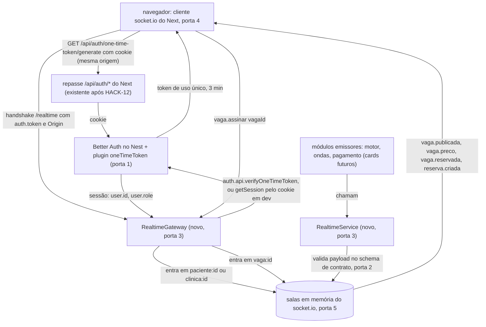

# HACK-38 · Tempo real por WebSocket: vaga nova, preço caindo, vaga preenchida

## Problem

Hoje uma tela aberta do marketplace só muda quando o usuário recarrega. O paciente que não autorizou push
(F13 "Sem permissão de push") não vê na lista a vaga que acabou de ser publicada para ele. Quem está na página
da vaga vê um preço parado enquanto o motor já baixou o degrau (F8, RN-27: o preço é o mesmo para todos no mesmo
instante), e, quando outro paciente paga o sinal, continua olhando para uma vaga que não existe mais (F9 "Vaga
preenchida cancela alertas", RN-36). A clínica só descobre a reserva nova recarregando a tela. Na demo de 3 min,
os passos 5 e 6 do roteiro (HACK-40: "tela da clínica mostra reservada ao vivo" e "preço cai em degraus na tela
do segundo celular") não acontecem sem isso. O card não traz números além do roteiro da demo.

Há um segundo problema, de ambiente: o HACK-12 deixa o cookie de sessão no domínio do Next (o Next repassa
`/api/auth/*` ao Nest). Em produção (T9: Next na Vercel, Nest no Railway/Render) o handshake do socket.io feito
direto ao Nest não leva esse cookie, então "auth pelo cookie no handshake" (T4) não funciona lá como está escrito.
O Gustavo decidiu em 07/11/2026 (D1 = A) que o socket se autentica por token de uso único do Better Auth, e isso
muda a letra do T4; o cookie continua aceito no handshake em dev.

Quando isto entrar, a API tem um canal socket.io autenticado pela sessão do Better Auth, com salas por paciente,
por clínica e por vaga, e um serviço que os módulos do motor, das ondas e do pagamento chamam para avisar as
telas. O Next tem um cliente com reconexão que as telas 2.2 (lista) e 2.4 (alerta) assinam.

## Flow

Reusa o Better Auth montado pelo HACK-12 (`@thallesp/nestjs-better-auth`, `auth.api`) e o repasse
`apps/web/app/api/auth/[...path]/route.ts` do Next: o token do socket nasce de um plugin do próprio Better Auth,
pela rota de auth que já existe, sem rota nova nem criptografia própria. Reusa também a configuração validada de
`apps/api/src/config/` (`WEB_ORIGIN`), o socket.io registrado pelo 12 e os schemas Zod de `@hackathon/contracts`.
O gateway de exemplo do 12 (`ping`/`pong`, namespace padrão) é substituído, não mantido ao lado.

1. antes de cada tentativa de conexão, o cliente do Next (novo, porta 4) chama `GET /api/auth/one-time-token/generate` no próprio Next; o repasse do HACK-12 (existente após o merge) leva o cookie ao Better Auth no Nest, que devolve um token de uso único de 3 min (porta 1).
2. handshake no namespace `/realtime` com `auth: { token }` -> `RealtimeGateway` (novo, porta 3) confere o `Origin` contra `WEB_ORIGIN` da configuração do HACK-12 (existente após o merge) e valida o token com `auth.api.verifyOneTimeToken` (porta 1); sem token, tenta o cookie do handshake com `auth.api.getSession({ headers })` (caminho de dev: Next e Nest no mesmo host); sem sessão por nenhum dos dois, recusa.
3. `RealtimeGateway` - põe a conexão em `paciente:<user.id>` ou `clinica:<user.id>` conforme `user.role` (porta 6); nada do cliente decide a sala.
4. `vaga.assinar { vagaId }` -> `RealtimeGateway` valida no schema de contrato (porta 2), aplica o limite de 20 salas de vaga por conexão e responde no ack.
5. `RealtimeService` (novo, porta 3, exportado pelo `RealtimeModule`) - os emissores chamam `vagaPublicada`, `vagaPreco`, `vagaReservada` e `reservaCriada`; cada método valida o payload no schema de contrato e emite só na sala de destino.
6. out: o cliente recebe o evento, valida no mesmo schema e entrega ao consumidor; ao reconectar, pede token novo, reassina as vagas e avisa o consumidor para recarregar o estado por HTTP.

## Impact

| Front | What changes |
| --- | --- |
| domain | termo novo: `sala` - grupo de conexões do socket.io que recebe um evento; `paciente:<id>`, `clinica:<id>`, `vaga:<id>`; vive em `apps/api/src/modules/realtime` |
| domain | termo novo: `evento de tempo real` - aviso sem estado de verdade; a fonte continua sendo a API HTTP, e o cliente recarrega por HTTP ao reconectar |
| domain | termo novo: `token do socket` - token de uso único do plugin `oneTimeToken` do Better Auth, válido 3 min, trocado pela sessão no handshake |
| auth (HACK-12) | existente no HACK-12 - o plugin `oneTimeToken({ storeToken: 'hashed', disableSetSessionCookie: true })` (validade padrão de 3 min) e a rota `/api/auth/one-time-token/generate` no Nest e no repasse do Next já existem; `POST /one-time-token/verify` fica desligado no HTTP. Este card não altera `auth.config.ts` |
| api | `AppModule` importa `RealtimeModule`; o gateway e o módulo de exemplo do HACK-12 saem (o job de exemplo fica, é do HACK-32) |
| api | o guard global da integração (`@thallesp/nestjs-better-auth` 2.8.0) roda em cada mensagem WS lendo o cookie do handshake; o `RealtimeGateway` leva `@AllowAnonymous()`, a autenticação fica no middleware do namespace, que grava o usuário em `socket.data`, e os handlers leem o usuário só de `socket.data`, nunca do payload. A sessão é lida pelo `AuthSessionService` do HACK-12 (`getSession`, `verifyOneTimeToken`) |
| contracts | arquivo novo de eventos de tempo real exportado por `index.ts` |
| web | dependência `socket.io-client` (e `socket.io` em `devDependencies` para o servidor de teste); cliente em módulo TS sem React, testado pelo runner existente do HACK-12 (`tsx --conditions=react-server --test`), e hook como invólucro fino sobre ele |
| config | `NEXT_PUBLIC_REALTIME_URL` em `apps/web/.env.example` (público por natureza: o navegador precisa do endereço do Nest); `WEB_ORIGIN` já é exigido pelo HACK-12 |
| deploy (HACK-14) | Nest com 1 réplica e WebSocket habilitado no host; `NEXT_PUBLIC_REALTIME_URL` apontando para a URL https do Nest; `WEB_ORIGIN` com a URL do Next |
| stored data | nada a migrar; se o plugin `oneTimeToken` exigir tabela além de `Verification`, para e escala (o `schema.prisma` é da Fundação) |

## Relations

Nenhum - este card não muda o shape de dado persistido. O token do socket fica onde o plugin do Better Auth guarda (a confirmar na versão instalada; ver Assumptions); salas e assinaturas vivem só na memória do processo e somem no restart.

## Surface

| Route | In | Out | Status |
| --- | --- | --- | --- |
| `GET /api/auth/one-time-token/generate` (Better Auth no Nest, via repasse do Next do HACK-12) | cookie de sessão | `token` | `200`, `401`, `502`, `504` |
| `WS /realtime` handshake (Nest) | `auth.token` (ou cookie de sessão, em dev), header `Origin` | conexão nas salas `paciente:<user.id>` ou `clinica:<user.id>` | `101` (upgrade), `403` (origem recusada no polling), `400` (origem recusada no upgrade websocket), `connect_error unauthorized`, `connect_error unavailable` |

Eventos no mesmo namespace. Não são HTTP, então não têm status code; o resultado de cada um está no ack ou na sala que recebe. Forma literal na porta 2.

- `vaga.assinar` (cliente → servidor, com ack): entra `vagaId`; ack `{ ok: true }`, `{ ok: false, erro: 'payload_invalido' }` ou `{ ok: false, erro: 'limite_assinaturas' }`
- `vaga.sair` (cliente → servidor, com ack): entra `vagaId`; ack `{ ok: true }` ou `{ ok: false, erro: 'payload_invalido' }`
- `vaga.publicada` (servidor → `paciente:<id>`): `vagaId` · `em`
- `vaga.preco` (servidor → `vaga:<id>`): `vagaId` · `precoCentavos` · `em`
- `vaga.reservada` (servidor → `vaga:<id>`): `vagaId` · `em`
- `reserva.criada` (servidor → `clinica:<id>`): `reservaId` · `vagaId` · `em`

## Landing

| One-way door | Literal shape | Alternative rejected |
| --- | --- | --- |
| 1. Autenticação do socket por token de uso único (D1 = A, decidida pelo Gustavo em 07/11/2026; muda a letra do T4) | existente no HACK-12 - plugin `oneTimeToken({ storeToken: 'hashed', disableSetSessionCookie: true })` de `better-auth/plugins` (validade padrão de 3 min) já na configuração do Better Auth do HACK-12, conferido em `1a2e804`; o token é emitido pela rota `GET /api/auth/one-time-token/generate`, chamada pelo navegador no próprio Next e levada ao Nest pelo repasse do servidor do Next com o cookie; o cliente pede um token antes de cada tentativa, pela forma de função do `auth` do `socket.io-client`; handshake com `auth: { token }`; validade 3 min, uso único; o middleware do namespace chama `AuthSessionService.verifyOneTimeToken(token)` do HACK-12 (que usa `auth.api.verifyOneTimeToken`). Sem `auth.token`, o middleware aceita o cookie de sessão do handshake por `AuthSessionService.getSession(headers)` (dev, mesmo host); token presente e inválido recusa, sem cair no cookie | (B) domínio pai comum com cookie no domínio pai: exige comprar e configurar domínio e TLS no HACK-14, mexe no cookie do HACK-12 e não autentica em URL de preview. (C) socket pela mesma origem do Next com long-polling por rewrite da Vercel: limite de tempo por requisição e latência pior, sem confirmação de que funciona. JWT ou HMAC próprio: `security.md` proíbe criptografia e sessão próprias |
| 2. Nomes e payloads dos eventos em `@hackathon/contracts` (consumidos pela tela 2.4 do Luiz, pela lista 2.2 e pelos emissores) | `vaga.publicada {vagaId: string, em: string ISO}`, `vaga.preco {vagaId, precoCentavos: int >= 0, em}`, `vaga.reservada {vagaId, em}`, `reserva.criada {reservaId, vagaId, em}`, `vaga.assinar`/`vaga.sair {vagaId: string 1..64}` com ack `{ok: true} \| {ok: false, erro: 'payload_invalido' \| 'limite_assinaturas'}`; nomes de evento exatamente os do card | Payload gordo (clínica, exame, distância, preparo): duplica o retrato HTTP, a distância é por paciente e vazaria dado em sala compartilhada. Preço em reais `float`: arredondamento diverge entre telas, e RN-27 exige o mesmo preço para todos |
| 3. Módulo `realtime` no Nest com `RealtimeService` exportado como único ponto de emissão | `apps/api/src/modules/realtime/` com `RealtimeModule` exportando `RealtimeService`; namespace `/realtime`; emissores injetam o service e nunca o `Server` do socket.io | Cada módulo emitir direto pelo `Server`: espalha nome de sala e validação de payload por quatro cards |
| 4. Dependência nova `socket.io-client` | `dependencies` de `apps/web`; `devDependencies` de `apps/api` (testes contra o gateway real); mesma major do `socket.io` instalado pelo HACK-12 | `WebSocket` nativo do navegador: não fala o protocolo do socket.io (salas, ack, reconexão) |
| 5. Uma instância do Nest, adapter em memória | adapter padrão do socket.io, sem `@socket.io/redis-adapter`; o HACK-14 sobe 1 réplica | Redis adapter: exige Redis, contra a decisão "sem fila"; vira necessário só com mais de uma réplica |
| 6. Nome das salas | `paciente:<user.id>`, `clinica:<user.id>` (D2 do HACK-12: um papel por conta), `vaga:<vagaId>` | Sala por id de `Clinica`: a entidade só chega no HACK-13. Uma função única resolve a chave da sala a partir da sessão, e é a única a trocar quando o HACK-13 ligar usuário a `Clinica` (aprovado pelo Maestro em 07/11/2026) |
| 7. Endereço público do Nest no navegador | `NEXT_PUBLIC_REALTIME_URL` em `apps/web` | Reaproveitar `API_BASE_URL` no navegador: é endereço server-only por regra do repo |

- Nada mais nesta mudança é difícil de reverter

## Criteria

### S1: Conexão autenticada pela sessão, com a sala do próprio usuário (P1)

Só quem tem sessão válida conecta, e cai apenas na sala do seu papel.

**Acceptance Criteria**

1. QUANDO o navegador chama `GET /api/auth/one-time-token/generate` no Next com cookie de sessão válido ENTÃO o sistema DEVE responder 200 com um `token`
2. SE `GET /api/auth/one-time-token/generate` chega sem cookie de sessão ou com sessão encerrada ENTÃO o sistema DEVE responder 401 sem token
3. QUANDO um cliente faz o handshake em `/realtime` com `auth.token` válido de um usuário `paciente` ENTÃO o sistema DEVE aceitar a conexão e colocá-la só na sala `paciente:<user.id>`
4. QUANDO um cliente faz o handshake com `auth.token` válido de um usuário `clinica` ENTÃO o sistema DEVE aceitar a conexão e colocá-la só na sala `clinica:<user.id>`
5. SE o handshake chega com `auth.token` adulterado ou gerado há mais de 3 minutos ENTÃO o sistema DEVE recusar a conexão com `connect_error` de mensagem `unauthorized`, sem colocá-la em sala alguma e sem tentar o cookie
6. SE um segundo handshake usa um token que já abriu uma conexão ENTÃO o sistema DEVE recusá-lo com `connect_error` `unauthorized`
7. QUANDO o handshake chega sem `auth.token` e com cookie de sessão válido do Better Auth (dev, Next e Nest no mesmo host) ENTÃO o sistema DEVE aceitar a conexão e colocá-la só na sala do papel da sessão, como nos AC 3 e 4
8. SE o handshake chega sem `auth.token` e sem cookie de sessão válido ENTÃO o sistema DEVE recusar a conexão com `connect_error` `unauthorized`
9. SE a verificação do token ou do cookie falha por erro inesperado (banco fora) ENTÃO o sistema DEVE recusar a conexão com `connect_error` de mensagem `unavailable` e registrar o erro sem token, cookie ou dado pessoal no log
10. SE o header `Origin` do handshake é diferente de `WEB_ORIGIN` ENTÃO o sistema DEVE recusar o handshake polling com HTTP 403 e o upgrade websocket com HTTP 400, sem abrir conexão, mesmo com token ou cookie válido (desvio decidido pelo Maestro em 08/11/2026: o `abortUpgrade` do engine.io 6 escreve 400 fixo)
11. O sistema DEVE derivar as salas de paciente e de clínica só da sessão devolvida pelo Better Auth, ignorando qualquer id enviado pelo cliente em `auth`, query ou evento

**Independent test:** contra o Nest de teste com o Postgres do worktree: cadastra um paciente pelo Better Auth, gera o token com o cookie, conecta com `socket.io-client` e entra; um cliente sem token e sem cookie recebe `unauthorized`; o mesmo token na segunda vez também; um cliente só com o cookie entra.

### S2: Página da vaga ao vivo: preço caindo e vaga preenchida (P1)

Quem está na página da vaga recebe o preço novo e o aviso de vaga preenchida sem recarregar.

**Acceptance Criteria**

12. QUANDO um cliente autenticado emite `vaga.assinar` com `{ vagaId }` válido ENTÃO o sistema DEVE colocá-lo na sala `vaga:<vagaId>` e responder no ack `{ ok: true }`
13. SE o `vagaId` de `vaga.assinar` ou `vaga.sair` é vazio, não é string ou passa de 64 caracteres ENTÃO o sistema DEVE responder `{ ok: false, erro: 'payload_invalido' }` e não mudar as salas da conexão
14. SE a conexão já está em 20 salas de vaga ENTÃO o sistema DEVE responder `{ ok: false, erro: 'limite_assinaturas' }` a um novo `vaga.assinar` e não entrar na 21ª
15. QUANDO um cliente emite `vaga.sair` com `{ vagaId }` válido ENTÃO o sistema DEVE tirá-lo da sala `vaga:<vagaId>`, e ele DEVE deixar de receber eventos dessa vaga
16. QUANDO um emissor chama `RealtimeService.vagaPreco` com `{ vagaId: 'v1', precoCentavos: 50400 }` ENTÃO todas as conexões na sala `vaga:v1` DEVEM receber `vaga.preco` com `precoCentavos` 50400 e um `em` ISO, e nenhuma conexão fora da sala DEVE recebê-lo
17. QUANDO um emissor chama `RealtimeService.vagaReservada` com `{ vagaId: 'v1' }` ENTÃO todas as conexões na sala `vaga:v1` DEVEM receber `vaga.reservada` com payload que contém só `vagaId` e `em`, sem id, nome ou contato de quem reservou

**Independent test:** dois clientes assinam `vaga:v1`, um terceiro assina `vaga:v2`; o teste chama `vagaPreco` e `vagaReservada` de `v1` e confere que só os dois primeiros recebem.

### S3: Alerta na lista do paciente e reserva na tela da clínica (P1)

O paciente da onda vê a vaga nova na lista aberta; a clínica vê a reserva nova.

**Acceptance Criteria**

18. QUANDO um emissor chama `RealtimeService.vagaPublicada` com `{ vagaId: 'v1' }` e os pacientes `[p1, p2]` ENTÃO as salas `paciente:p1` e `paciente:p2` DEVEM receber `vaga.publicada` com `vagaId` 'v1', e a sala `paciente:p3` NÃO DEVE recebê-lo
19. QUANDO um emissor chama `RealtimeService.reservaCriada` para a clínica `c1` ENTÃO só as conexões da sala `clinica:c1` DEVEM receber `reserva.criada` com `reservaId`, `vagaId` e `em`, e a sala `clinica:c2` NÃO DEVE recebê-lo
20. SE um método do `RealtimeService` recebe payload que não passa no schema de contrato (por exemplo `precoCentavos` negativo ou fracionário) ENTÃO o sistema DEVE lançar erro ao emissor e não emitir nada em sala alguma
21. QUANDO um método do `RealtimeService` emite para uma sala sem conexões ENTÃO o sistema DEVE concluir sem erro

**Independent test:** clientes de dois pacientes e de duas clínicas conectados; o teste chama `vagaPublicada` e `reservaCriada` e confere quem recebeu.

### S4: Cliente no Next com reconexão (P2)

As telas 2.2 e 2.4 assinam eventos por um hook, e uma queda de rede não deixa a tela parada em silêncio.

**Acceptance Criteria**

22. O cliente do Next DEVE conectar em `NEXT_PUBLIC_REALTIME_URL` + `/realtime` com uma única conexão por aba, compartilhada por todos os consumidores
23. QUANDO o cliente vai tentar conectar ou reconectar ENTÃO ele DEVE pedir um token novo em `/api/auth/one-time-token/generate` e enviá-lo em `auth.token`
24. QUANDO a conexão volta depois de uma queda ENTÃO o cliente DEVE reenviar `vaga.assinar` para cada vaga ainda assinada e chamar o callback de reconexão dos consumidores para recarregarem o estado por HTTP
25. SE um evento recebido não passa no schema de contrato ENTÃO o cliente DEVE descartá-lo sem chamar o consumidor
26. ENQUANTO a conexão está caída o cliente DEVE expor o estado `reconectando` aos consumidores
27. SE a geração do token responde 401 ou o handshake falha com `unauthorized` ENTÃO o cliente DEVE expor o estado `nao_autenticado` e parar de tentar reconectar

**Independent test:** teste do cliente contra um servidor socket.io local e uma geração de token simulada: derrubar e religar o servidor e conferir token novo, reassinatura e callback; emitir payload inválido e conferir que o consumidor não é chamado.

## Out of scope

| Excluded | Why |
| --- | --- |
| Chamar o `RealtimeService` a partir do motor de preço (3.2), das ondas (3.4) e da confirmação do pagamento (2.5) | Esses módulos não existem na base deste card; cada card emissor injeta o service. Os critérios do card "dois celulares, um paga" e "preço cai no mesmo segundo" fecham ponta a ponta quando 2.4, 2.5 e 3.2 ligarem; aqui ficam provados no transporte (AC 16, AC 17) |
| Ligar o hook nas telas 2.2 e 2.4 | Telas de outros cards (Luiz constrói com dado estático e liga o socket depois) |
| Deploy, HTTPS e WSS em produção | HACK-14; o bloqueio vale só para produção |
| Mais de uma réplica do Nest e Redis adapter | Porta 5; uma réplica atende o piloto |
| Repetição de eventos perdidos durante a queda | Evento é aviso; o estado vem do HTTP ao reconectar (AC 24) |
| Conferir se a vaga existe em `vaga.assinar` | `Vaga` chega no HACK-13, fora da base; sala de vaga inexistente não recebe nada e o limite de 20 contém abuso |
| Desconectar socket aberto quando a sessão é encerrada | Sessão conferida só no handshake; ver Assumptions |
| Controle de tempo da demo | HACK-40 |

## Assumptions

Pressupostos do HACK-12 marcados com «12», conferidos pelo Construtor contra o código do HACK-12 em `1a2e804` (branch local) em 08/11/2026; ajustes aprovados pelo Maestro Tempo real. O Construtor confere de novo, depois do `git merge origin/main`, que nada mudou.

| Assumption | Chosen default | Rationale | Confirmed? |
| --- | --- | --- | --- |
| «12» dependências | `@nestjs/websockets` e `@nestjs/platform-socket.io` 11.2.8, `socket.io` 4.8.4, `better-auth` 1.7.18 e `@thallesp/nestjs-better-auth` 2.8.0 já instalados; este card adiciona `socket.io-client` (web e API) e `socket.io` no web para teste (com o lock pesado, `npm install`) | conferido em `1a2e804` | y |
| «12» acesso ao `auth.api` no Nest | o gateway injeta o `AuthSessionService` exportado pelo `AuthModule` do HACK-12 (`getSession(headers)`, `verifyOneTimeToken(token)`: `null` em erro da API ou papel inválido, lança em erro inesperado); nenhuma segunda instância do Better Auth | um dono para a sessão (design-patterns); conferido em `1a2e804` | y |
| «12» repasse do Next | `apps/web/app/api/auth/[...path]/route.ts` repassa qualquer caminho de `/api/auth/*`, inclusive `GET /one-time-token/generate`, com cookie e `origin` e timeout de 10 s (502/504) | conferido em `1a2e804` | y |
| «12» papel na sessão | `user.role` (`paciente` \| `clinica`) vem na sessão que `verifyOneTimeToken` devolve, como `additionalFields` (T2) | teste C25 do HACK-12; conferido em `1a2e804` | y |
| «12» configuração | `WEB_ORIGIN` lido de `apps/api/src/config/env.ts` (Zod, injetado por `APP_ENV`, boot falha sem ele); não há `enableCors`; nenhuma leitura nova de `process.env` na API | conferido em `1a2e804` | y |
| «12» guard global | o guard global intercepta cada mensagem WS lendo o cookie do handshake; o `RealtimeGateway` leva `@AllowAnonymous()` (como o gateway de exemplo do 12), a autenticação fica no middleware do namespace, e os handlers leem o usuário só de `socket.data` | o guard roda por mensagem, não na conexão; conferido em `1a2e804` | y |
| «12» gateway de exemplo | `ExampleGateway` no namespace padrão, com teste C35 em `examples.test.ts`; é removido por este card, junto com o teste; o job de exemplo (C34) fica | conferido em `1a2e804` | y |
| «12» testes da API em subpastas | já descobertos pelo `npm test` da API (`.test-dist/**/*.test.js`) | conferido em `1a2e804` | y |
| «12» banco e portas deste worktree | Postgres do Docker Compose do 12 (usuário `hackathon`, porta e banco vindos do `.env` da raiz) com `POSTGRES_PORT=54338`, `POSTGRES_DB=hack_38`; API 3381, Next 3380 | contrato dos maestros; conferido em `1a2e804` | y |
| Armazenamento do token | o plugin `oneTimeToken` guarda o token com hash em `Verification` (`identifier` `one-time-token:<hash>`), sem migration nova | código do plugin 1.7.18 e teste C28 do HACK-12 | y |
| Uso único do token | `verifyOneTimeToken` consome o token em transação e recusa token expirado; o segundo uso falha (AC 6) | `consumeVerificationValue` do Better Auth 1.7.18 e teste C26 do HACK-12; o AC 5 e o AC 6 são provados no gateway | y |
| Sessão encerrada com socket aberto | a sessão é conferida só no handshake; o cliente desconecta no logout; socket aberto de sessão encerrada recebe eventos até cair | piloto; eventos não carregam dado pessoal (AC 17) | n |
| Ordem dos eventos | socket.io mantém a ordem por conexão; sem número de sequência | uma réplica, uma conexão por aba | n |
| Dinheiro | `precoCentavos` inteiro em centavos | evita arredondamento entre telas (RN-27) | n |
| Runner de teste do web | `tsx --test` como no pacote de contratos, ligado ao `check`; `tsx` já está no lock (hoisted por contracts) e o web só o declara em `devDependencies`, junto com `socket.io` para o servidor de teste, no mesmo `npm install` do `socket.io-client` | web não tem runner; structure.md exige ligar o runner ao `check`; aprovado pelo Maestro em 07/11/2026 | y |
| Nome do plugin | `oneTimeToken`, de `better-auth/plugins`, com `generateOneTimeToken`/`verifyOneTimeToken` em `auth.api` e rota `GET /one-time-token/generate` | documentação do plugin e código instalado 1.7.18, conferidos antes dos checks | y |
| Sala da clínica | `clinica:<user.id>`, resolvida por uma função única a partir da sessão, até o HACK-13 ligar usuário a `Clinica` | aprovado pelo Maestro em 07/11/2026; D2 do HACK-12 (um papel por conta) | y |
| Emissores | `RealtimeService` exportado com os 4 métodos e prova no transporte; ligar motor 3.2, ondas 3.4 e pagamento 2.5 fica nos cards deles | aprovado pelo Maestro em 07/11/2026 | y |
| Cookie no handshake fora de dev | o caminho do cookie não é desligado por ambiente: em produção o cookie simplesmente não chega ao Nest, e o token é o caminho | um caminho a menos para configurar; o `Origin` contra `WEB_ORIGIN` vale para os dois (AC 10) | n |

**Perguntas abertas:** nenhuma - D1 e D2 decididas pelo Gustavo em 07/11/2026 (ver «Decisões»); as dúvidas técnicas foram respondidas pelo Maestro e estão nas linhas acima.

## Decisões

Decididas pelo Gustavo em 07/11/2026, trazidas pelo Maestro Tempo real.

| # | Decisão | Escolha | Por quê, e o que muda |
| --- | --- | --- | --- |
| D1 | Autenticação do socket em produção (T4, T9, HACK-14): o cookie fica no domínio do Next e o handshake direto ao Nest não o leva | (A) token de uso único do Better Auth, emitido pela rota de auth que o servidor do Next repassa, enviado em `auth.token`; cookie continua aceito em dev (porta 1) | Funciona em dev, produção e preview, sem domínio próprio e sem criptografia própria; HACK-14 só precisa de 1 réplica e WebSocket ligado no host. Muda a letra do T4 (o cookie origina o token, mas não viaja no handshake em produção). Rejeitadas: (B) domínio pai comum, por custo e risco de domínio/DNS/TLS no HACK-14 e por não cobrir preview; (C) long-polling pela mesma origem, por limite de tempo do rewrite da Vercel e funcionamento não confirmado |
| D2 | `vaga.reservada` na lista do paciente | (A) só na sala `vaga:<id>` | Custo zero; a lista 2.2 mostra a vaga até recarregar ou abrir, e a página da vaga diz "vaga preenchida" (F9). Rejeitada: (B) mandar também às salas dos pacientes alertados, que exigiria do card 3.4 a lista de alertados na reserva |
| M1 | Status do upgrade websocket recusado por origem (AC 10), decidido pelo Maestro Tempo real em 08/11/2026 no build | (A) manter o `allowRequest` do engine.io: 403 no handshake polling, 400 no upgrade websocket, nenhuma conexão aberta | O `abortUpgrade` do engine.io 6 escreve `HTTP/1.1 400 Bad Request` fixo; a garantia de segurança é a mesma. Rejeitada: (B) listener `upgrade` próprio antes do engine.io para responder 403, código próprio no caminho do protocolo |

## Observable

| Surface | Decision | Landing |
| --- | --- | --- |
| API `GET /api/auth/one-time-token/generate` | quem pode chamar e erro | AC 1, AC 2 |
| API `GET /api/auth/one-time-token/generate` | limite de taxa | existente - rate limit embutido do Better Auth configurado no HACK-12 |
| API `GET /api/auth/one-time-token/generate` via Next | erro quando a API falha | existente - repasse do HACK-12 responde 502/504 |
| `WS /realtime` handshake | quem pode conectar | AC 3, AC 4, AC 5, AC 6, AC 7, AC 8, AC 10 |
| `WS /realtime` handshake | formato e códigos de erro | AC 5, AC 8, AC 9, AC 10 |
| `WS vaga.assinar`, `WS vaga.sair` | formato e códigos de erro no ack | AC 13, AC 14 |
| `WS vaga.assinar` | limite de uso | AC 14 |
| todos os eventos servidor → sala | quem recebe | AC 16, AC 17, AC 18, AC 19 |
| todos os eventos | versionamento | não se aplica - cliente e servidor no mesmo repo e no mesmo deploy; mudança incompatível atualiza os dois na mesma entrega (rule de contracts) |
| todos os eventos | formato do payload | AC 20, AC 25 |
| hook cliente do Next | estado de carregamento/conexão | AC 26 |
| hook cliente do Next | estado de erro e não autorizado | AC 27 |
| hook cliente do Next | estado vazio | não se aplica - o hook não tem lista própria; vazio é da tela 2.2 |
| hook cliente do Next | ação destrutiva confirma | não se aplica - o hook não apaga nada |

## Sources

- Card HACK-38 no Linear: https://linear.app/workspace-do-gustavo/issue/HACK-38/45-tempo-real-por-websocket-vaga-nova-preco-caindo-vaga-preenchida - entrega, eventos e critérios; sem comentários
- Plano do HACK-12 (`.worktrees/HACK-12/.specs/features/hack-12-stack/plan.md`, pergunta 3) e insumo do Maestro Tempo real em 07/11/2026; D1 e D2 decididas pelo Gustavo em 07/11/2026: cookie no domínio do Next, handshake direto ao Nest não leva o cookie em produção
- `.specs/features/marketplace-vagas-imagem/brainstorm.md` T4 e T9; `docs/product/marketplace-vagas-imagem.md` RN-27, RN-36, F8, F9, F13; HACK-26 (tela do alerta assina estes eventos); plugin One-Time Token do Better Auth: https://www.better-auth.com/docs/plugins/one-time-token
